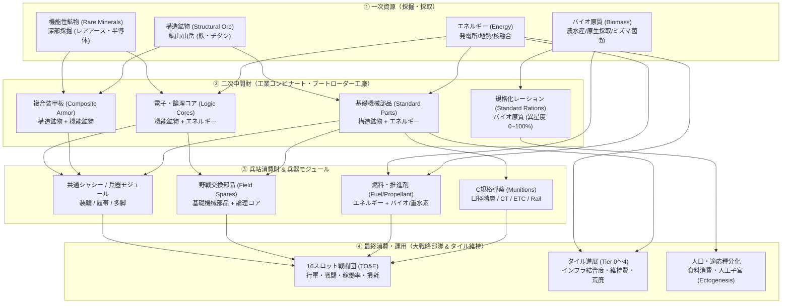

# 資源・経済・サプライチェーン体系目録 (Resource, Economy & Supply Chain Index)

本ドキュメントは、本作（4X大戦略＋脱・都市中心タイル進展＋16スロット戦闘団制）における**「資源品目・加工連鎖・弾薬規格・兵站インフラ・食料」**の経済・産業モデルを俯瞰・体系的に確認するための統合目録（インデックス兼リファレンス）です。

※ルールに従い、本ドキュメント内のリンクはすべてリポジトリ内相対パスで記載されています。

---

## 1. 資源・物流・規格の多層循環構造（全体フロー）

本作の資源経済は、抽象的な単一通貨ではなく、**「採掘（一次） ➔ 部品加工（二次） ➔ 兵站・装備・食料 ➔ 部隊・インフラ消費」**という物理的・工学的な連鎖としてモデル化されています。



---

## 2. 体系別ドキュメント・リンク目録

各要素の詳細な仕様・設計根拠は、以下の個別ドキュメントに定義されています。

### ① 資源品目・食料・弾薬ダイナミクス

| ドキュメント | 概要・主要論点 |
| :--- | :--- |
| **[concept_resource_economy_and_logistics.md](./discussion/industry_logistics/concept_resource_economy_and_logistics.md)** | **資源モデルの基本設計書**。一次（4種）・二次（4種）・消費財（3種）の3層品目体系。陸・海・工業の食料3大生産方式と異星度（0〜100%）。弾薬規格の分化・再統合。 |
| **[concept_ammunition_caliber_standards_c.md](./discussion/military_tactics/concept_ammunition_caliber_standards_c.md)** | **弾薬・火砲規格体系（C規格 / 単位：C）仕様書**。1C ≒ 1mm相当の普遍ボア径単位。小火器（6C/8C）から重火砲（210C）までの階層体系と薬莢長非依存クラス設計。 |

### ② 産業構造・ブートローダー工廠・生産技術

| ドキュメント | 概要・主要論点 |
| :--- | :--- |
| **[concept_bootloader_and_national_supply_chains.md](./discussion/industry_logistics/concept_bootloader_and_national_supply_chains.md)** | **機械が機械を作るブートローダー産業仕様書**。工作機械プール、金型、歩留まり、初期母星遺産ストックから現地サプライチェーンへの自立プロセス。 |
| **[concept_industry_dynamics_novelty_continuity.md](./discussion/industry_logistics/concept_industry_dynamics_novelty_continuity.md)** | **新規性と継続性の産業構造仕様書**。既存金型の高歩留まりによる長寿命プラットフォームと、新世代AI・新物性による初期脆弱性・ライン転換ラグ。 |
| **[concept_industry_structure.md](./discussion/industry_logistics/concept_industry_structure.md)** | **産業基本ツリー**。素材採掘から精錬、中間部品加工、最終組立に至る多段階産業構造。 |
| **[concept_homeworld_roadmaps_and_niche_industries.md](./discussion/military_tactics/concept_homeworld_roadmaps_and_niche_industries.md)** | **企業エコシステム仕様書**。母星重工ロードマップ、現地国策重工、民需転用キット、開拓現場の特化ニッチモジュール（深地採石・廃船解体等）。 |

### ③ 兵器モジュール・シャシー規格・カタログ

| ドキュメント | 概要・主要論点 |
| :--- | :--- |
| **[concept_starter_modules_and_common_chassis_catalog.md](./discussion/military_tactics/concept_starter_modules_and_common_chassis_catalog.md)** | **Turn 0 初期カタログ仕様書**。ISO-Terran Baselineに基づく共通規格。装輪・履帯・多脚の足回りスペック、初期武装・装甲・推進モジュール。 |
| **[concept_weapon_module_commonality.md](./discussion/military_tactics/concept_weapon_module_commonality.md)** | **モジュール共通化基本設計**。シャシーと兵装モジュールの共通化設計による生産効率・後方互換性向上。 |
| **[example_weapon_modules_cases.md](./discussion/military_tactics/example_weapon_modules_cases.md)** | **兵装モジュール具体例**。対空砲架、電磁投射レールガン、ミサイルポッド、電子戦装備の実装ケース。 |
| **[concept_frontier_industry_and_weapon_generations.md](./discussion/military_tactics/concept_frontier_industry_and_weapon_generations.md)** | **兵器世代体系（Gen 0〜Gen 4）仕様書**。母星精密遺産（Gen 0）から開拓急造（Gen 1）、現地重工（Gen 2）、復元（Gen 3）、アフィニティ特化（Gen 4）への進化。 |

### ④ インフラ網・輸送・兵站・領土進展

| ドキュメント | 概要・主要論点 |
| :--- | :--- |
| **[concept_infrastructure_grid_and_transit_artery.md](./discussion/map_tile/concept_infrastructure_grid_and_transit_artery.md)** | **大戦略動脈インフラ仕様書**。道路・鉄道・送電線・光ファイバーの自動一体敷設、1タイル橋、運河、海底HVDC給電、インフラ結合度の伝播。 |
| **[concept_transport_windows_and_infrastructure_bottlenecks.md](./discussion/industry_logistics/concept_transport_windows_and_infrastructure_bottlenecks.md)** | **輸送ウインドウ・兵站ボトルネック仕様書**。インフラ結合度に応じたプッシュ補給レート、輸送容量（帯域幅）制約と前哨の補給途絶リスク。 |
| **[concept_tile_progression_system.md](./discussion/map_tile/concept_tile_progression_system.md)** | **タイル進展（Tier 0〜4）仕様書**。機能サイトの設営から要塞中枢への発展、インフラ結合度・稼働率・荒廃（デグレード）ルール。 |
| **[concept_maritime_governance_and_ocean_engineering.md](./discussion/map_tile/concept_maritime_governance_and_ocean_engineering.md)** | **海洋工学・水産資源仕様書**。メガフロート、シーレーン防衛、閉鎖養殖、海洋都市の動力途絶と沈没リスク。 |

---

## 3. 実装用データマッピング早見表（Rust / Bevy ECS）

ゲームエンジン上で実装する際のデータ型対応の要約です。

```rust
// 一次資源 (Raw Resources)
pub enum RawResource {
    Energy,         // エネルギー (発電・工場維持・シールド)
    StructuralOre,  // 構造鉱物 (鉄・チタン・建材・シャシー)
    RareMinerals,   // 機能性鉱物 (レアアース・半導体・センサー)
    Biomass,        // バイオ原質 (食料・医薬品・人工子宮)
}

// 二次中間財 (Manufactured Goods)
pub enum ManufacturedGood {
    StandardParts,  // 基礎機械部品 (構造鉱物 + エネルギー)
    LogicCores,     // 電子・論理コア (機能性鉱物 + エネルギー)
    CompositeArmor, // 耐熱複合装甲板 (構造鉱物 + 機能性鉱物)
    StandardRations,// 規格化レーション (バイオ原質 / 異星度 0~100%)
}

// 兵站消費財 (Consumables)
pub enum MilitaryConsumable {
    Munitions(CaliberC), // C規格軍用弾薬 (小火器〜重火砲、CT/ETC/Rail)
    PropellantFuel,      // 推進剤・燃料
    FieldSpares,         // 野戦交換部品 (整備・回復用)
}
```
