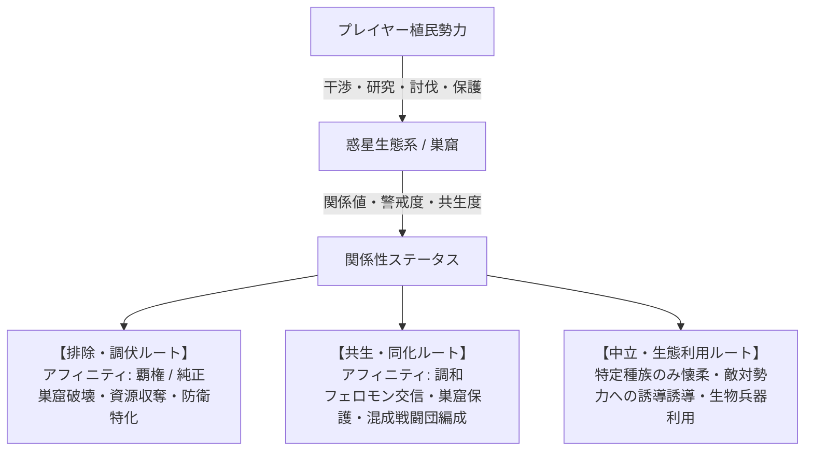

# ゲーム企画・仕様設計書：Nanai Alien Com Game (仮称)

基本的にはAI生成の文書なので注意。

## 1. ゲーム概要 & コンセプト

### 1.1 基本コンセプト

- **ジャンル**: 4X SF ターン制戦略シミュレーション（Civ / Civilization: Beyond Earth ライク）
- **テーマ**: 未知の惑星への植民、惑星生態系・原住エイリアンとの関係性構築と共存／支配／排除、勢力間競争。
- **コア体験**:
  - civbeの代替
  - 単なる「害虫駆除」ではない、**多層的かつ動的なエイリアン関係性システム**。
  - **マクロ（全体マップ）とミクロ（単一タイル個別戦術マップ）のシームレスな融合**。
  - 煩雑なスタック管理・極小ユニット操作を排除した**「固定編成・戦闘団制（増強師団相当）」**による直感的な軍事運用。
  - プレイヤーの意思決定と体験（ドラマ性）を最優先する**手動戦術戦選択制**と**豊富なダイナミックイベント**。
- **マルチスケール戦略シミュレーション**: 全体マップでの都市建設・研究・外交・部隊移動と、単一タイルマップでの小部隊戦術戦闘を統合。

---

## 2. スケールとマップシステム

本ゲームは**「全体マップ（大戦略層）」**と**「単一タイルマップ（戦術・局所運用層）」**の2重スケール構造を採用する。

```text
+-----------------------------------------------------------+
|               全体マップ (Overworld / Hex Grid)            |
|  - 都市開発・領土拡張・研究・外交・マクロ部隊移動         |
|  - 各タイルは環境特性・エイリアン巣窟・資源などを保有     |
+-----------------------------+-----------------------------+
                              |
                     [ 戦闘 / 調査 / 開発 ]
                              |
                              v
+-----------------------------------------------------------+
|             単一タイルマップ (Tactical Sub-Grid)          |
|  - 1つの全体タイル内部を展開したミクロ戦術マップ          |
|  - 戦闘団を構成する「小部隊」を配置・指揮して局所戦を展開 |
|  - 周辺タイルからの増援（戦闘団）も合流可能               |
+-----------------------------------------------------------+
```

### 2.1 全体マップ（大戦略スケール）

- ヘックスグリッドによる広域惑星マップ。
- 各タイルは地形（平原、山岳、海洋、毒性湿地、瘴気帯など）とエイリアン活性度、資源を持つ。
- 全体マップ上のユニット単位はすべて**「戦闘団（Combat Group / Task Force）」**。

### 2.2 単一タイルマップ（戦術・局所スケール）

- 全体マップの1タイル内部をさらに細分化した局所マップ。
- **突入・展開契機**:
  - 敵対勢力や野生エイリアンとの交戦時
  - 未知の遺跡・巣窟・特殊資源ポイントの深層調査
  - 特殊防衛施設や拠点の防衛戦
- **小部隊展開システム**:
  - 全体マップ上の戦闘団1個が、単一タイルマップ内では**「歩兵小隊・戦車小隊・砲兵支援班・航空支援枠」等の規定小部隊グループ**として展開される。
  - プレイヤーは小部隊レベルで遮蔽物利用、側面攻撃、スキル発動などの細かな指揮を行える。
- **周辺タイル増援ルール**:
  - 戦場となったタイルにいる戦闘団に加え、**隣接する味方戦闘団（1タイルにつき最大1個）**が増援・支援部隊として戦場に参戦可能。
  - これにより全体マップ上の布陣・陣形配置が戦術マップへダイレクトに影響を与える。

### 2.3 戦闘移行とプレイヤー体験設計（シングルプレイ重視）

- **手動戦術戦の選択権**:
  - 交戦発生時、プレイヤーは「**手動指揮（単一タイルマップで戦闘）**」か「**自動解決（全体マップ上で即座に計算）**」を自由に選択可能。
  - 手動指揮を選択した場合、地形・遮蔽・小部隊スキル・周辺増援を駆使することで、数的不利や格上相手でも覆せる**「プレイヤー有利・高体験価値」**のバランスに調整。1ターンの時間を分割するので、有限のターンでターン制限に収まるようにする。例えば包囲されたユニットが全体マップで耐えられるなら、単一タイルマップでも全体ターン終了時に損害を同程度に抑えられるよう調整。
- **マルチプレイ（将来拡張/設計思想）**:
  - 原則は双方が同意した場合のみ手動戦術戦に移行（または非同期タイマー制／自動解決メイン）。

---

## 3. 部隊・ユニット体系（軍団・戦闘団制）

煩雑なスタック管理や個別の極小ユニット生産を廃止し、すべて**「2個師団統合型軍団（Corps）・艦隊・航空団相当の固定編成単位」**として統一。

### 3.1 陸上軍団（Ground Corps）

榴弾砲・長距離自走砲を持った自動車化軽歩兵軍団以上では隣接沿海域タイルへの砲撃能力あり。

### 3.1.1 通常陸上軍団のカテゴリー（歩兵装甲化・自動車化の多層体系）

| 種別 | 主な役割・特徴 | イメージ・構成（2個師団統合軍団） |
| :--- | :--- | :--- |
| **民間人・避難民群** | 民間人集団 | 民間人、武装はないか、あっても鉄パイプ、刃物、少数ではチェーンソー、射出工具、猟銃程度 |
| **民兵軍団** | 民間人を軽武装化した民兵部隊 | 自衛民兵大隊、小銃・火炎瓶・軽火器主体、治安維持・拠点自活 |
| **軽歩兵軍団** | 徒歩主体の軽歩兵軍団（山岳・隘路・森林への高い適性） | 徒歩行軍ライフル大隊、携帯対戦車（ATM）班、60C/81C軽迫撃砲、車両なし |
| **自動車化軽歩兵軍団** | 4x4軽装甲車（LAV）とトラックによる自動車化部隊。牽引砲のため展開と砲撃回避が苦手 | 4x4軽装甲車歩兵連隊、トラック輸送班、牽引式120C重迫撃砲、牽引式155C榴弾砲、自動車化整備班 |
| **自動車化歩兵軍団** | 同一の4x4軽装甲車（LAV）基幹にトラック架装自走砲を組み合わせた部隊。非装甲・軽装甲部隊の中では最上位 | 4x4軽装甲車歩兵連隊、8x8トラック架装120C自走迫、155C装輪自走榴弾砲、自動車化整備大隊 |
| **装輪機動軍団（装輪装甲軍団）** | 8x8装輪装甲車（Std-W8）統一。路面での高速急行展開力と前線装甲・火力を両立 | 105C火力戦闘車（MCV）、装輪IFV/APC、装輪自走迫撃砲、装輪自走榴弾砲、装輪ARV、直協航空隊 |
| **空中機動・空地強襲軍団** | ヘリコプターやVTOL機による地形無視の垂直急襲・後方遮断部隊 | 空挺軽IFV連隊、空挺超軽量自走迫、強襲航空旅団（VTOL/ヘリ）、吊り下げ榴弾砲、FARP支援群 |
| **装甲化軍団（諸兵科連合装甲軍団）** | 戦車2連隊・装輪偵察2連隊・装甲歩兵連隊によるバランス型装甲軍団。機動・索敵・突破を高度に両立 | 戦車2個連隊（戦車128両＋重IFV128両）、装輪偵察2個連隊（左右両翼スクリーン160両）、装甲歩兵連隊、自走特科・高射連隊、直協航空隊 |
| **常設増強機甲軍団（重機甲軍団）** | 戦車4連隊基幹。圧倒的不整地突破力・戦略打撃の中核。左右両翼スクリーンと航空打撃群を完全内包 | 4個諸兵科連合機甲連隊（戦車256両＋重IFV256両＋自走重迫128両）、装甲歩兵2個連隊、左右両翼偵察連隊（装輪160両）、戦車車体160C/210C特科、多層高射連隊、直協航空隊（計48機）（詳細は [toe_corps_heavy_armored.md](./toe_definitions/ground/regular/toe_corps_heavy_armored.md) 参照） |
| **歩行戦闘車両軍団（二脚歩行混成軍団）** | 装甲車風の二脚歩行戦闘機と戦車・重IFVを小隊混成した歩行兵器打撃軍団。基本的な組織・運用思想は機甲軍団に準じるが、廃墟・瓦礫・段差での死角掃討や短時間跳躍奇襲といった歩行兵器特有の立体機動に優れる | 混成機甲連隊（戦車128両＋通常二脚128機）、跳躍強襲連隊（飛翔二脚128機＋重IFV128両）、左右両翼偵察連隊（装輪160両）、自走特科・高射、軍団航空隊（詳細は [toe_corps_bipedal_assault.md](./toe_definitions/ground/regular/toe_corps_bipedal_assault.md) 参照） |
| **長距離ミサイル打撃軍団** | 大戦略マップ上で2タイル先などの遠隔タイル・敵拠点・巣穴へスタンドオフ精密打撃を行うミサイル専門部隊。直接交戦を避け、後方から誘導弾による戦域阻止・重要施設破壊を担当 | 重装輪TEL（ミサイル発射機車）、射撃指揮・索敵通信車、弾薬運搬・装填車、近接防衛護衛隊 |
| **調査・科学探査軍団** | 科学探査・遺跡解析・未知バイオーム分析に特化したあらゆる環境で活動可能な調査部隊 | 科学調査探査大隊、環境防護工兵、特殊分析コンテナ、護衛装甲部隊 |

> [!NOTE]
> **歩行戦闘車両（二脚兵器）の運用位置づけ**:
> アニメ的な万能人型ロボットではなく、重装甲車・IFVの系譜にある装甲歩行機（全高3.8m〜5m級・完全歩行駆動）として定義。基本的な部隊規模や運用思想は機甲軍団とほぼ同格であり、戦車や重IFV・装輪偵察部隊と緊密に連携する。路面舗装破壊や燃費・整備負荷などの制約を持つ一方、都市廃墟や段差障害での射界確保・立体跳躍奇襲において独自の強みを発揮する。

### 3.1.2 エイリアン陸上軍団（野生・固有エイリアン）

惑星固有の生命体が群生・生態系を形成した軍団。人間のような火器体系（機関砲、誘導弾、自走迫撃砲、自走榴弾砲）や指揮通信種は持たず、群生本能と**カマキリ状の鎌腕や爪による格闘戦**を主体とする。戦車型は敵戦車に組み付いて長い時間を掛けて装甲を破壊する。対空種のみ**生体機関砲の近接信管砲弾と生体ミサイル**による本格的な対空迎撃火力を保持。軍団は生物のサイズ・階層（小型・中型・大型・超大型）および専用役割をベースに展開される。

| 種別 | 主な役割・特徴 | イメージ・構成 |
| :--- | :--- | :--- |
| **小型エイリアン軍団** | 数千〜数万の小型格闘種による軽量スウォーム軍団。山岳・密林での浸透突撃に優れる | 小型格闘種主体、対空種、治療種 |
| **中型エイリアン軍団** | 中型格闘種（軽装甲車を短時間、装甲車は時間を掛けて解体）を主力とし、小型種を従えたバランス型突撃軍団 | 中型格闘種（装甲車大）基幹、小型格闘種、対空種、治療種 |
| **大型エイリアン軍団** | 戦車型（大型格闘種）が敵戦車隊と泥沼の格闘戦を展開しつつ包囲殲滅を図る主力軍団 | 戦車型（大型格闘種）基幹、中型格闘種、小型格闘種、対空種、治療種 |
| **超大型エイリアン軍団** | 全高20m級の接近戦巨獣を核とする決戦軍団。圧倒的な巨体質量と巨大鎌腕で敵陣地・戦車を踏み潰す | 超大型接近戦型、護衛格闘種、対空種、大型治療種 |
| **長距離砲撃軍団** | 超大型ニードル砲撃種を核とする部隊。遠距離からミサイル程度のニードル弾を放物線投射し牽制 | 超大型ニードル砲撃型（ミサイル威力程度）、護衛格闘種、対空種、治療種 |
| **陸棲航空格闘軍団** | 有翼格闘種が低空急降下して地上部隊や車両上面を奇襲・切り裂く地上急襲航空群（制空権確保は空棲種の担当） | 陸棲航空型（飛行格闘種） |

### 3.1.3 多種族混成軍団のカテゴリー

人類と同盟エイリアンを混成した軍団。通常軍団の半分の人員・兵力を同盟エイリアンに置き換えている。

| 種別 | 主な役割・特徴 | イメージ・構成 |
| :--- | :--- | :--- |
| **多種族混成偵察軍団** | あらゆる環境での高機動力・高視界・隠蔽性。索敵に特化 | 偵察連隊、エイリアン共生斥候群 |
| **多種族混成軽歩兵軍団** | 徒歩主体の軽歩兵部隊 | 歩兵連隊、エイリアン軽突撃個体、迫撃砲 |
| **多種族混成自動車化軽歩兵軍団** | 路面での機動力を持つ。牽引砲のため展開と砲撃回避が苦手 | 軽装甲車歩兵連隊、エイリアン重殻随伴班、牽引重迫撃砲、牽引榴弾砲、自動車化整備班 |
| **多種族混成自動車化歩兵軍団** | 路面での機動力と展開力に優れ、非装甲化部隊の中では最上位 | 軽装甲車歩兵連隊、自走重迫撃砲、自走榴弾砲、自動車化整備班 |
| **多種族混成装輪機動軍団** | 装輪装甲車による部隊。路面での機動力と展開力に優れ、装甲と火力を併せ持つ | 装輪装甲MCV、装輪IFV/APC、装輪自走榴弾砲、共生エイリアン護衛 |
| **多種族混成航空化機動軍団** | ヘリコプターやVTOL機による航空機動部隊 | 空挺歩兵連隊、飛翔エイリアン混成隊、吊り下げ榴弾砲、航空整備班 |
| **多種族混成装甲化軍団** | 戦車2連隊・装輪偵察2連隊・装甲歩兵にエイリアン強襲体を複合 | 戦車連隊、装輪偵察連隊、装甲歩兵連隊、エイリアン重撃爪個体、自走特科 |
| **多種族混成機甲軍団** | 戦車部隊と随伴装甲車化歩兵部隊、超大型エイリアン個体で不整地突破 | 戦車連隊、装軌IFV、巨大生体装甲怪獣、装甲工兵、移動整備班 |
| **多種族混成歩行戦闘軍団** | 二脚歩行戦闘機と跳躍・多脚エイリアン強襲体の混成打撃部隊 | 二脚歩行戦闘機、生体多脚強襲獣、重IFV、装輪偵察連隊 |
| **多種族混成長距離ミサイル打撃軍団** | 長距離誘導ミサイルと生体胞子弾道投射による2タイル先へのスタンドオフ精密打撃 | ミサイルTEL発射機車、生体長距離発射個体、射撃指揮通信車、弾薬装填車 |
| **多種族混成調査軍団** | 科学探査・遺跡解析に特化したあらゆる環境で活動可能な調査隊 | 調査科学班、共生エイリアン分析個体、護衛部隊 |

### 3.1.4 融合生物軍団のカテゴリー

人類と同盟エイリアンが生み出した融合生物の軍団。

// todo

| 種別 | 主な役割・特徴 | イメージ・構成 |
| :--- | :--- | :--- |
| **融合偵察軍団** | あらゆる環境での高機動力・高視界・隠蔽性。索敵に特化 | 融合小型斥候体群 |
| **融合軽歩兵軍団** | 徒歩主体の生体装甲歩兵部隊 | 融合生体小銃班、外骨格突撃班、生体迫撃班 |
| **融合自動車化歩兵軍団** | 生体融合車両と自走生体砲による高速展開 | 融合軽装甲車、生体自走榴弾砲、生体再生班 |
| **融合装輪機動軍団** | 高速装輪生体装甲車による打撃と面制圧 | 融合装甲MCV、融合装甲IFV、高速生体駆逐体 |
| **融合航空機動軍団** | 航空生体兵器・VTOL融合体による垂直強襲 | 融合重戦闘飛翔獣、生体空挺班、滞空弾幕種 |
| **融合装甲化軍団** | 戦車と生体装甲獣・高速装輪偵察の有機的融合 | 戦車連隊、装輪生体偵察連隊、融合重突撃体 |
| **融合機甲軍団** | 超重装甲融合体と戦車による圧倒的突破力 | 重融合戦車、超巨大生体突撃体、再生工作班 |
| **融合歩行戦闘軍団** | 装甲歩行骨格とバイオメカニクス脚部融合体による立体強襲 | 融合型二脚戦闘機、生体関節装甲歩行体、重生体IFV |
| **融合長距離ミサイル打撃軍団** | 大深度生体誘導ミサイルによる2タイル先への長距離精密破壊・破砕 | 長距離生体ミサイル射出体、目標指示・通信誘導種、弾薬補給生体 |
| **融合調査軍団** | 惑星深部解析・未知共鳴の探査 | 生体共鳴探査班、生体防護班、調査護衛種 |

### 3.2 海上戦闘団（Naval Fleets）

#### 3.2.1 通常海上戦闘団（人類通常艦隊）

| 種別           | 主な役割・特徴                                           | 構成艦艇イメージ                                   |
| :------------- | :------------------------------------------------------- | :------------------------------------------------- |
| **民間船艦隊** | 民間船                                                   | 大型船、小型船                                     |
| **武装船艦隊** | 軽武装を施した民間船                                     | 武装大型船、武装小型船                             |
| **哨戒艦隊**   | 哨戒・領海内監視、海賊・野生海洋エイリアンへの警戒監視   | 哨戒コルベット艦、対潜哨戒ヘリ、ミサイル艇         |
| **護衛艦隊**   | 対潜・対空に優れた輸送路防衛用艦隊                       | 護衛フリゲート、汎用駆逐艦、対潜ヘリ               |
| **通常艦隊**   | 駆逐艦・巡洋艦を中心とする外洋汎用戦闘艦隊               | 防空駆逐艦、汎用駆逐艦、護衛フリゲート             |
| **戦艦艦隊**   | 超長距離艦砲射撃と重装甲を誇る決戦用艦隊。沿岸砲撃が可能 | 戦艦、防空駆逐艦、汎用駆逐艦、護衛フリゲート       |
| **航空艦隊**   | 航空拠点としての能力を持った艦隊                         | 空母、軽空母、強襲揚陸艦、艦載戦闘機隊、早期警戒機 |
| **潜水艦隊**   | 高い隠密性を持った艦隊                                   | 攻撃型原潜、巡航ミサイル潜水艦                     |

#### 3.2.2 野生・固有エイリアン海洋群（エイリアン艦隊）

人類の海上戦闘団と完全に一致する兵種体系を持つ生体海洋群。

| 種別 | 主な役割・特徴（人類艦隊と完全一致） | イメージ・構成 |
| :--- | :--- | :--- |
| **エイリアン哨戒艦隊** | 哨戒・近海警戒・索敵に特化した俊敏な海洋生体群 | 小型刺胞遊泳個体、高速遊泳魚雷獣、表層監視種 |
| **エイリアン護衛艦隊** | 防空・対潜水生体への迎撃と遊泳群護衛を担当 | 棘皮防空個体、超音波迎撃種、中型護衛甲殻獣 |
| **エイリアン通常艦隊** | 外洋での水上打撃・制海権確保を担当する汎用海洋群 | 中型重装甲甲殻獣、強酸投射種、生体魚雷射出種 |
| **エイリアン戦艦艦隊** | 超重装甲と長距離生体砲撃・沿岸破壊を担当する決戦海洋群 | 超大型甲殻巨獣（リヴァイアサン級）、重キャビテーション衝撃砲種 |
| **エイリアン航空艦隊** | 飛行型エイリアンを背部で多数輸送・発進させる海洋生体群 | 浮遊母艦生体（バイオキャリア）、艦載小型飛行種、警戒生体 |
| **エイリアン潜水艦隊** | 深海に潜航し、高い隠密性から奇襲雷撃を行う生体潜水群 | 深海潜航巨獣、超音波共鳴種、誘導生体魚雷放出種 |

#### 3.2.3 多種族混成海上戦闘団

| 種別 | 主な役割・特徴 | 構成イメージ |
| :--- | :--- | :--- |
| **多種族混成艦隊** | 人類艦隊と同盟海棲エイリアンの混成艦隊 | 護衛フリゲート、汎用駆逐艦、同盟潜水個体、共生索敵種 |

#### 3.2.4 融合生物海上戦闘団

| 種別 | 主な役割・特徴 | 構成イメージ |
| :--- | :--- | :--- |
| **融合生物艦隊** | 人類造船技術と同盟海棲エイリアンの甲殻・耐圧構造を融合したバイオ軍艦 | 生体装甲フリゲート、有機潜航駆逐艦、生体魚雷射出艦 |

---

### 3.3 航空戦闘団（Air Wings）

#### 3.3.1 通常航空戦闘団（人類通常航空隊）

| 種別                             | 主な役割・特徴                                                                   | 構成機体イメージ                                                           |
| :------------------------------- | :------------------------------------------------------------------------------- | :------------------------------------------------------------------------- |
| **民間航空団**                   | 惑星内高速輸送・物資空輸を担当                                                   | 貨物機、旅客機                                                             |
| **武装民間航空団**               | 軽武装を施した民間航空機                                                         | 武装貨物機                                                                 |
| **輸送航空団**                   | 陸上部隊を収容でき、不整地着陸能力を持った大型輸送機による航空団                 | 軍用輸送機                                                                 |
| **哨戒航空団**                   | 広域索敵・早期警戒を担当                                                         | 早期警戒機（AEW）、対潜哨戒偵察機、大型戦闘機                              |
| **護衛航空団**                   | 民間航空機の護衛を目的とした小規模な部隊                                         | 大型戦闘機                                                                 |
| **迎撃航空団**                   | 小規模拠点から道路を活用して行動する軽戦闘機隊                                   | 軽戦闘機                                                                   |
| **垂直離陸航空団**               | SVTOL型戦闘機による戦闘航空団                                                    | SVTOL型戦闘機                                                              |
| **戦闘航空団**                   | 制空権確保および対地攻撃を行う主力航空隊                                         | 大型戦闘機                                                                 |
| **光学・電波ステルス戦闘航空団** | 光学・電波ステルスを装備した戦闘機部隊、コストのわりに戦闘能力は通常と同程度     | 光学迷彩ステルス戦闘機                                                     |
| **爆撃航空団**                   | 爆撃機による戦略爆撃を行う航空隊                                                 | 爆撃機、大型戦闘機                                                         |
| **光学・電波ステルス爆撃航空団** | 光学ステルスを装備した爆撃機と護衛機、爆撃能力は一般爆撃機よりも劣る             | 光学迷彩ステルス爆撃機、光学迷彩ステルス戦闘機                             |
| **空中戦艦航空団**               | 空中戦艦による接近戦闘を得意とする                                               | 空中戦艦、空中空母、大型戦闘機、空中防空駆逐艦、空中護衛フリゲート         |
| **空中空母航空団**               | 空中空母による航空機の運用を主目的とする。航空拠点としての能力を持つ             | 空中空母、大型戦闘機、空中防空駆逐艦、空中護衛フリゲート                   |
| **光学・電波ステルス偵察航空団** | 敵領空などへの偵察を行う部隊                                                     | 光学ステルス偵察機                                                         |
| **超大型輸送航空団**             | 複数の超大型輸送機による部隊の長距離空輸を行う航空団。コストは戦艦艦隊を凌駕する | 超大型大型輸送機、空中空母、大型戦闘機、空中防空駆逐艦、空中護衛フリゲート |

#### 3.3.2 野生・固有エイリアン航空群（エイリアン航空団）

人類の航空戦闘団と完全に一致する兵種体系を持つ生体航空群。

| 種別 | 主な役割・特徴（人類航空団と完全一致） | イメージ・構成 |
| :--- | :--- | :--- |
| **エイリアン輸送航空団** | 陸上生体や物資を空輸・不整地に直接降下させる生体輸送群 | 巨大嚢胞飛行獣、生体空輸コンテナ種、護衛飛行種 |
| **エイリアン哨戒航空団** | 広域生体レーダー・早期警戒・フェロモン索敵を担当する飛行群 | 大気浮遊巨大クラゲ（生体レーダー個体）、長距離滑空索敵種 |
| **エイリアン迎撃航空団** | 狭小地や前線巣穴から即時緊急発進する軽量迎撃飛行群 | 小型高速有翼爪獣、生体短距離迎撃針射出種 |
| **エイリアン戦闘航空団** | 制空権確保および地上への急降下襲撃を担当する主力生体飛行群 | 中型重戦闘ワイバーン、強酸弾投射種、格闘鉤爪個体 |
| **エイリアンステルス戦闘航空団** | カモフラージュ外皮と生体熱マスキングで敵レーダーを欺瞞する戦闘群 | 光学擬態有翼種、低赤外線放出捕食個体 |
| **エイリアン爆撃航空団** | 重有機爆弾・強酸カプセルによる地上目標の面制圧・戦略破壊群 | 重爆撃巨大飛行獣、有機クラスター酸爆弾投射種 |
| **エイリアン空中戦艦航空団** | 圧倒的質量と重生体プラズマ砲で空戦・対地制圧を行う巨大空中生体群 | 超大型空中生体戦艦（リヴァイアサン飛行種）、直協飛行護衛群 |
| **エイリアン空中空母航空団** | 飛行生体群の生息・発進母体となる超巨大浮遊生体群 | 超巨大気嚢浮遊母艦獣、艦載小型突撃飛行種 |
| **エイリアンステルス偵察航空団** | 敵防空網を潜り抜けて深部索敵を行う光学・電波欺瞞偵察群 | 高度擬態長距離飛行種、生体電波吸収膜保有個体 |
| **エイリアン超大型輸送航空団** | 大規模生体軍団を一括して戦域間長距離輸送する超巨大飛行群 | 巨大型嚢胞輸送怪獣、浮遊護衛飛行群 |

#### 3.3.3 多種族混成航空戦闘団

| 種別 | 主な役割・特徴 | 構成イメージ |
| :--- | :--- | :--- |
| **多種族混成航空団** | 飛行エイリアンにパイロットが搭乗・サイバネ制御する混成航空隊 | 生体サイボーグ飛行隊、胞子散布バイオファイター、護衛戦闘機 |

#### 3.3.4 融合生物航空戦闘団

| 種別 | 主な役割・特徴 | 構成イメージ |
| :--- | :--- | :--- |
| **融合生物航空団** | 航空力学エンジンと生体翼・自己修復外皮を完全結合したバイオ戦闘機隊 | 融合ジェット飛翔体、生体プラズマ爆撃獣、バイオアビオニクス機 |

---

補足
気流観測による完全ステルス機の索敵能力、凍った目（戦闘妖精・雪風）

## 4. エイリアンとの関係性システム（Diplomacy & Ecology）

Civ:BEの単なる「怒りメーター（攻撃頻度変化）」を超え、**種族ごとの生態・文化・コミュニケーション・思想進化（アフィニティ）**と結びついた多層的な関係性を構築。

多種族混成部隊の編成には必要なエイリアン種族を取り込む必要がある。これは兵種ごとに必要なエイリアン種が異なるだけでなく、各兵種ごとに必要なエイリアン種が事前に設定されているため、多種族混成部隊は後半程度まで時間がかかる。特に潜水エイリアンと航空エイリアンは取り込みが難しい。
例えば多種族混成機甲軍団を編成するためには、「戦車型（大型格闘種）」「中型格闘種」「対空種」「治療種」などが必要。これらすべてを取り込む必要がある。



### 4.1 関係性パラメータ

1. **警戒度（Alertness / Aggression）**:
   - 瘴気除去、巣窟接近、資源乱掘により上昇。高くなると攻撃的になり、領内や開拓団を急襲。
2. **共生親和度（Symbiosis / Harmony）**:
   - 巣窟の保護、生体フェロモンの散布、共生研究により上昇。
   - 一定値を超えると領内通過が許可され、さらに高まると**「野生エイリアン戦闘団の指揮権獲得」や「多種族混成戦闘団の解禁」**が可能になる。
3. **生態系変異度（Mutation / Evolution Level）**:
   - プレイヤーやAI勢力の行動（核攻撃、遺伝子操作、過剰乱獲）により、エイリアン側も適応進化し、より強力・凶暴・特異な種が出現する。

### 4.2 巣窟・コミュニケーションシステム

- **巣窟（Nest）の扱い**: 単なる破壊対象ではなく、外交・生体資源供給源・防衛拠点としての選択肢が存在。
- **生体フェロモン送信機 / 心理感応アンテナ**: 特殊な施設や調査戦闘団を派遣することで、巣窟単位での協定締結や、敵対AI勢力への「エイリアン誘導」が可能。

---

## 5. ダイナミック・イベントシステム

ゲーム展開をドラマチックにするランダム＆プログレッシブイベント群。
civ6の圧力と忠誠度は一考の価値はあるかな。あの長尺でもあれがやりすぎもありかもだが。

### 5.1 イベントカテゴリ

1. **生態系異変・大移動（Migration & Stampede）**:
   - 惑星の季節変動や天変地異により、巨大エイリアンの大群が大陸を横断。都市防衛か、誘導して敵勢力にぶつけるかの選択。
2. **接触・ファーストコンタクトイベント**:
   - 知性を持つ高次エイリアン種族や古代遺跡の守護生命体との対話・解読クエスト。
3. **入植者思想対立（アフィニティ論争）**:
   - エイリアンとの共生を望むグループと、母星化（テラフォーミング）・純血主義を掲げるグループとの摩擦・暴動イベント。
4. **生体暴走・パンデミック（Bio-Hazard）**:
   - 未知の胞子やエイリアン寄生体による部隊の突然変異、都市の感染危機。研究投資や隔離政策の選択。
5. **古代巨大エイリアン（タイタン級）の覚醒**:
   - 惑星深部に眠る超巨大生命体の目覚め。討伐して強大なテクノロジーを得るか、共生儀式を行い守護獣とするかの大型分岐イベント。
6. **人類勢力・派閥間の外交・戦争イベント**:
   - エイリアンと共生する派閥が過激化し、他の人類勢力との対立が発生。
   - エイリアンを「母星化」の障害と見なす勢力が、人類勢力間で連携し、エイリアン撲滅キャンペーンを開始。
7. **エイリアン取り込みイベント**:
   - 種族ごとに友好度を上げる、全体の友好度を上げる、種族を取り込む
8. **他派閥・部署親交と合意形成（取り込み）イベント**:
   - 部署ごとに親交・理解を深める（裏切りではなく良好な関係構築）。
   - 各部署との連携を通じて全体の空気感を導き、相手勢力全体の完全合意に至った段階で平和的に吸収・合邦。
9. **合意に基づく他勢力タイル取り込み**:
   - 外交提案を行い、相手国の同意が得られれば円滑にタイルを割譲・移管。相手ユニットは整然と撤兵する。
   - 相手国が受け入れない場合は一方的な手出しは不可。
10. **兵器・電子機器の適合性と調達課題**:
    - 通信機非対応・データリンク不適合の兵器は配備不可（出撃制限）。
    - 兵装・アビオニクスに対する自国化改修（レトロフィット）、ライセンス生産、適合品の正規輸入などのシステマチックな選択。
11. **民族・文化圏**:
    - 社会基盤や思想のバックボーンとして。
12. **変わる自分（自己変容）**:
    - 他者との関わりの中で変わる自派閥。
    - 製造業や外交姿勢などカジュアル目に反映。
    - 詳細は [concept_faction_consensus_and_standardization.md](./discussion/events/concept_faction_consensus_and_standardization.md) を参照。

### 5.3 産業基盤・兵器世代と国家ステアリング（発展コア仕様）

本作の深層シミュレーション性を支える根幹メカニクス群（詳細は `doc/discussion/` 参照）。

1. **兵器世代（Gen 0〜Gen 4）と入植産業の落差**:
   - 母星の高度な設計図を持ちながら、現地の未熟な工作機械・素材に合わせて兵器をダウンサイジング・再建していくプロセス。
   - **Gen 0（母星遺産・虎の子）**: 最強だが再生産・部品補充不能。初期拠点の中央戦略予備として温存。
   - **初期の非資源消費部隊**: 弾薬・燃料を消費せず、食料・生命維持パックのみで動く探査バギー、治安警備兵、監視杭。
   - **Gen 1（開拓急造） ──► Gen 2（独立軍制式） ──► Gen 3（母星基準復元） ──► Gen 4（異星超克アフィニティ特化）** へと産業発展に伴い進化。
   - 詳細は [concept_frontier_industry_and_weapon_generations.md](./discussion/military_tactics/concept_frontier_industry_and_weapon_generations.md) 参照。
2. **多層ステアリングと産業の自律性**:
   - プレイヤーは1両ずつのマイクロマネジメントではなく、大戦略ドクトリンや兵器クラス別RFP（防護/機動/火力・共通化率）を指示・誘導（ステアリング）。
   - 国内工廠が自律的にブロック更新（Block I → II）を行い、金型転換ラグ（Tooling Friction）や新旧混在ペナルティを経て配備車両が更新される。
   - 詳細は [concept_doctrine_and_equipment_steering.md](./discussion/industry_logistics/concept_doctrine_and_equipment_steering.md) 参照。
3. **脱・都市中心（Post-City Centric）のタイル個別進展**:
   - 万能都市を廃止し、タイル自体を前哨(FOB)・採掘・重工・居住区画などの個別機能サイトとして定義。
   - インフラ延伸（道路・送電線・パイプライン）と進展度（Tier 0〜4）により広域に分散展開。
   - 詳細は [concept_tile_centric_expansion.md](./discussion/map_tile/concept_tile_centric_expansion.md) 参照。

---

## 6. 技術スタック & アーキテクチャ計画 (Rust / Bevy)

既存の `src/main.rs` に基づき、データ駆動型アーキテクチャ（ECS）で実装する。
メニュー、ゲーム画面、wiki
ゲーム画面は単純な3Dベース。地形は単純に。

- **エンジン**: Rust + Bevy (0.15系)
- **状態管理 (GameState)**:
  - `OverworldMapState`: 全体マップのターン進行、都市建設、部隊移動。
  - `TacticalMapState`: 単一タイルマップ突入時の小部隊戦術戦闘。
  - `EventModalState`: イベント発生時の選択肢提示・処理。
- **データ構造**:
  - `CombatGroup`: 各種族・編成データ、小部隊リスト、ステータス、増援リンク。
  - `AlienFaction`: 種族ごとの警戒度、共生度、進化ステータス。
  - `TileData`: 地形、瘴気濃度、資源、巣窟情報、ミクロ戦術マップ生成シード。
