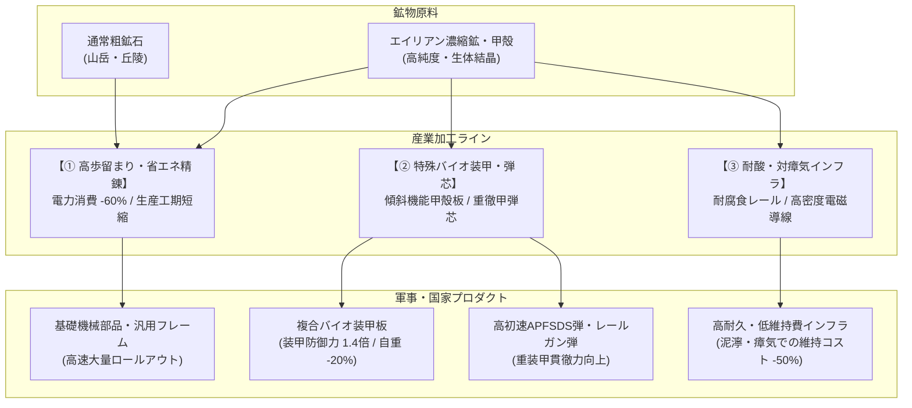

# 鉱物資源・エイリアン濃縮鉱床と産業利用仕様書

## (Mineral Resources, Alien Concentration & Industrial Utilization Specification)

本ドキュメントは、本作における**「鉱物資源の産出バランス、エイリアン生態系による鉱物濃縮・集約メカニズム、獲得アプローチ（収奪 vs 巣窟制圧・鉱脈化）、および産業・兵器への多面的な利用システム」**を規定する基本仕様書である。

---

## 1. 鉱物資源の基本哲学と産出スケール

### 1.1 「埋蔵量なし（永久産出・無尽蔵）」によるゲーム安定化

* **埋蔵量（Depletion）の不採用**:
  * タイルの埋蔵量が枯渇して鉱山が消滅するシステムは、プレイヤーに過度の再配置ストレスと産業ラインの停止（破綻）を招くため採用しない。
  * 土地利用（Tier 0〜4）とインフラ結合度に応じて、**安定して毎ターン恒久産出**される。
* **入手難易度のバランス（割と手に入る）**:
  * 自国領内の山岳・丘陵・平野に基礎的な採掘インフラ（Tier 1〜2）を展開すれば、日々の弾薬消費や軽度な車両維持に必要な鉱物資源は**安定して自給可能**。
  * 資源が全く見つからず初期に即詰みするような理不尽なボトルネックは排除する。

### 1.2 師団スケールに整合する産出量レンジの改定

諸兵科連合戦闘団（増強師団：10,000名規模）が1ターン（激戦時）に砲弾・弾薬で `150〜500 t`、燃料で `200〜500 t` を消費することと整合させるため、タイル産出量のスケールを再調整する。

| 資源名 | 単位 | 通常タイル産出 (Tier 1〜2) | 高度開発 (Tier 3〜4) | エイリアン濃縮鉱床 (拠点・巣窟跡) | 特性・用途 |
| :--- | :---: | :---: | :---: | :---: | :--- |
| **エネルギー** | `MWh` | `50 〜 150` | `300 〜 800` | `100 〜 300` (生体熱) | 発電所、地熱、核融合。精錬と加工の原動力。 |
| **構造鉱物** (鉄・チタン等) | `t` | `100 〜 300` | `500 〜 1,200` | `800 〜 2,500` (超高品位) | 装甲、車体、線路、砲弾外殻の基礎材。 |
| **機能性鉱物** (希土類・半導体) | `t` | `20 〜 60` | `100 〜 300` | `200 〜 600` (生体濃縮晶析) | FCS、電子コア、信管、センサー母材。 |
| **バイオ原質** | `t` | `50 〜 200` | `200 〜 600` | `500 〜 1,500` (バイオマス塊) | 合成燃料、食料、有機触媒。 |

---

## 2. エイリアンの生体鉱化作用と鉱物集約（生物濃縮の極致）

### 2.1 生態メカニズム（なぜ集約されるのか？）

エイリアン種（特に甲殻種・大型突撃種・タイタン級）は、自身の外骨格や鋭利な爪牙、電磁防護器官を形成するため、**広域の土壌・地下水・岩石中から重金属や希土類を体内に吸収・濃縮・晶析（生体鉱化作用：Biomineralization）**する性質を持つ。
その結果、広大な領域に薄く散らばっていた鉱物が、エイリアンの生息巣窟周辺に「超高純度・高密度の結晶塊や脱皮殻」として自然集約される。

```text
┌─────────────────────────────────────────────────────────────────────────────┐
│                    エイリアン生体鉱化と集約サイクル                         │
└─────────────────────────────────────────────────────────────────────────────┘
  [広域の大地・地下水] ─── (土壌中の希薄な鉄・チタン・希土類を吸収) ───┐
                                                                       │
                                                                       ▼
  [エイリアン個体群]   ─── (体内濃縮・甲殻硬化・結晶牙の形成) ─────────┤
                                                                       │
                                                                       ▼
  ┌─────────────────────────────────────────────────────────────────────────┐
  │ 巣窟周辺への超高純度集約体                                              │
  │  ① 脱皮殻・角質マウンド (Molt Heap): 半精錬状態の硬質装甲殻の山堆積     │
  │  ② 鉱化嚢胞柱 (Mineral Cyst Spire): 結晶化した高純度希土類の生体晶析柱 │
  │  ③ スウォーム死骸層 (Bone Field): 戦闘・代謝で残された重金属格子の骨格   │
  └─────────────────────────────────────────────────────────────────────────┘
```

---

## 3. 資源獲得の2大アプローチ（掠め取り vs 殲滅鉱脈化）

エイリアン支配域・巣窟タイルの超濃縮資源に対し、国家は2つの運用アプローチを選択できる。

```text
┌─────────────────────────────────────────────────────────────────────────────┐
│                       エイリアン濃縮資源の獲得アプローチ                    │
├─────────────────────────────────────────────────────────────────────────────┤
│  【A. 共生・掠め取り（ハニーハーベスト方式 / 採餌回収）】                    │
│   ・エイリアン巣窟をあえて全滅させず、外縁部から脱皮殻や排泄鉱物を定期回収。│
│   ・特性：巣窟が存続する限り、恒久的に「半精錬・生体濃縮鉱物」が自動湧出。  │
│   ・リスク：巣窟の活性度（Aggro）が上昇。防護フェンスや定期警備戦闘団の     │
│             駐留・損耗コストが発生。                                        │
├─────────────────────────────────────────────────────────────────────────────┤
│  【B. 巣窟壊滅・露天鉱脈化（エクスターミネート方式 / 完全制圧）】            │
│   ・軍事力でエイリアンの巣・母体を完全に殲滅・消毒・無力化。                │
│   ・特性：巣窟跡地を永久の「超高品位・巨大露天掘り鉱山（Tier 3〜4相当）」へ │
│           即時転換。周辺タイルの脅威がゼロになり完全安全化。                │
│   ・産出：莫大な構造鉱物・機能性鉱物がノーリスクで恒久産出される。          │
│           （※埋蔵量制限はなく、恒久的な富鉱地帯として国家の重工業を牽引）  │
└─────────────────────────────────────────────────────────────────────────────┘
```

---

## 4. 鉱物資源の産業利用（Industrial Utilization）

入手した鉱物（特にエイリアン濃縮鉱床からの高純度資源）は、以下の3大産業ラインで消費・製品化される。



### 4.1 利用ライン①：一般工業の高歩留まり・省エネ精錬（生産ブースト）

* 通常の粗鉱石（脈石や不純物が多い）を溶鉱炉で精錬するには大量の電力（`MWh`）とスラグ排出が伴う。
* **エイリアン濃縮鉱の利点**:
  * エイリアンの消化・晶析プロセスによって不純物が濾過されており、**精錬エネルギー消費が 60% 削減**される。
  * 部品加工工期が短縮され、工廠の部品歩留まりが飛躍。大量の戦車・装甲車・鉄道車両を短期間でロールアウト可能。

### 4.2 利用ライン②：複合バイオ装甲板・重徹甲弾芯（軍事ブレイクスルー）

* **傾斜機能バイオ装甲（Chitin-Composite Armor）**:
  * エイリアン重戦車種の甲殻組織（キチン・金属結晶ナノ多層構造）をそのまま圧延装甲の内装・表面硬化層として転用。
  * **効果**: 従来の均質圧延装甲や複合装甲に比べ、**防御力1.4倍、重量20%減**。戦闘団の自重が軽くなるため、行軍時の**燃料消費が低減**する。
* **超高硬度ニードル弾芯（Xeno-APFSDS / Railgun Slugs）**:
  * 貫徹牙・生体レールガン器官由来の金属間化合物結晶を削り出し、120C戦車砲や電磁投射砲の徹甲弾芯に採用。
  * 敵大型生体や敵主力戦車に対する装甲貫徹力が大幅に向上。

### 4.3 利用ライン③：耐酸・対瘴気インフラ材（国土強靭化）

* **腐食耐性軌条・建材**:
  * 湿地や瘴気帯、酸性土壌に鉄道・舗装道路・パイプラインを敷設すると、通常は激しい腐食により維持費（部品消費）が倍増する。
  * 濃縮鉱物由来の耐酸性合金をインフラ建材に混ぜることで、**過酷バイオームにおけるインフラ維持部品の消費量を半減**させ、物流網の途絶を防ぐ。
* **生体電磁導線（Bio-conductive Wiring）**:
  * センサーや送電網の送電ロスを半減させ、通信妨害（ジャミング）に対する耐性を獲得。

---

## 5. Bevy ECS 実装データ構造仕様 (Rust)

```rust
use bevy::prelude::*;

/// タイル上の鉱物特性
#[derive(Component, Debug, Clone, Reflect)]
pub struct TileMineralDeposit {
    /// 通常粗鉱石の基礎産出量 (t/T)
    pub raw_ore_yield_tons: u32,
    /// 機能性鉱物の基礎産出量 (t/T)
    pub rare_mineral_yield_tons: u32,
    /// エイリアン生体濃縮鉱床の存在フラグ・グレード
    pub alien_concentration: Option<AlienDepositGrade>,
}

/// エイリアン濃縮鉱床のグレードと採取方式
#[derive(Debug, Clone, PartialEq, Eq, Reflect)]
pub enum AlienDepositGrade {
    /// 存続する巣窟からの掠め取り（危険度高・継続産出）
    ActiveHarvesting {
        chitin_ore_tons_per_turn: u32,
        aggro_hazard_level: u8,
    },
    /// 殲滅制圧後の巨大露天鉱脈（無尽蔵・安全・高産出）
    ExterminatedOpenPit {
        refined_yield_bonus_tons: u32,
        rare_mineral_bonus_tons: u32,
    },
}

/// 工業中間財・特殊加工レシピ種別
#[derive(Debug, Clone, Copy, PartialEq, Eq, Reflect)]
pub enum ArmorProductionRecipe {
    /// 通常製鉄・複合装甲
    StandardSteelComposite,
    /// エイリアン甲殻ハイブリッド装甲（軽量・高耐久）
    AlienChitinComposite,
}

impl ArmorProductionRecipe {
    /// 生産効率とコスト係数
    pub fn cost_and_efficiency(&self) -> (f32, f32) {
        match self {
            Self::StandardSteelComposite => (1.0, 1.0), // (防御係数, 自重係数)
            Self::AlienChitinComposite => (1.4, 0.8),   // 防御1.4倍、自重0.8倍
        }
    }
}
```

---

## 6. ドキュメント相互参照

* [`../specs/RESOURCE_ITEM_DICTIONARY.md`](../specs/RESOURCE_ITEM_DICTIONARY.md) - 資源・部品・弾薬マスター定義書
* [`../specs/RESOURCE_ECONOMY_SYSTEM.md`](../specs/RESOURCE_ECONOMY_SYSTEM.md) - 資源・経済・サプライチェーン体系目録
* [`../specs/LAND_USE_SYSTEM.md`](../specs/LAND_USE_SYSTEM.md) - 脱・都市中心型 土地利用・開発システム仕様書
* [`concept_resource_economy_and_logistics.md`](./concept_resource_economy_and_logistics.md) - 資源モデル基本設計書
