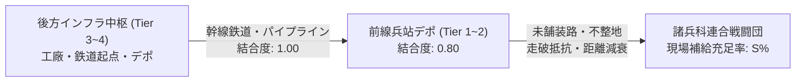
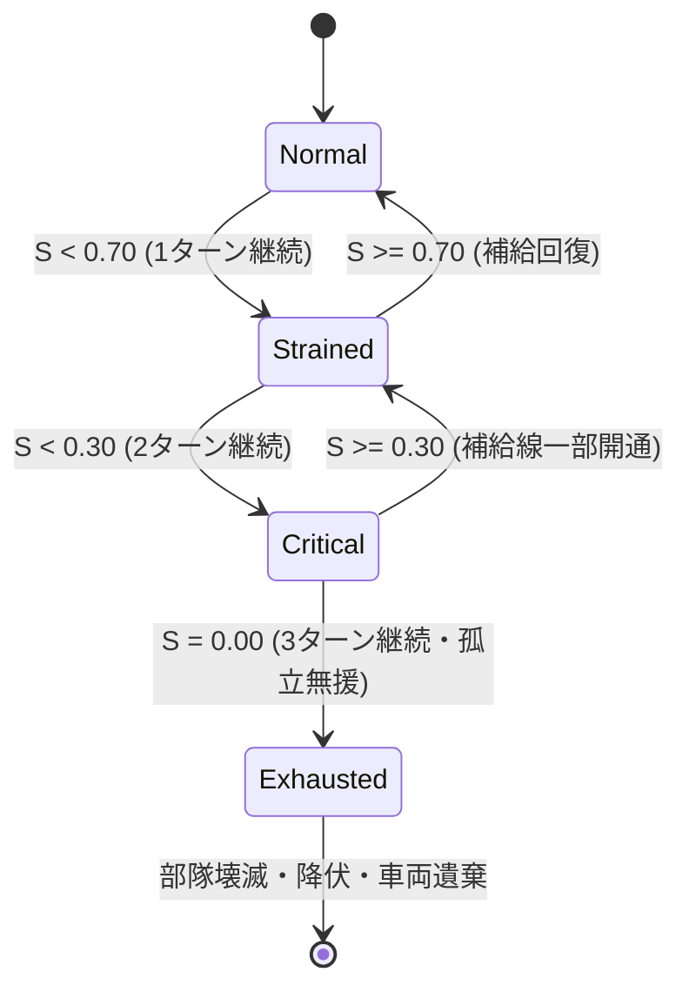
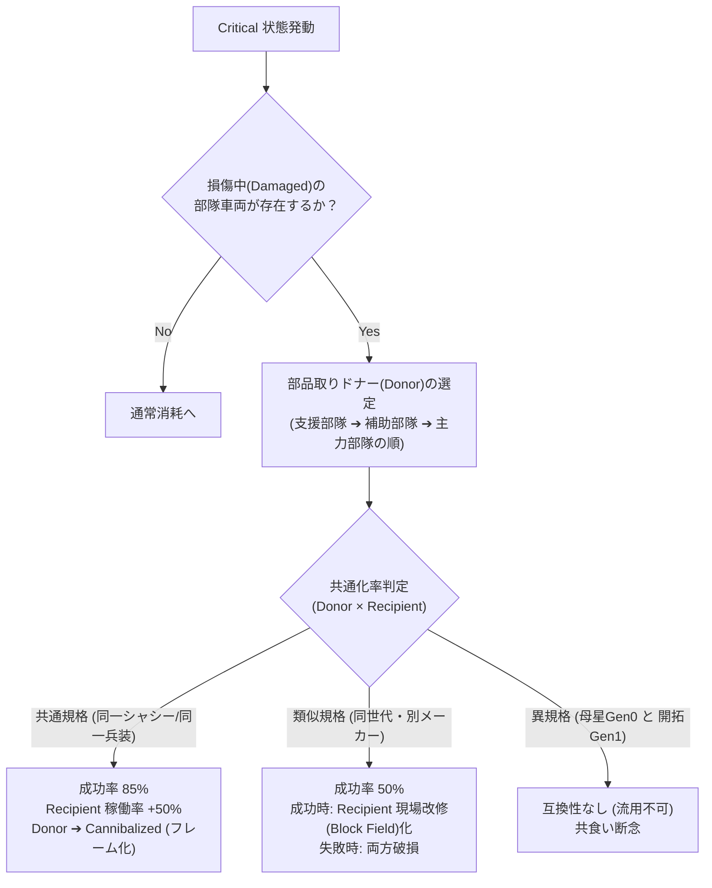

# 戦闘団（TO&E）× 兵站・装備更新統合データ仕様書 (SEC-01)

(Combat Group TO&E, Logistics Infrastructure & Cannibalization Specification)

本作（4X大戦略＋諸兵科連合戦闘団制＋脱都市タイル進展）における**「戦闘団（小隊・中隊・大隊階層）の内部データ構造、インフラ結合度に応じた自動補給、兵站途絶時の稼働率低下、および現場判断による共食い整備（Cannibalization）のステートマシン」**を定義する統合仕様書である。

---

## 1. 増強師団・諸兵科連合戦闘団（TO&E）データ構造

大戦略マップ上の1コマとして運用される戦闘団は、歩兵・戦車・自走砲・防空・直協航空・工兵・補給が自己完結した**「増強師団／諸兵科連合旅団（約10,000〜15,000名、戦闘・支援車両・航空機 約600〜700両/機規模）」**に相当する。
内部階層は**「4両＝1小隊、4小隊＝1中隊（16両）、4個中隊＝1個大隊（64両）」**という2進数倍々補完（2-2構成）を基底とする。

```text
┌─────────────────────────────────────────────────────────────────────────────┐
│       増強師団・諸兵科連合戦闘団 (Combined Arms Combat Group TO&E) 構造     │
├─────────────────────────────────────────────────────────────────────────────┤
│                                                                             │
│  【基幹機甲連隊群 (4個諸兵科混成機甲連隊: 戦車256両 ＋ 重IFV256両)】         │
│    ・第1機甲連隊（主力戦車 64両 ＋ 随伴重IFV 64両 ＋ 連隊工兵偵察）          │
│    ・第2機甲連隊（主力戦車 64両 ＋ 随伴重IFV 64両 ＋ 連隊工兵偵察）          │
│    ・第3機甲連隊（主力戦車 64両 ＋ 随伴重IFV 64両 ＋ 連隊工兵偵察）          │
│    ・第4機甲連隊（主力戦車 64両 ＋ 随伴重IFV 64両 ＋ 連隊工兵偵察）          │
│    ※ 各連隊が戦車1大隊＋重IFV1大隊の完全同数ペアで自律打撃・相互躍進        │
│                                                                             │
│  【師団直轄 装輪偵察戦闘群 (Wheeled Recon & Combat: 計64両)】               │
│    ・第1装輪偵察戦闘大隊（装甲偵察車16両 ＋ 装甲火力戦闘車16両: 前方哨戒）   │
│    ・第2装輪偵察戦闘大隊（装甲偵察車16両 ＋ 装甲火力戦闘車16両: 回廊警戒）   │
│    ※ 偵察車（25C＋光学マスト）と火力戦闘車（105C低反動砲）の即応ペア        │
│                                                                             │
│  【師団野戦特科連隊 (Field Artillery Regiment)】                            │
│    ・自走野戦特科第1大隊（155C自走榴弾砲 24両）                            │
│    ・自走野戦特科第2大隊（155C自走榴弾砲 24両） ◀── 持続斉射               │
│    ・重破砕特科大隊（210C重自走榴弾砲 / 重迫撃砲 16両）                     │
│    ・戦術誘導打撃大隊（TELミサイルランチャー 16両） ◀── 長距離精密阻止     │
│                                                                             │
│  【師団高射連隊 (Air Defense Regiment)】                                    │
│    ・近接・低高度防空大隊（35C自走複合機関砲 24両）                         │
│    ・短・中距離地対空誘導弾大隊（装軌式複合SAM 24両） ◀── 師団防空傘    │
│    ・師団電子戦・早期警戒防空大隊（対空レーダー・指向性EW 16両）             │
│                                                                             │
│  【師団直轄 航空連隊・兵站回収群 (Aviation & Logistics)】                    │
│    ・師団直協戦闘航空連隊（計32機: 1飛行隊8機 × 4個飛行隊）                │
│       ├─ 第1戦闘飛行隊（重武装戦闘ヘリ/VTOL 8機） ◀── 近接航空支援(CAS)    │
│       ├─ 第2戦闘飛行隊（重武装戦闘ヘリ/VTOL 8機） ◀── 対戦車阻止         │
│       ├─ 第1輸送飛行隊（強襲輸送ヘリ 8機） ◀── 空中機動・兵站架橋        │
│       └─ 第2輸送飛行隊（強襲輸送ヘリ 8機） ◀── 高地補給・急患空送        │
│    ・前方回収・野戦整備大隊（装甲回収車ARV 32両 ＋ 移動工作ドック）         │
│    ・師団兵站補給第1連隊（燃料弾薬輸送大型トラック梯団）                   │
│    ・師団兵站補給第2連隊（航空推進剤・重部品輸送梯団）                     │
│                                                                             │
└─────────────────────────────────────────────────────────────────────────────┘
```

### 1.1 部隊単位のデータ構造（Rust / Bevy ECS想定）

```rust
/// 戦闘団を構成する各大隊・中隊エンティティ
#[derive(Debug, Clone, PartialEq)]
pub struct SubUnit {
    pub unit_id: u32,
    pub name: String,
    pub echelon: EchelonLevel,          // Platoon, Company, Battalion
    pub category: UnitCategory,         // Armor, MechInf, Artillery, AirDefense, Aviation, Logistics
    pub chassis_id: String,             // 車台ID (例: "Std-T4", "Std-W6", "Biped-H1")
    pub weapon_module_id: String,       // 兵装ID (例: "WPN-01", "WPN-02")
    pub powerpack_id: String,           // 動力ID (例: "PWR-01", "PWR-02")
    pub armor_module_id: String,        // 装甲ID (例: "ARM-01", "ARM-02")
    pub generation: Generation,         // Gen0(遺産), Gen1(開拓), Gen2(現地重工)...
    pub vehicle_count: u16,             // 配備両数 (小隊=4, 中隊=16, 大隊=48~64)
    pub status: UnitHealthStatus,       // 部隊健全度状態
    pub field_modified: bool,           // 現場現地改修 (Block Field) フラグ
}

#[derive(Debug, Clone, Copy, PartialEq, Eq)]
pub enum EchelonLevel {
    Platoon,    // 小隊 (4両)
    Company,    // 中隊 (16両)
    Battalion,  // 大隊 (48〜64両)
}

#[derive(Debug, Clone, Copy, PartialEq, Eq)]
pub enum UnitCategory {
    Armor,              // 機甲（戦車・突撃砲）
    MechanizedInf,      // 機械化歩兵（IFV・APC・工兵）
    Artillery,          // 特科（自走砲・TEL誘導弾）
    AirDefense,         // 高射防空（機関砲・SAM）
    Aviation,           // 直協航空（戦闘ヘリ・VTOL・UAV）
    LogisticsSupport,   // 兵站支援（ARV・補給トラック・ドローン母車）
}

#[derive(Debug, Clone, Copy, PartialEq)]
pub enum UnitHealthStatus {
    Operational { efficiency: f32 },   // 健全〜軽微損傷 (稼働効率 0.70..=1.00)
    Damaged { repair_turns: u8 },      // 要整備・現場修理中 (戦闘力半減)
    Cannibalized,                      // 部品取り済・稼働不能 (フレームのみ残存)
    Destroyed,                         // 完全撃破・全滅
}
```

---

## 2. インフラ結合度による自動プッシュ補給モデル

本作では前線部隊に「燃料切れ」や「弾薬運び」を1手ずつ命じることはせず、親タイルの**「インフラ結合度（Infrastructure Connectivity: 0.00〜1.00）」**と**「補給線距離（Supply Line Distance）」**に基づいて自動算出される。



### 2.1 補給充足率（Supply Satisfaction: $S$）の計算式

戦闘団が所在するタイルにおいて、毎ターン受け取れる補給充足率 $S$（0.00〜1.00）は以下で決定される：

$$S = C_{\text{tile}} \times \left(1.0 - \min(1.0, \frac{D_{\text{depot}}}{R_{\text{supply}}})\right) \times \eta_{\text{doctrine}}$$

- $C_{\text{tile}}$: 戦闘団が所在するタイルのインフラ結合度（0.00〜1.00）。未開拓地は 0.10、野戦前哨は 0.40、舗装動脈上は 0.80〜1.00。
- $D_{\text{depot}}$: 最寄りの補給デポ（Tier 1以上の兵站拠点）からの親タイル距離（ヘックス数）。
- $R_{\text{supply}}$: 補給デポの最大有効兵站半径（基本値: 4〜8タイル）。
- $\eta_{\text{doctrine}}$: 国家兵站ドクトリンによる効率補正（0.85〜1.15）。

---

## 3. 兵站断絶時の状態遷移（State Machine）

毎ターンの補給充足率 $S$ に応じて、戦闘団のステータスは以下の4段階で遷移する。



### 3.1 ステート別挙動詳細

| ステート名 | 判定条件 | 戦術・大戦略ペナルティ | 現場整備大隊の自律動作 |
| :--- | :--- | :--- | :--- |
| **Normal** | $S \ge 0.70$ | なし（稼働率 100%）。全火器自由射撃。 | 定期点検を実施。軽微損傷車両を毎ターン全快。 |
| **Strained** | $0.30 \le S < 0.70$ | 移動速度 -20%、支援砲撃の弾薬割当量 -30%。 | 消耗部品の延命措置。主打撃大隊へ優先配分。 |
| **Critical** | $S < 0.30$ | 移動速度 -50%、反撃のみ許可（攻勢不可）。 | **共食い整備（Cannibalization）の自律実行**。損傷車両をパーツ取りに回し主力車両を復旧。 |
| **Exhausted** | $S = 0.00$（3ターン） | 移動不能、全武装弾薬枯渇（白兵・自衛のみ）。 | 整備不能。敵性部隊と交戦時、名誉・ドクトリンに応じた投降/遺棄自爆を実行。 |

---

## 4. 共食い整備（Cannibalization）ロジック

`Critical` 状態に陥った戦闘団において、整備部隊は部隊の全滅を防ぐため、**「損傷の激しい車両を犠牲にし、その部品を取り外して別の大隊・中隊の車両を稼働状態に戻す」**自律処理を行う。



### 4.1 非再生産・初期高度装備（Gen 0等）の共食い整備メカニクス

国内に金型や工作機械ラインが存在しない「非再生産装備（初期積載の高度MIL-SPEC品や鹵獲先進兵器など）」の共食い整備は、産業自立度と規格互換性の観点から以下の普遍的メカニクスで処理される。

1. **同型機からの部品取り（同一規格ドナー）**:
   - **元部品（ドナー部位）の残存健全度に応じた復旧率と劣化度**:
     - 一律に劣化するのではなく、**「ドナー機体側のどの部位が無事だったか（元部品の状態）」**によって復旧結果が分岐する。
     - **非被弾・健全部位の流用（クリーンパーツ）**:
       - 例: 砲塔が吹き飛んだ撃破車から無傷のエンジンブロックを回収、または履帯が吹き飛んだ車体からFCS・電子コアを移植。
       - **結果**: 稼働率はほぼ **100%（新品同様）** に回復し、劣化蓄積も極めて軽微（0〜5%程度）。
     - **過酷稼働・疲労部位の流用（摩耗パーツ）**:
       - 例: 長期行軍で熱疲労を起こしたパワーパック、被弾破片が食い込んだ装甲板、衝撃で歪んだサスペンションの移植。
       - **結果**: 応急復旧はするものの、**稼働率上限の低下（100% ➔ 80〜90%）**や「累積整備疲労」が蓄積し、次回の故障率が上昇。
   - **ドナー機の恒久欠損**:
     - 部品を剥ぎ取られたドナー機体は**「恒久欠損（廃車・フレーム化）」**となり、国内に該当金型ラインが新設・リバースエンジニアリングされるまで再生産・補充が効かない。
     - 大戦略ダッシュボードにおいて「非再生産資産の消耗・欠損アラート」が通知される。
   - **ゲーム的力学**:
     - 「砲塔をやられた車両」と「足回りをやられた車両」をニコイチ合体させて1両をほぼ完全復旧させる現場のリアリズムと、ボロボロの残骸から無理やり寄せ集めた車両が次第に劣化・疲弊していくリアリズムが両立する。
2. **現地暫定規格（Gen 1等の低精度部品）の流用・無理な溶接**:
   - 規格不一致のため、流用成功率は基礎値 **25%** に低迷。
   - **成功時**: 車両は「現場改修型（Block Field）」となり、稼働率は復旧するが整備工数係数が増加し、スペック（電子戦・出力）が一定割合低下する。
   - **失敗時**: 駆動部・電子系統のショート等により、移植先車両も致命的損傷を被る。
3. **本メカニクスのゲーム的意義**:
   - これは「母星だから特別扱い」なのではなく、**「国内にサプライチェーンが存在しない高度機材を、無理に前線維持させるか（劣化と共食い死の受容）、後方温存して技術解析・国産化の雛形にするか」という普遍的な資源・装備管理の意思決定**として機能する。

---

## 5. 国家整備ドクトリン（ステアリング介入）

プレイヤーは個々の共食い整備を手動でポチポチ指示することはできないが、**「国家整備ドクトリン（Maintenance Steering）」**をマクロ設定することで、全軍の整備方針を誘導できる。

```text
┌─────────────────────────────────────────────────────────────────────────────┐
│                 国家整備ドクトリン（ステアリング設定値）                    │
├─────────────────────────────────────────────────────────────────────────────┤
│                                                                             │
│  [1. 前線維持最優先 (Survival First)]                                       │
│    ・共食い整備の閾値を緩和（Strained 段階から部品流用を開始）              │
│    ・Gen 0 の共食い解体を許可（主戦力大隊の稼働車両数を死守）               │
│    ・効果: 包囲戦・遠征時の継戦能力 +40%、Gen 0 喪失ペースが加速            │
│                                                                             │
│  [2. プラットフォーム温存 (Platform Preservation - 標準)]                  │
│    ・Critical 状態でのみ同型間共食いを許可                                  │
│    ・Gen 0 の部品取り解体を原則禁止（稼働率低下を受け入れ後方回送）         │
│    ・効果: 兵器耐用年数の最大化、長期的な軍事資産の保全                     │
│                                                                             │
│  [3. 共通化厳格準拠 (Strict Modular Discipline)]                           │
│    ・規格外・類似モジュールの無理な現場溶接（Block Field化）を厳禁          │
│    ・故障車は共食いさせず、正規インフラ（工廠デポ）への牽引搬送を徹底       │
│    ・効果: 部隊共通化率 100% を維持、兵站が繋がっている際の修理速度 +30%     │
│                                                                             │
└─────────────────────────────────────────────────────────────────────────────┘
```

---

## 6. 実装用コンポーネント・システム対応（Bevy ECS）

```rust
use bevy::prelude::*;

/// 戦闘団の兵站・補給ステータスコンポーネント
#[derive(Component, Debug)]
pub struct CombatGroupLogistics {
    pub supply_satisfaction: f32,      // 0.00..=1.00
    pub strained_turns: u8,            // 連続兵站圧迫ターン数
    pub state: LogisticsState,         // Normal, Strained, Critical, Exhausted
    pub doctrine: MaintenanceDoctrine, // SurvivalFirst, Preservation, StrictModular
}

#[derive(Debug, Clone, Copy, PartialEq, Eq)]
pub enum LogisticsState {
    Normal,
    Strained,
    Critical,
    Exhausted,
}

#[derive(Debug, Clone, Copy, PartialEq, Eq)]
pub enum MaintenanceDoctrine {
    SurvivalFirst,
    PlatformPreservation,
    StrictModularDiscipline,
}

/// 毎ターンの兵站評価および自律共食い整備システム
pub fn evaluate_combat_group_logistics_system(
    mut query: Query<(&mut CombatGroupLogistics, &mut Vec<SubUnit>)>,
    tile_infrastructure_query: Query<&TileInfrastructureGrid>,
) {
    // 1. 各タイルのインフラ結合度・距離から supply_satisfaction を算出
    // 2. ステートマシンの遷移判定 (Normal ➔ Strained ➔ Critical ➔ Exhausted)
    // 3. Critical 時、ドクトリンに応じた自動共食い整備 (Cannibalization) の実行
}
```
