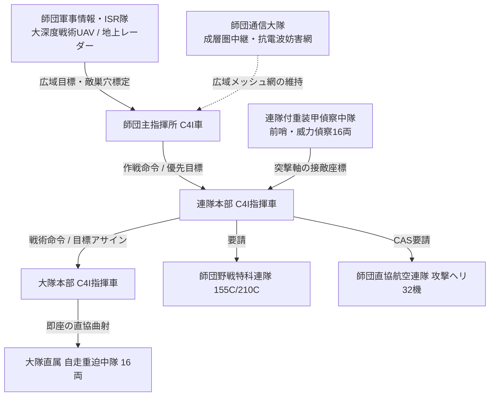

# 常設増強機甲師団 各階層本部付き隊の相互連携・指揮統制関係検討書

(Hierarchical Headquarters & Attached Units Integration Study)

本ドキュメントは、[`concept_headquarters_and_attached_units.md`](./concept_headquarters_and_attached_units.md) で定義された本部管理中隊（HHC）の基本構造、および [`../toe_definitions/ground/regular/toe_corps_heavy_armored.md`](../toe_definitions/ground/regular/toe_corps_heavy_armored.md) における常設増強機甲師団の戦闘序列（Order of Battle）に基づき、**「師団司令部付隊 ⇄ 連隊本部管理中隊 ⇄ 大隊本部管理班」という3階層の本部付き隊が果たす機能分担、上下連携ダイナミクス、および損耗時の縮退運用**を体系的に検討・定義した文書である。

---

## 1. 検討の背景と目的

増強機甲師団（総計約800〜900両、航空機32機、兵員1.5万人超）は、単一の集団ではなく「師団 ➔ 連隊 ➔ 大隊 ➔ 中隊 ➔ 小隊」という厳格な階層構造（エシュロン）によって統制される。

本ゲームのシミュレーションにおいて、戦闘部隊（戦車中隊、重歩兵中隊など）が最大の打撃力を発揮し続けるためには、**各階層の本部付き隊（HHC / HQ Units）が自階層の戦闘部隊を支えるだけでなく、上位・下位の本部付き隊とどのような指揮・情報・兵站パイプラインを形成しているか**を明確にする必要がある。

### 本検討の核心的論点

1. **指揮通信（C4I）・キルチェーンの縦深連携**: 師団ISR（大深度UAV）の目標情報を、連隊・大隊・中隊の火器へどう中継・伝達するか。
2. **兵站・回収（Maintenance & Supply）の段列（Echelon）構造**: 現場の擱座車両や補給要求を、大隊回収班・連隊重ARV・師団整備大隊がどう連携して処理するか。
3. **障害克服・工兵連携**: 師団重架橋大隊と連隊付戦闘工兵中隊の作戦空間の切り分け。
4. **階層縮退（Degradation）メカニクス**: 上位司令部や下位管理班が撃破・電磁途絶された際の指揮権・補給権の継承。

---

## 2. 3階層本部付き隊の構成と基本諸元比較

2進数倍々補完（4両＝1小隊、16両＝1中隊、64両＝1大隊）の体系に基づき、各エシュロンの本部付き隊の規模と主装備を整理する。

```text
┌─────────────────────────────────────────────────────────────────────────────┐
│                 増強機甲師団 本部付き隊 3階層構造マップ                     │
├─────────────────────────────────────────────────────────────────────────────┤
│                                                                             │
│  【第1階層: 師団司令部および直轄付属群】 (Division Echelon: 全域統括・戦略アセット) │
│    ├─ 師団司令部管理中隊・付隊（HHC: 主指揮所6両、後方指揮所4両、警護4両） │
│    ├─ 師団通信大隊（大容量データリンク車 16両 ＋ 成層圏中継・抗妨害 8両）   │
│    ├─ 師団軍事情報・ISR隊（戦術UAV管制車 8両 ＋ 長距離レーダー車 8両）       │
│    ├─ 師団施設戦闘工兵大隊（重架橋車 16両 ＋ 重啓開工作車 16両 ＋ 地雷散布8両）│
│    ├─ 師団特殊生物化学防護隊（NBC・酸除染車 16両）                         │
│    ├─ 師団対舟艇対戦車誘導弾隊（重誘導弾発射車 16両）                       │
│    └─ 前方回収・野戦整備大隊（装甲回収車ARV 32両 ＋ 移動工作ドック）        │
│                                 │ (作戦指示・広域情報 / 大動脈補給)          │
│                                 ▼                                           │
│  【第2階層: 連隊本部管理中隊 (Regimental HHC)】 (Regiment Echelon: 突撃軸統括・独立戦術) │
│    ├─ 司令部・C4I通信小隊（連隊指揮車 4両 ＋ データリンク中継車 2両）       │
│    ├─ 兵站・衛生・回収小隊（重ARV 2両 ＋ 装甲救護車 2両 ＋ 弾薬燃料指揮 2両）│
│    ├─ 連隊付装甲戦闘工兵中隊（装甲架橋AVLB 8両 ＋ 戦闘工兵啓開車 8両）      │
│    └─ 連隊付重装甲偵察中隊（Std-T4重偵察戦闘車 16両） ◀── 前哨・威力偵察     │
│                                 │ (戦術命令・ポケット射撃統制 / 前進補給)    │
│                                 ▼                                           │
│  【第3階層: 大隊本部管理班 (Battalion HHC)】 (Battalion Echelon: 前線即応・直協打撃)   │
│    ├─ 指揮・C4I班（大隊指揮車 2両 ＋ 戦術通信車 2両）                      │
│    ├─ 衛生・即応回収班（装甲救護車 2両 ＋ 装甲回収車ARV 2両）               │
│    └─ 大隊直属専従火力（自走重迫撃砲中隊: 120C自走重迫 16両） ◀── 直協曲射 │
│                                                                             │
└─────────────────────────────────────────────────────────────────────────────┘
```

| 階層 (Echelon) | 単位名称 | 車両規模 | 担当戦術空間（空間深度） | 主要責務 |
| :--- | :--- | :--- | :--- | :--- |
| **師団 (Division)** | 師団司令部管理中隊 ＋ 直轄大隊群 | 約100〜120両 | 師団正面 40〜80km深度 50〜100km | 戦域ISR、大動脈兵站、全域防空傘、全域通信網、戦略予備投入 |
| **連隊 (Regiment)** | 連隊本部管理中隊 (HHC) ＋ 付隊 | 約48〜56両(HHC16+工兵16+偵察16) | 連隊正面 15〜25km深度 20〜40km | 突撃軸（突破軸）の指揮統制、障害啓開・架橋、威力偵察、中間兵站 |
| **大隊 (Battalion)** | 大隊本部管理班 ＋ 直属重迫中隊 | 計24両(管理班8+迫撃16) | 大隊正面 4〜8km深度 5〜10km | 直接交戦の射撃指揮、ポケット砲兵射撃、擱座車両の即時回収・救護 |

---

## 3. 機能別の上下連携関係ダイナミクス

### 3.1 指揮通信（C4I）と情報キルチェーンの連携



1. **大深度索敵から中隊展開までのパイプライン**:
   - 師団ISR（大深度UAV）が30〜50km先の敵増援群や巣窟を探知。
   - 師団司令部C4Iが突撃軸を担当する各連隊本部（第1〜第4機甲連隊）へ目標情報をリアルタイム配布。
   - 連隊長は直属の**重装甲偵察中隊（16両）**を進発させて接触面を確定し、大隊長へ突撃態勢への移行を下令。
2. **近接火力支援（CAS / 特科 / 重迫）の要求ルート**:
   - **大隊レベル（数分以内）**: 大隊本部管理班が直属の**自走重迫撃砲中隊（16両）**に直接射撃指示。上位の承認不要で即座に煙幕展張・支援射撃を実施。
   - **連隊レベル（中深度・師団特科への要請）**: 連隊本部HHCのJTAC/砲兵連絡班が、師団野戦特科連隊（155C/210C）または直協航空連隊（攻撃ヘリ）へ即応射撃・近接航空支援（CAS）を要請。

---

### 3.2 兵站・衛生・回収（Maintenance & Logistics）の3段列構造

損傷・故障した車両の回収・整備、および弾薬・燃料の補給は、3階層がバケツリレー式に受け渡すことで、戦車部隊の足を止めない設計となっている。

```text
┌─────────────────────────────────────────────────────────────────────────────┐
│                 兵站・回収の3段列（Echelon）パイプライン                    │
├─────────────────────────────────────────────────────────────────────────────┤
│                                                                             │
│  【現場・大隊レベル】 (第1線: 即応回収・応急処置)                           │
│    ・戦闘中隊（戦車・IFV）が被弾・M-Kill（機動不能）発生                    │
│    ・大隊本部管理班の「装甲回収車（ARV 2両）」が砲火下へ急行し牽引         │
│    ・大隊「装甲救護車（2両）」が負傷搭乗員を回収、初期止血処置             │
│    ・大隊内「自走重迫中隊」の補給車から緊急弾薬融通                         │
│                                 │ (自隊で修理不能な重度損傷車 / 重傷者)     │
│                                 ▼                                           │
│  【連隊レベル (HHC)】 (第2線: 前方集積所・中間整備・共食い整備)            │
│    ・連隊HHCの「重ARV（2両）」および回収班が合流                            │
│    ・連隊FSP（前方支援点: Forward Support Point）にて応急ユニット交換       │
│    ・同型被撃破車からの「共食い整備（部品剥ぎ取り）」の実行統制             │
│    ・連隊救護班が負傷者をトリアージ、除染班がエイリアン強酸を中和           │
│                                 │ (フレーム全損、エンジン換装、後方移送)    │
│                                 ▼                                           │
│  【師団直轄レベル】 (第3線: 重整備工作ドック・大動脈兵站)                   │
│    ・「師団前方回収・野戦整備大隊（重ARV 32両 ＋ 移動工作ドック）」が収容  │
│    ・パワーパック完全載せ替え、主砲身交換、装甲板溶接復旧                   │
│    ・師団兵站補給第1・第2連隊（燃料・弾薬梯団）から連隊FSPへ一括輸送補給   │
│                                                                             │
└─────────────────────────────────────────────────────────────────────────────┘
```

- **回収能力の役割分担**:
  - **大隊（ARV 2両）**: 前線火線からの「離脱・牽引（バディトーイング）」に特化。修理は行わず安全圏へ引っ張り出す。
  - **連隊（重ARV 2両＋工作班）**: エンジン補機類・履帯・転輪の現場交換、共食い整備の判定。
  - **師団（ARV 32両＋工作ドック）**: 車台レベルの重分解整備、後方デポへの移送、新品ストック車両の受領と配分。

---

### 3.3 施設工兵（Mobility / Counter-Mobility）の連携

進撃を妨げる地形（大河川、断崖、湿地）やエイリアン障害（強酸泥濘、巣穴網、巨大生物バリケード）に対する役割分担。

- **師団施設戦闘工兵大隊（重架橋16両＋重啓開16両＋地雷散布8両）**:
  - **戦略・全域級の突破**: 幅数十mを超える大河川への重ポンツーン・大型トラス架橋（MBT 60t級が連続通過可能な幹線ルート開拓）。
  - **広域エリア拒絶**: 師団側背面に地雷散布車を投入し、エイリアン大群の迂回奇襲ルートを遮断。
- **連隊付装甲戦闘工兵中隊（AVLB 8両＋啓開車8両）**:
  - **戦術・突撃軸の即時突破**: 各機甲連隊の直前に進発。小河川・対戦車壕・塹壕にAVLB（装甲架橋車）を数分で架設し、戦車隊を一瞬も停止させずに突入させる。
  - **巣穴入口の爆砕啓開**: 工兵啓開車の大型ドーザーと爆薬投射機で、前哨陣地をこじ開ける。

---

### 3.4 非火力支援部隊の階層配置思想：「C4I・衛生の不可欠性」と「後方負荷の集約」

本軍事体系における重要な設計思想として、**「火力部隊（戦車・IFV・迫撃砲）は邪魔にならなければ前線にいくらあっても良いが、非火力支援部隊（後方支援・管理部隊）を各大隊にまで過剰配備することは行軍縦隊の伸長と脆弱化を招く」**という原則がある。

現実の独立即応機動連隊（あるいはロシア軍の独立大隊戦術群/BTG）のように「師団支援のない孤立環境で戦う」部隊は、各大隊が自前で工兵・補給・整備をフルパッケージで抱え込まざるを得ない。しかし、**常設増強機甲師団のように師団全体がひとつの打撃パッケージとして機能する場合、大隊レベルは身軽にし、重い支援は上位へ集約するのが合理的**である。

その中にあっても、**「C4I（指揮通信）」**と**「衛生（野戦救護）」**の2点だけは全階層・各大隊において絶対に削減できない生命線として位置づけられる。

```text
┌─────────────────────────────────────────────────────────────────────────────┐
│                 大隊本部管理班 (Battalion HHC) のメリハリ設計               │
├─────────────────────────────────────────────────────────────────────────────┤
│                                                                             │
│  【全階層・各大隊で絶対に削れない生命線】（生存性と直結）                  │
│    ◎ C4I・指揮通信班（装甲指揮車 2両 ＋ 戦術データリンク車 2両）            │
│       ・師団ISRや偵察隊が捉えたリアルタイム座標を遅延0で各小隊FCSへ流し込む │
│       ・局所的な生体胞子ジャミングや強電磁環境下でも孤立（盲目化）を防止   │
│    ◎ 即応衛生・トリアージ班（装甲救護車 2両）                               │
│       ・エイリアン強酸体液・生体毒素に対する「黄金の10分（プラチナ・テン）」│
│       ・火線際での即時中和・緊急気道確保・止血。兵員の戦死率抑制と士気維持   │
│                                                                             │
│  【大隊からは削減・最小化し、連隊／師団へ集約するもの】（足手まといの排除）│
│    △ 重整備・工作ドック ➔ 連隊FSP・師団工作大隊へ集約 (大隊はARV牽引のみ)│
│    △ 架橋・重啓開工兵 ➔ 連隊付工兵中隊へ集約 (必要時に小隊をアタッチ)       │
│    △ 大規模兵站・弾薬輸送梯団 ➔ 師団兵站連隊が連隊FSPまで押し出し補給        │
│                                                                             │
└─────────────────────────────────────────────────────────────────────────────┘
```

1. **C4Iの不可欠性**:
   - 前線の大隊にC4I中継能力がなければ、師団野戦特科（155C/210C）や直協航空連隊（攻撃ヘリ）の強大な火力を呼び出すキルチェーンが寸断される。
   - 大隊本部の装甲指揮車・通信車は、戦闘部隊の「神経中枢」として常時稼働が義務付けられる。
2. **衛生の不可欠性**:
   - 対エイリアン戦における酸腐食や生体毒は、数分〜十数分の放置で搭乗員・歩兵を死に至らしめる。
   - 後方の連隊・師団野戦病院に送る前の「火線際での一次救命処置（酸中和・解毒剤投与）」を行う装甲救護車は、各大隊の最前線に常駐していなければ機能しない。
3. **その他の非火力アセットの集約**:
   - 一方で、工兵工作車や重部品輸送トラック、大型整備クレーンコンテナなどの「自衛戦闘力が低く足の遅い非火力車両」は大隊から排除され、連隊本部管理中隊（HHC）または師団直轄部隊に一元管理される。
   - 大隊は「戦車・重IFV・自走重迫の圧倒的打撃力 ＋ C4I ＋ 救護 ＋ 最低限の牽引ARV」という**戦闘即応に特化した強靭かつスリムなパッケージ**を維持する。

---

## 4. 指揮所（CP）のサバイバビリティと縮退（Degradation）運用

エイリアンは知能的奇襲や大深度潜行突進、長距離生体弾頭などにより司令部中枢を狙い撃ちにしてくるリスクがある。これに対抗するため、階層を跨いだ指揮権委譲ルールを策定する。

### 4.1 師団司令部の主・後方分散運用（Main CP / Rear CP）

- **師団主指揮所（Main CP: 6両）**:
  - 師団長が座乗。連隊本部の後方5〜10kmに推進し、直接戦闘・攻撃前進を統制。

- **師団後方指揮所（Rear CP: 4両）**:
  - 師団副長・兵站参謀が座乗。師団後方20〜30kmの兵站基地・整備ドック群に位置し、補給梯団・補充を統制。
- **指揮権即時継承**: Main CPが電磁障害や攻撃で沈黙した場合、0ターンの遅延なくRear CPへ全軍の統括指揮権が自動委譲される。

### 4.2 連隊・大隊の自律戦闘（Mission Command）

- **師団司令部との通信途絶時**:
  - 各機甲連隊は、連隊HHCのC4I車と偵察中隊・工兵中隊により**「独立旅団戦闘団」**と同等の戦闘能力を保持。
  - 師団からの命令が途絶しても、大戦略目標ベクトルに沿って自己判断で戦闘前進・拠点確保を継続可能。

- **連隊司令部（HHC）損耗時**:
  - 連隊内の第1大隊本部（先任大隊長）が大隊C4I車を用いて連隊全体の指揮を臨時代行。
  - ただし、特科要請の精度低下や工兵・偵察中隊の協調に一定のディレイペナルティが発生。

---

## 5. ゲームメカニクス（ECS・データ構造）への実装方針

各階層の本部付き隊をゲーム内で表現するためのデータ設計案。

### 5.1 コンポーネント構造案

```rust
// 本部付き隊の共通コンポーネント
#[derive(Component, Debug, Clone)]
pub struct HeadquartersUnitComponent {
    pub echelon: EchelonLevel,          // Division, Regiment, Battalion
    pub parent_hq_entity: Option<Entity>, // 上位司令部のEntity参照
    pub subordinate_units: Vec<Entity>,  // 傘下部隊のEntityリスト
    pub c4i_health_ratio: f32,          // C4I通信能力 (0.0 - 1.0)
    pub recovery_capacity: u32,         // ARVによる同時回収可能車両数
    pub organic_supply_stock: f32,      // 直属補給バッファ保有量
}

// 階層区分
#[derive(Debug, Clone, Copy, PartialEq, Eq)]
pub enum EchelonLevel {
    Division,   // 師団司令部・付属群
    Regiment,   // 連隊本部管理中隊 (HHC)
    Battalion,  // 大隊本部管理班 (HHC)
}

// 指揮統制リンク状態
#[derive(Component, Debug, Clone)]
pub struct CommandLinkStatus {
    pub is_linked_to_parent: bool,      // 上位HQとデータリンク接続中か
    pub is_jammed: bool,                 // 生体ジャミング・EMP下にあるか
    pub effective_command_delay: u8,    // 命令伝達遅延ターン数 (0=即時, 1〜3=遅延)
}
```

### 5.2 システム連携ルール

1. **索敵共有（Kill-Chain System）**:
   - `CommandLinkStatus.is_linked_to_parent == true` の場合のみ、師団ISR隊が捕捉した索敵情報が大隊・中隊の射撃統制に反映される。
   - 通信途絶時は自隊の直接視界（サブタイル視界）のみで索敵・交戦。
2. **自動回収・現地修理（Maintenance System）**:
   - 戦闘終了フェーズにおいて、大隊HHCのARVが即座に回収判定（成功率70%）。
   - 修理不能と判定された車両は、上位の連隊HHCおよび師団整備大隊のキューへ送られ、翌日以降の修理または共食い整備材料へ転換。

---

## 6. まとめ

常設増強機甲師団における各階層の本部付き隊は、単なる「おまけの随伴車両」ではなく、以下のような相互補完構造を持つ不可欠なインフラである。

1. **大隊HHC**: 前線戦闘の即応救護・即時牽引、および大隊長の切り札（120C重迫中隊）を提供。
2. **連隊HHC**: 突撃軸における障害突破（工兵）と接敵探知（重偵察）、および中間兵站（FSP・共食い整備）を統率。
3. **師団司令部付隊**: 戦域全方位のC4I・ISR・全域防空傘・大動脈兵站ドックを提供し、各連隊が全力で突進できる環境を担保。

この3層が密接に連携することで、増強機甲師団は過酷なエイリアン生体環境下でも足を止めずに電撃的な打撃力を発揮し続けることができる。
