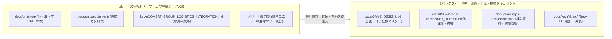
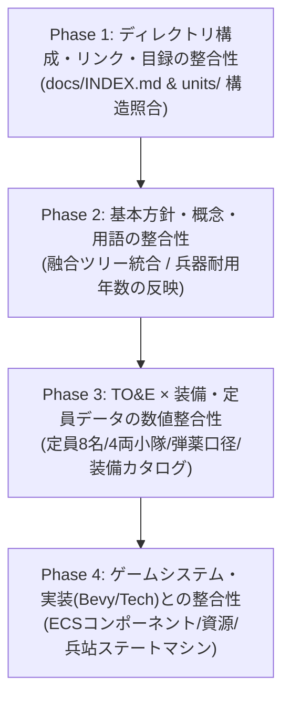

# 仕様・ドキュメント整合性チェック計画書 (CONSISTENCY_AUDIT_PLAN)

本ドキュメントは、プロジェクト「Nanai Alien Com Game」における設計思想の進化・最新決定事項（「融合ユニットの通常ツリー統合」「兵器耐用年数（消耗度）の定義」「TO&Eディレクトリ再編」等）を踏まえ、各種仕様書・目録・データ定義間の整合性を**段階的（部分的）に検証・是正するための実行計画書**である。

---

## 1. 目的と基本原則

### 1.1 目的・背景

本計画は、**ユーザー自身が主導して策定・コミットした「最新のコア仕様・定義文書」（例: TO&E最新定義、装備カタログ、耐用年数仕様、ツリー再編等）を一次情報（マスター / 正）とし、その最新設計思想や規格を、周辺文書（全体ゲームデザイン、各種目録、検討ドキュメント、技術仕様等）へと計画的・段階的に逆還元（バックフィード）すること**を目的とする。

AIが機械的に整合させるのではなく、ユーザーが確定させた思想やデータを起点として、プロジェクト全体へ波及させていく。

### 1.2 コア文書とバックフィードの関係性

### 1.3 進行の基本原則

- **ユーザー策定コア文書をマスターとする**: 周辺の古い記述に合わせてコア文書を戻すのではなく、コア文書の記述を正として周辺ドキュメントをアップデートする。
- **部分的な段階的進行（Phased Approach）**: 一括での書き換えによる意図しない改変を防ぐため、スコープを明確に区切って1領域ずつ確認・フィードバックしながら進める。
- **相対パス規約の厳守**: 各ドキュメント内の内部リンクは、環境依存や個人情報漏洩を避けるため、必ずリポジトリ内相対パス（例: `./docs/...`, `../src/...`）を用いる。
- **進捗の可視化**: 各タスクにステータス（`[ ] 未着手` / `[-] 進行中` / `[x] 完了`）を付与し、本ドキュメントを更新しながら管理する。

---

## 2. フェーズ別実行計画

---

### 【Phase 1】ディレクトリ構成・リンク・目録の整合性（構造レイヤー）

まずは、ファイルパスや目次の不整合・リンク切れを解消し、仕様探索の基盤を最新化する。

- [ ] **1.1 全体目録（[docs/INDEX.md](../INDEX.md)）の構造照合・更新**
  - 旧 `docs/toe_definitions/` や `docs/force_structure/` 表記を、新ディレクトリ `docs/units/` 構成に更新。
  - 新設された装備カタログ（`docs/units/equipment/`）や各種仕様書の配置を正しく反映。
- [ ] **1.2 TO&Eマスター目録（[docs/units/INDEX_TOE.md](../units/INDEX_TOE.md)）と各インデックス照合**
  - `docs/units/toe_indexes/` 配下の各Markdown（全9カテゴリ）のリンク先存在確認。
  - 実体ファイル（`docs/units/toe/`）とのファイル名・パス一致確認。
- [ ] **1.3 相対パスおよびリンク記法の確認**
  - プロジェクトルール（`path_privacy.md`）に従い、絶対パスやローカルURLが含まれていないことの検証。

---

### 【Phase 2】設計思想・ツリー・基本概念の整合性（概念レイヤー）

直近の主要な意思決定が、全体設計および個別仕様書に矛盾なく浸透しているかを検証・修正する。

- [ ] **2.1 融合ユニット（Fusion Units）の通常ツリー上位統合の反映**
  - [docs/GAME_DESIGN.md](../GAME_DESIGN.md) 内のスキルツリー・研究系統図において、「独立融合ツリー」記述を撤廃し、「正規軍ツリー上位のGen 3/4近代化改修」として再定義。
  - `docs/units/toe/` 内の各仕様書における世代表記（Gen 1〜Gen 4）の整合性確認。
- [ ] **2.2 兵器耐用年数（Weapon Lifespan / Degradation）の定義整合性**
  - [COMBAT_GROUP_LOGISTICS_INTEGRATION.md](../units/force/COMBAT_GROUP_LOGISTICS_INTEGRATION.md) に追加された耐用年数（消耗度）および共食い整備ルールが、各兵科・装備仕様と調和しているか確認。
  - 航空・海上・陸上装備における耐用年数パラメータの適用基準確認。

---

### 【Phase 3】TO&E × 装備・定員データの数値整合性（データレイヤー）

陸・海・空の各ユニット内部編成仕様（TO&E）と装備カタログ間で、数値・規格の齟齬を解消する。

- [ ] **3.1 陸上装甲車定員・編成単位の統一確認**
  - 下車歩兵定員「固定8名（1個分隊）」、基本小隊「固定4両」のルールが、全陸上TO&Eおよび装備カタログ（`ground_regular_equipment.md` 等）で厳格に一致しているか。
- [ ] **3.2 共通弾薬口径規格（C表記）の照合**
  - `155C`, `120C`, `35C`, `30C`, `12.7C` 等の口径・モジュール規格が各兵器仕様書で揃っているか。
- [ ] **3.3 エイリアン群（野生・固有種）の階級・生態パラメータの整合性**
  - 陸・海・空のエイリアン編成仕様書におけるサイズ階層（小型群、中型群、大型群、コロッサス級）の定義と戦闘能力値のバランス確認。

---

### 【Phase 4】ゲームシステム・技術実装（Bevy ECS）との整合性（システムレイヤー）

確定した仕様書群と、技術アーキテクチャ（`docs/tech/`）およびRust実装コード間の整合性を担保する。

- [ ] **4.1 ECSコンポーネント定義の同期**
  - [COMBAT_GROUP_LOGISTICS_INTEGRATION.md](../units/force/COMBAT_GROUP_LOGISTICS_INTEGRATION.md) や各仕様書に記載されているサンプルRustコード（`CombatGroupLogistics`, `LogisticsState` 等）と、[SYSTEM_ARCHITECTURE_AND_DEPENDENCIES.md](../tech/SYSTEM_ARCHITECTURE_AND_DEPENDENCIES.md) のアーキテクチャ整合。
- [ ] **4.2 資源・サプライチェーン・兵站ステートマシンの接続**
  - [RESOURCE_ECONOMY_SYSTEM.md](../specs/RESOURCE_ECONOMY_SYSTEM.md) / [RESOURCE_IMPLEMENTATION_BRIDGE.md](../tech/RESOURCE_IMPLEMENTATION_BRIDGE.md) と、兵站充足度（`supply_satisfaction`）算出ロジックの連携整合。
- [ ] **4.3 実装タスク・ロードマップへの反映**
  - [MISSING_DOCUMENTS_ROADMAP.md](./MISSING_DOCUMENTS_ROADMAP.md) および [PENDING_ISSUES.md](./PENDING_ISSUES.md) の未完了タスク・課題との同期。

---

## 3. 進捗管理表

| フェーズ | 対象領域 | 主要担当ファイル | ステータス | 備考 |
| :--- | :--- | :--- | :---: | :--- |
| **Phase 1** | 構造・リンク整合 | `docs/INDEX.md`, `docs/units/INDEX_TOE.md` | 未着手 | 最優先で着手推奨 |
| **Phase 2** | 思想・概念整合 | `docs/GAME_DESIGN.md`, `docs/units/toe/` | 未着手 | 融合ツリー統合・耐用年数 |
| **Phase 3** | データ・数値整合 | `docs/units/equipment/`, `docs/units/toe/` | 未着手 | 定員8名・小隊4両・口径 |
| **Phase 4** | 実装・技術整合 | `docs/tech/`, `docs/specs/`, `src/` | 未着手 | Bevy ECS・資源橋渡し |

---

## 4. 関連ドキュメント

- [ドキュメント構成・目録 (INDEX.md)](../INDEX.md)
- [TO&Eマスター目録 (INDEX_TOE.md)](../units/INDEX_TOE.md)
- [ゲーム企画・コア仕様設計書 (GAME_DESIGN.md)](../GAME_DESIGN.md)
- [戦闘団（TO&E）× 兵站・装備更新統合データ仕様書 (SEC-01)](../units/force/COMBAT_GROUP_LOGISTICS_INTEGRATION.md)
- [パス・プライバシー規約](../../.agents/rules/path_privacy.md)
