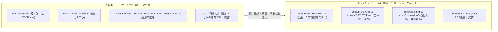
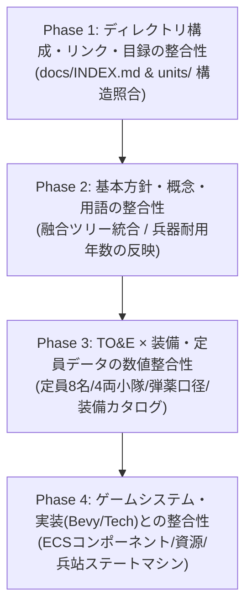

# 仕様・ドキュメント整合性チェック計画書 (CONSISTENCY_AUDIT_PLAN)

本ドキュメントは、プロジェクト「Nanai Alien Com Game」における設計思想の進化・最新決定事項（「融合ユニットの通常ツリー統合」「兵器耐用年数（消耗度）の定義」「TO&Eディレクトリ再編」等）を踏まえ、各種仕様書・目録・データ定義間の整合性を**段階的（部分的）に検証・是正するための実行計画書**である。

---

## 1. 目的と基本原則

### 1.1 目的・背景

本計画は、**ユーザー自身が主導して策定・コミットした「最新のコア仕様・定義文書」（例: TO&E最新定義、装備カタログ、耐用年数仕様、ツリー再編等）を一次情報（マスター / 正）とし、その最新設計思想や規格を、周辺文書（全体ゲームデザイン、各種目録、検討ドキュメント、技術仕様等）へと計画的・段階的に逆還元（バックフィード）すること**を目的とする。

AIが機械的に整合させるのではなく、ユーザーが確定させた思想やデータを起点として、プロジェクト全体へ波及させていく。

### 1.2 コア文書とバックフィードの関係性

### 1.3 進行の基本原則

- **ユーザー策定コア文書をマスターとする**: 周辺の古い記述に合わせてコア文書を戻すのではなく、コア文書の記述を正として周辺ドキュメントをアップデートする。
- **部分的な段階的進行（Phased Approach）**: 一括での書き換えによる意図しない改変を防ぐため、スコープを明確に区切って1領域ずつ確認・フィードバックしながら進める。
- **相対パス規約の厳守**: 各ドキュメント内の内部リンクは、環境依存や個人情報漏洩を避けるため、必ずリポジトリ内相対パス（例: `./docs/...`, `../src/...`）を用いる。
- **進捗の可視化**: 各タスクにステータス（`[ ] 未着手` / `[-] 進行中` / `[x] 完了`）を付与し、本ドキュメントを更新しながら管理する。

---

## 2. フェーズ別実行計画

---

### 【Phase 1】ディレクトリ構成・リンク・目録の整合性（構造レイヤー）

まずは、ファイルパスや目次の不整合・リンク切れを解消し、仕様探索の基盤を最新化する。

- [x] **1.1 全体目録（[docs/INDEX.md](../INDEX.md)）の構造照合・更新**
  - 旧 `docs/toe_definitions/` や `docs/force_structure/` 表記を、新ディレクトリ `docs/units/` 構成に更新完了。
  - 新設された装備カタログ（`docs/units/equipment/`）セクションの追加と各仕様書の配置を反映完了。
  - セクション番号の正規化（1〜7）および全内部リンクの疎通確認完了（リンク切れ0件）。
- [x] **1.2 TO&Eマスター目録（[docs/units/INDEX_TOE.md](../units/INDEX_TOE.md)）と各インデックス照合**
  - `docs/units/toe_indexes/` 配下の全12インデックス文書内（全86リンク）の疎通確認完了（リンク切れ0件）。
  - `docs/units/toe/` 配下の全62個のTO&E実体ファイルが漏れなく各インデックスから参照されていることを確認完了（網羅率100%）。
  - [INDEX_TOE.md](../units/INDEX_TOE.md) の記載を最新状況（航空正規軍15文書、旧融合インデックスの世代発展集約）へ同期完了。
- [x] **1.3 相対パスおよびリンク記法の確認**
  - `docs/` 配下の全160個のMarkdownファイルを自動検証。`file:///` やユーザー名を含む絶対パスの混入は **0件（完全準拠）** であることを確認完了。

---

### 【Phase 2】設計思想・ツリー・基本概念の整合性（概念レイヤー）

直近の主要な意思決定が、全体設計および個別仕様書に矛盾なく浸透しているかを検証・修正する。

- [x] **2.1 融合ユニット（Fusion Units）の通常ツリー上位統合の反映**
  - [GAME_DESIGN.md](../GAME_DESIGN.md) のセクション 3.1.4, 3.2.3, 3.3.3 において、「独立融合ツリー」を撤廃し「正規軍ツリー上位のGen 3/4近代化改修」として統合されていることを確認。
  - `docs/units/toe/` 内の各仕様書（`toe_corps_fusion_ground.md`, `toe_naval_fusion.md`, `toe_air_fusion.md`）における世代表記（Gen 1〜Gen 4）および「通常ツリー上位近代化（Gen 4）」の位置づけを点検・整備。
  - 陸上Gen 4対応表に「陸上戦艦打撃軍団」の生体甲殻改修を追加し、通常12カテゴリー（正規軍全編成）との整合を完了。
  - [INDEX_TOE.md](../units/INDEX_TOE.md) および各インデックスの正規軍仕様書数表記（陸上14、航空15、海上7）を「通常＋上位世代発展1」として完全同期。
- [x] **2.2 兵器耐用年数（Weapon Lifespan / Degradation）の定義整合性**
  - [COMBAT_GROUP_LOGISTICS_INTEGRATION.md](../units/force/COMBAT_GROUP_LOGISTICS_INTEGRATION.md) の基本規定（最長1世紀/100年基準、構造健全度 `structural_integrity`、共食い整備アルゴリズム）と、陸・海・空の正規軍装備仕様書（`ground_regular_equipment.md`, `naval_regular_equipment.md`, `air_regular_equipment.md`）の耐用年数パラメータ（陸上戦艦・決戦艦80〜100年、戦車60〜80年、装甲車・航空機30〜50年、二脚20〜30年）が完全に調和していることを確認。
  - 編成・エシュロン関連仕様書（[concept_corps_variants.md](../units/force/concept_corps_variants.md), [concept_personnel_and_manning_standards.md](../units/force/concept_personnel_and_manning_standards.md)）に、共食い整備およびフレーム物理的耐用年数（最長1世紀）の相互参照リンクと運用注記を拡充・同期完了。

---

### 【Phase 3】TO&E × 装備・定員データの数値整合性（データレイヤー）

陸・海・空の各ユニット内部編成仕様（TO&E）と装備カタログ間で、数値・規格の齟齬を解消する。

- [x] **3.1 陸上装甲車定員・編成単位の統一確認**
  - 下車歩兵定員「固定8名（1個分隊）」および基本小隊「固定4両（中隊16両、大隊64〜80両）」の2進数倍々補完ルールが、全陸上TO&Eおよび車体仕様書で厳格に一致していることを確認。
  - [ground_regular_equipment.md](../units/equipment/ground/regular/ground_regular_equipment.md) および [concept_ground_vehicle_chassis_and_variants.md](../units/force/concept_ground_vehicle_chassis_and_variants.md) において、自動車化歩兵の基幹である「4×4 LAV（乗員2名＋下車歩兵8名固定）」の定義を明記・同期。
  - [concept_personnel_and_manning_standards.md](../units/force/concept_personnel_and_manning_standards.md) の主要戦闘車両定員リストに「4×4 LAV（計10名: 乗員2＋下車8）」を追加し、歩兵多層エシュロン全体の定員積算基準を統一。
  - 8×8装輪ファミリーの「基本10大バリアント（＋対空2種）」の表記揺れを整流化。
- [x] **3.2 共通弾薬口径規格（C表記）の照合**
  - 重榴弾砲規格を全文書で **`160C`**（全周旋回砲塔自走榴弾砲、装輪トラック自走榴弾砲、牽引式榴弾砲）に完全統一し、残存していた旧表記（155C）を排除。
  - 陸上戦艦打撃軍団の陸上近接戦闘艦主砲において、残存していた旧来ミリ表記（127mm）を共通C規格である **`130C-N速射砲`**（130×800C艦載両用砲規格）に統一。
  - 旧来のミリ引きずり・細分化規格（`12.7C`, `25C`, `35C`, `105C`）を排除し、完全整数化・現代化されたC規格体系（`13C`重機銃、`30C`標準機関砲、`40C`対空・重機関砲、`50C`重IFV機関砲、`110C`低反動砲、`120C`母星標準滑腔砲、`130C`/`140C`重滑腔砲、`160C`重榴弾砲、`210C`超重砲、`60C-N`/`130C-N`艦砲、`EM-40C`/`EM-180C`電磁砲）に全仕様書・TO&Eを整流化。
- [x] **3.3 エイリアン群（野生・固有種）の階級・生態パラメータの整合性**
  - 陸・海・空のエイリアン装備仕様書（`ground_alien_equipment.md`, `air_alien_equipment.md`, `naval_alien_equipment.md`）と全22個のエイリアンTO&E、および `GAME_DESIGN.md` 間のサイズ階層・戦闘能力値の整合性を確認。
  - **陸棲種（6大系統）**: 小型（歩兵殺傷/装甲無力）、中型（軽装甲車破壊/装甲車は時間要/戦車破壊不能）、戦車型（戦車に組み付き長時間の格闘戦）、タイタン級（接近戦型巨獣コロッサスによる陣地圧壊 vs 超大型ニードル砲撃型によるミサイル程度の遠距離牽制）、陸棲航空型（上面急降下格闘/制空戦不参加）、対空種（例外的な生体機関砲・自律追尾生体ミサイル保持）の厳格な威力階層が全TO&Eで統一されていることを確認。
  - **空棲種（極限シンプル3種）**: 通常制空（生体戦闘種）、不可視制空（光学戦闘種）、空中要塞決戦（空中巨大格闘種/空中戦艦級質量）の生体ジェット推進・生体機関砲・生体ミサイル兵装体系を確認。
  - **海棲種（浅瀬3種＋深海1種）**: 浅瀬中型（舷側こじ開け）、浅瀬大型（決戦体当たり）、浅瀬大型対空（生体ミサイルVLS専従）、深海潜航巨獣（無音潜航・艦底キール噛み砕き）の深度・格闘パラメータの一致を確認。

---

### 【Phase 4】ゲームシステム・技術実装（Bevy ECS）との整合性（システムレイヤー）

確定した仕様書群と、技術アーキテクチャ（`docs/tech/`）およびRust実装コード間の整合性を担保する。

- [ ] **4.1 ECSコンポーネント定義の同期**
  - [COMBAT_GROUP_LOGISTICS_INTEGRATION.md](../units/force/COMBAT_GROUP_LOGISTICS_INTEGRATION.md) や各仕様書に記載されているサンプルRustコード（`CombatGroupLogistics`, `LogisticsState` 等）と、[SYSTEM_ARCHITECTURE_AND_DEPENDENCIES.md](../tech/SYSTEM_ARCHITECTURE_AND_DEPENDENCIES.md) のアーキテクチャ整合。
- [ ] **4.2 資源・サプライチェーン・兵站ステートマシンの接続**
  - [RESOURCE_ECONOMY_SYSTEM.md](../specs/RESOURCE_ECONOMY_SYSTEM.md) / [RESOURCE_IMPLEMENTATION_BRIDGE.md](../tech/RESOURCE_IMPLEMENTATION_BRIDGE.md) と、兵站充足度（`supply_satisfaction`）算出ロジックの連携整合。
- [ ] **4.3 実装タスク・ロードマップへの反映**
  - [MISSING_DOCUMENTS_ROADMAP.md](./MISSING_DOCUMENTS_ROADMAP.md) および [PENDING_ISSUES.md](./PENDING_ISSUES.md) の未完了タスク・課題との同期。

---

## 3. 進捗管理表

| フェーズ | 対象領域 | 主要担当ファイル | ステータス | 備考 |
| :--- | :--- | :--- | :---: | :--- |
| **Phase 1** | 構造・リンク整合 | `docs/INDEX.md`, `docs/units/INDEX_TOE.md` | 完了 | 1.1, 1.2, 1.3 すべて完了（構造基盤整備完了） |
| **Phase 2** | 思想・概念整合 | `docs/GAME_DESIGN.md`, `docs/units/toe/` | 完了 | 2.1, 2.2 すべて完了（概念レイヤー整合完了） |
| **Phase 3** | データ・数値整合 | `docs/units/equipment/`, `docs/units/toe/` | 進行中 | 3.1完了、3.2・3.3未着手 |
| **Phase 4** | 実装・技術整合 | `docs/tech/`, `docs/specs/`, `src/` | 未着手 | Bevy ECS・資源橋渡し |

---

## 4. 関連ドキュメント

- [ドキュメント構成・目録 (INDEX.md)](../INDEX.md)
- [TO&Eマスター目録 (INDEX_TOE.md)](../units/INDEX_TOE.md)
- [ゲーム企画・コア仕様設計書 (GAME_DESIGN.md)](../GAME_DESIGN.md)
- [戦闘団（TO&E）× 兵站・装備更新統合データ仕様書 (SEC-01)](../units/force/COMBAT_GROUP_LOGISTICS_INTEGRATION.md)
- [パス・プライバシー規約](../../.agents/rules/path_privacy.md)
