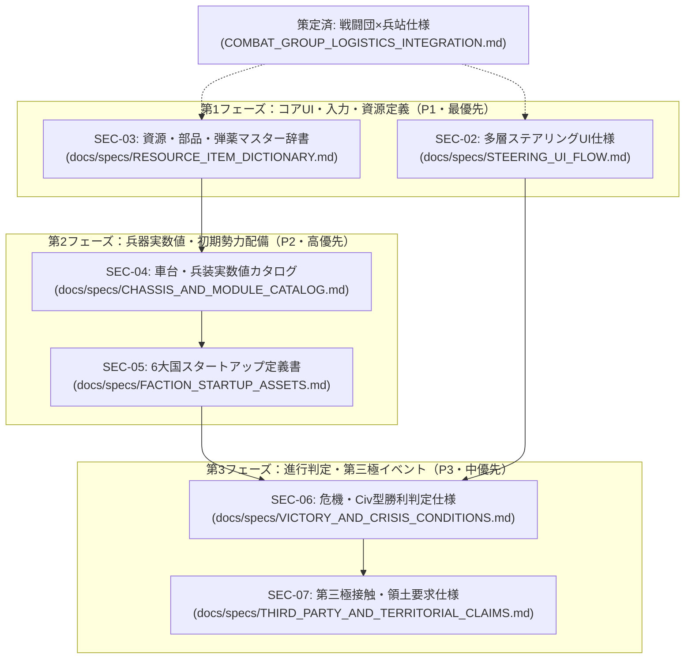

# 不足ドキュメント整備・具体化実行計画書 (Missing Specs Execution Plan)

本ドキュメントは、[`MISSING_DOCUMENTS_ROADMAP.md`](./MISSING_DOCUMENTS_ROADMAP.md) および [`SECONDARY_MISSING_SPECS.md`](./SECONDARY_MISSING_SPECS.md) にて特定された未作成・不足ドキュメント群（第4・第5シリーズ）を、段階的かつ破綻なく具体化・策定していくための実行計画書（ロードマップ）である。

---

## 1. 計画の目的と基本方針

### 1.1 目的

本作（4X大戦略＋諸兵科連合戦闘団制＋脱都市タイル進展＋多層自動化ステアリング）は、第1〜第3シリーズを通じて世界観・概念思想（50件超の検討書）および軍事編成カタログ（全62件のTO&E）の策定を完了した。
本計画の目的は、これらハイレベルな概念を**「Rust / Bevy ECSコードおよびUI/データ構造として実装・結合可能な具象仕様書（`docs/specs/`）」**へと段階的に落とし込み、開発基盤を完成させることである。

### 1.2 策定の基本原則

1. **リポジトリ内相対パス規約の遵守**:
   - すべてのMarkdown内リンクは `./` または `../` を起点とする相対パスを用い、環境依存パスや個人情報を含めない。
2. **システム結合・ロジック先行アプローチ（アプローチA）**:
   - 単なる架空カタログ作成にとどまらず、「ECSコンポーネント構造体（Rust）」「状態遷移ステートマシン」「数理計算式」を仕様内に明記する。
3. **段階的・小刻みな合意形成**:
   - 1文書ずつ作成・内容検証を行い、[docs/INDEX.md](../INDEX.md) や関連目録を更新しながら進行する。

---

## 2. 不足ドキュメント群の全体体系（依存関係マップ）

---

## 3. フェーズ別策定計画とタスク一覧

### 【Phase 1】コアUI動線・資源データ辞書（P1: 最優先）

プレイヤーの意思決定（ステアリング）と、ゲーム内経済・兵站の最小構成要素を確定する。

- [x] **Task 1-1: 多層ステアリングUI画面遷移・操作フロー仕様書 (`SEC-02`)**
  - **対象ファイル**: `docs/specs/STEERING_UI_FLOW.md`（初版策定完了）
  - **論点・確定事項**:
    - 国家4大指針（思想・好戦性・友好性・孤立性）に基づく完全自動委任から段階的主導化（4段階介入度）の体系化
    - 4層ステアリング画面（大戦略スライダー／方面軍指定／RFP要求仕様エディタ／現場改修承認）のワイヤーフレーム
    - 金型転換（Re-tooling Lag）の移行ゲージと前線部隊稼働率ペナルティのダッシュボード表示
    - 現場発現地改修（Block Field）車両の正式採用・原状復帰承認モーダル動線
    - マウスドラッグによる作戦ベクトル（Mission Vector）入力プロトコル
  - **完了条件**: 画面モックアップテキスト・入力イベント・Bevy UIコンポーネント構造が定義されていること。

- [x] **Task 1-2: 資源・部品・弾薬マスター定義書（Data Dictionary） (`SEC-03`)**
  - **対象ファイル**: `docs/specs/RESOURCE_ITEM_DICTIONARY.md`（初版策定完了）
  - **論点・確定事項**:
    - 質量基準（t：トン、MWh）による物理的妥当性と、集約バルク管理による軽量計算の両立
    - 一次資源4種（エネルギー、構造鉱物、機能鉱物、バイオ原質）の標準産出量・蓄電/備蓄モデル
    - 二次中間財4種（基礎機械部品、電子・論理コア、耐熱複合装甲板、規格化レーション）の加工工数・原料比率
    - 師団（1万人・600両規模）を基準とする弾薬（1,500t）・燃料（2,000t）・交換部品（500t）のバルク消費モデル
    - 異星適応度に応じたレーション自給率と医療費・適応障害ペナルティ計算式
  - **完了条件**: RustのEnum/Structとして直写できるテーブル定義が完了していること。

---

### 【Phase 2】兵器実数値・初期勢力配備（P2: 高優先）

戦闘団（TO&E）に搭載される実車台・実兵器のパラメータと、ゲーム開始時（Turn 0）の非対称な初期盤面を確定する。

- [x] **Task 2-1: 初期兵器モジュール・基本車台実数値カタログ仕様書 (`SEC-04`)**
  - **対象ファイル**: `docs/specs/CHASSIS_AND_MODULE_CATALOG.md`（初版策定完了）
  - **論点・確定事項**:
    - 対エイリアン専用の奇策・特効兵器を排し、母星軍事規格の汎用火器（30C機関砲、80C低圧破砕砲、同軸8C重機、4連装ミサイル）による物理打撃仕様
    - 戦略機動は自走航続距離ではなく重機トレーラー（HET）牽引および鉄道輸送を前提とする運用ドクトリン
    - 同軸・副武装を小火器と共通の「8C」規格に統一
    - 3大基本車台（Std-W6装輪 5t/7t、Std-T4装軌 9t/15t、Std-L4多脚 7t/9t）の自重・積載余力・地形走破係数・整備負荷係数
  - **完了条件**: 戦闘団TO&Eの各スロットにバインド可能な実データカタログが完成すること。

- [ ] **Task 2-2: 架空6大国 初期保有アセット・スタートアップ定義書 (`SEC-05`)**
  - **対象ファイル**: `docs/specs/FACTION_STARTUP_ASSETS.md`
  - **論点・確定事項**:
    - 全国家共通のTurn 0スターター戦力（探査バギー×2、軽警備中隊×2、監視杭×4、虎の子Gen 0戦車×2小隊）の初期配置
    - 6大国の初期ブートローダー工廠設備値（鋳造/精密/大量枠/電子/海洋/規格適合）の非対称配分
    - 初期母星輸送船降着タイルの資源備蓄量および初期研究ポイント
  - **完了条件**: 新規ゲーム生成時の初期エンティティ生成スクリプト仕様が定義されていること。

---

### 【Phase 3】動的進行・危機・第三極イベント（P3: 中優先）

中盤以降の緊張度上昇、ゲーム終了条件、および国境地帯の偶発イベントを確定する。

- [ ] **Task 3-1: 動的情勢推移・危機（Crisis）・Civ型勝利条件詳細仕様書 (`SEC-06`)**
  - **対象ファイル**: `docs/specs/VICTORY_AND_CRISIS_CONDITIONS.md`
  - **論点・確定事項**:
    - 緊張度メーター（Tension & Friction Index）の動的計算式（国境距離、資源競合、巣窟掃討数）
    - 5大勝利条件（軍事制覇、宇宙港再建、ガイア同化、完全合意吸収、技術的特異点）の判定フラグ式
    - 中盤・終盤の危機（エイリアン大侵入 Swarm、母星増援艦隊の失踪・分裂等）トリガー
    - 勝利達成後の「もう1ターンだけ続ける」オープンエンド継続プレイ挙動
  - **完了条件**: ターン終了時の勝利・危機判定システム関数仕様が確定していること。

- [ ] **Task 3-2: 自発的失踪者・軍閥（第三極）接触・調達・領土要求仕様書 (`SEC-07`)**
  - **対象ファイル**: `docs/specs/THIRD_PARTY_AND_TERRITORIAL_CLAIMS.md`
  - **論点・確定事項**:
    - 国境未定地での自発的失踪者コミュニティ遭遇イベントテーブル
    - 闇市調達（正規規格外兵器・異星生体試料）の交換レートと国内規律ペナルティ
    - 自然国境（山脈・河川・海峡）に基づく4段階領土主張（Claims）とCasus Belli（開戦事由）の生成ロジック
  - **完了条件**: 外交・イベントエンジンで処理可能なイベントフローチャートと確率式が定義されていること。

---

## 4. 実行スケジュール・マイルストーン

| フェーズ | 対象ドキュメント | 主な成果物 | 目安ステップ |
| :--- | :--- | :--- | :--- |
| **Phase 1** | `SEC-02`, `SEC-03` | 操作UI動線仕様、資源・部品マスター定義 | 第1ステップ（即時着手） |
| **Phase 2** | `SEC-04`, `SEC-05` | 車台・兵装カタログ、6大国初期配置定義 | 第2ステップ |
| **Phase 3** | `SEC-06`, `SEC-07` | 勝利・危機判定仕様、第三極・領土主張仕様 | 第3ステップ |
| **統合反映** | 全般 | `docs/INDEX.md`、`MISSING_DOCUMENTS_ROADMAP.md` の更新 | 随時並行 |

---

## 5. 次の具体的アクション

本計画書の承認後、**【Phase 1】の Task 1-1（`docs/specs/STEERING_UI_FLOW.md`）** または **Task 1-2（`docs/specs/RESOURCE_ITEM_DICTIONARY.md`）** の作成に着手します。
