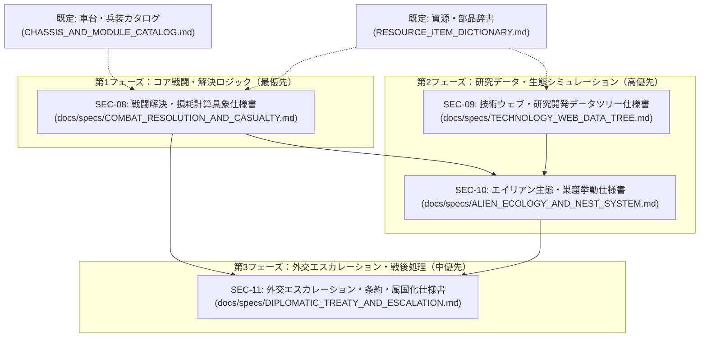

# 第2期 不足ドキュメント整備・具象仕様化実行計画書

## (Secondary Missing Specs Phase 2 Execution Plan)

本ドキュメントは、第1期整備計画（[`MISSING_SPECS_EXECUTION_PLAN.md`](./MISSING_SPECS_EXECUTION_PLAN.md) / `SEC-01`〜`SEC-07`）の完了に伴い、依然として概念検討段階（`docs/discussion/`）に留まっている**「戦闘解決・損耗アルゴリズム」「技術ウェブ・具体的ツリーデータ」「エイリアン生態・巣窟挙動」「外交エスカレーション・条約・属国化」**の4大不足領域を、Rust/Bevy ECSおよびデータテーブルとして実装可能な具象仕様書（`docs/specs/` 配下、`SEC-08`〜`SEC-11`）へと段階的かつ破綻なく落とし込むための実行計画書である。

---

## 1. 計画の背景と基本原則

### 1.1 背景

第1期（`SEC-01`〜`SEC-07`）により、部隊TO&E、基本車台・初期兵装カタログ、資源物理データ辞書、初期配備、ステアリングUI動線、終局思想、第三極領土主張が確定した。
しかし、これらを動かす**「戦闘のダメージ計算と損耗数式」「研究ウェブの全ノード依存関係」「マップ上でのエイリアン巣窟・瘴気の物理的シミュレーション」「国家間の緊張度推移と講和・属国化のプロトコル」**というコアメカニクスが依然として概念段階にあり、ゲームループの完全実装に向けた次なるボトルネックとなっている。

### 1.2 策定の基本原則

1. **リポジトリ内相対パス規約の厳守**:
   - すべてのMarkdown内リンクは `./` または `../` を起点とする相対パスを用い、環境依存パスや個人情報を含めない。
2. **システム結合・ロジック先行アプローチ**:
   - 単なるフレーバー設定にとどまらず、「ECSコンポーネント構造体（Rust）」「状態遷移ステートマシン」「数理計算式（決定論＋微小ノイズ）」「データテーブル（CSV/JSON互換）」を仕様内に明記する。
3. **段階的・小刻みな合意形成**:
   - 1文書ずつ作成・内容検証を行い、[`docs/INDEX.md`](../INDEX.md) や関連目録を更新しながら進行する。

---

## 2. 第2期 不足ドキュメント体系（依存関係マップ）

---

## 3. 各仕様書の詳細要件と策定スコープ

### 【Phase 1】コア戦闘・損耗計算（最優先 / P1）

#### SEC-08: 戦闘解決・部隊損耗および弾薬消費計算仕様書

- **対象ファイル**: `docs/specs/COMBAT_RESOLUTION_AND_CASUALTY.md`
- **目的**: 諸兵科連合戦闘団（TO&E）同士、およびエイリアン群との交戦において、サブタイルのターン進行および自動戦闘解決を行う数理モデル・ECSシステムを確定する。
- **主要定義内容**:
  1. **自動戦闘解決数理モデル**:
     - 射程・命中率（地形遮蔽・光学迷彩・天候減衰）
     - 火力貫徹力（運動エネルギー・HEAT・生体酸） vs 装甲防護値（均質圧延鋼・複合・生体甲殻）のダメージ減衰式
  2. **損耗（Casualty）および部隊状態遷移**:
     - 下車歩兵の死傷・負傷率、戦闘車両の軽度損傷・擱座・全損判定
     - 弾薬（C規格弾薬・ミサイル）および燃料の実数消費計算式
  3. **膠着（Grinding Combat）と戦線維持**:
     - 1親ターン（12〜15サブターン）で決着がつかない場合の戦線固定、後退・撤退判定
     - 隣接親タイルからの増援進入ラグと、親マップへの損耗フィードバック
  4. **盤外長距離支援砲撃（Off-map Artillery）**:
     - 160C自走榴弾砲等の親タイル間砲撃支援の着弾散布界とインフラ破壊計算式

---

### 【Phase 2】研究開発データ・生態シミュレーション（高優先 / P2）

#### SEC-09: 技術ウェブ（Tech Web）実データ構造・研究開発仕様書

- **対象ファイル**: `docs/specs/TECHNOLOGY_WEB_DATA_TREE.md`
- **目的**: 放射状Web構造（Tier 0〜3）の全技術ノード、アフィニティポイント付与量、解禁要素、および現場自律研究とステアリングの接続データを確定する。
- **主要定義内容**:
  1. **全技術ノード一覧（約30〜40ノード）**:
     - 降着基盤（Core）を中心とした放射状グラフ構造
     - ノード名、前提技術、所要研究点（RP）、解禁モジュール/施設/ドクトリン
  2. **3大アフィニティ（Purity / Harmony / Supremacy）配分**:
     - 各技術の研究完了時に獲得されるアフィニティ累積値
     - 混成アフィニティ（生体サイバネティクス、純血自律兵器等）の到達閾値
  3. **自律研究ベクトルとステアリング**:
     - 国内産業・交戦・環境刺激による自然研究加速（ブースト）
     - 国家指導者による重点特許・奨励金（ステアリング）と移行ラグ計算式
  4. **敵残骸法医学（Battlefield Forensics）**:
     - 撃破された敵高度兵器・エイリアン残骸からの技術ポイント抽出率

#### SEC-10: エイリアン生態ライフサイクル・巣窟（Nest）運用仕様書

- **対象ファイル**: `docs/specs/ALIEN_ECOLOGY_AND_NEST_SYSTEM.md`
- **目的**: マップ上の野生エイリアン巣窟（Nest）の自律発生、瘴気（Miasma）の動的変容、繁殖・大侵入（Swarm）メカニクスを規定する。
- **主要定義内容**:
  1. **巣窟（Nest）の4段階ライフサイクル**:
     - `Dormant`（休眠） ➔ `Active`（活性） ➔ `Breeding`（繁殖） ➔ `Swarming`（暴走大侵入）
     - 人類の領土拡張・環境破壊による刺激ヘイト蓄積ロジック
  2. **瘴気（Miasma）ダイナミクス**:
     - 巣窟を起点とする瘴気の自律拡散・濃度勾配（0.00〜1.00）
     - 人類通常部隊への継続腐食ダメージ vs 異星適応部隊・エイリアンへの回復・迷彩バフ
  3. **生態兵站・誘引と共生採取**:
     - フェロモン誘引弾（Pheromone Warhead）による敵国タイルへの誘導メカニクス
     - 生体試料の定期採取（共生協定時）と、過剰採取時の報復襲撃トリガー

---

### 【Phase 3】外交エスカレーション・条約・属国化（中優先 / P3）

#### SEC-11: 外交エスカレーション・和平条約・属国化交渉仕様書

- **対象ファイル**: `docs/specs/DIPLOMATIC_TREATY_AND_ESCALATION.md`
- **目的**: グレーゾーン事態から全面戦争に至る緊張度推移、講和条約、および無条件降伏・主権解体時の二重経済・属国化処理を確定する。
- **主要定義内容**:
  1. **国家間緊張度メーター（Tension & Friction Index）**:
     - 国境未定地での密輸・資源探査・領犯による緊張蓄積ロジック
     - 4段階エスカレーション・ラダー（警告 ➔ 経済制裁・資産凍結 ➔ 局地紛争 ➔ 最後通牒）
  2. **講和・休戦交渉テーブル**:
     - 領土割譲（自然国境に基づく確定ライン）、非武装地帯（DMZ）設定、賠償金（物資/エネルギー）
  3. **降伏・属国化・主権解体プロトコル**:
     - 敗戦国の「二重経済（Divided Economy）」化（宗主国への物資上納と現地最低維持費）
     - 工廠設備・軍事技術の接収と、地下ゲリラ（自発的失踪者化）の発生確率式

---

## 4. マイルストーンと策定スケジュール

| 順序 | 仕様書ID | ドキュメント名 | 主な成果物 | ステータス |
| :---: | :--- | :--- | :--- | :---: |
| 1 | **SEC-08** | `COMBAT_RESOLUTION_AND_CASUALTY.md` | 戦闘解決数理式、損耗・弾薬消費モデル、膠着判定 | **【未着手】** |
| 2 | **SEC-09** | `TECHNOLOGY_WEB_DATA_TREE.md` | 全技術ノードデータ、アフィニティ配分、残骸ブースト | **【未着手】** |
| 3 | **SEC-10** | `ALIEN_ECOLOGY_AND_NEST_SYSTEM.md` | 巣窟ライフサイクル、瘴気拡散、フェロモン誘導 | **【未着手】** |
| 4 | **SEC-11** | `DIPLOMATIC_TREATY_AND_ESCALATION.md` | 緊張度ラダー、講和条約、属国化・二重経済 | **【未着手】** |
| 5 | **統合反映** | 全般 | `docs/INDEX.md`、`docs/planning/` の更新・同期 | **【未着手】** |

---

## 5. 次の具体的アクション

本計画書に基づき、直ちに**第1フェーズ最優先タスクである「SEC-08: 戦闘解決・部隊損耗および弾薬消費計算仕様書 (`docs/specs/COMBAT_RESOLUTION_AND_CASUALTY.md`)」の策定**に着手します。
