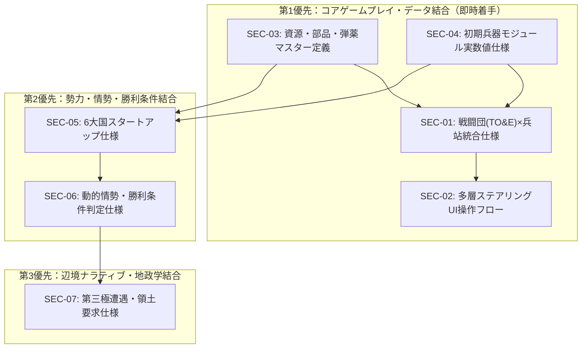

# 二次的不足ドキュメント・システム統合仕様書体系 (Secondary Missing Specifications Architecture)

本ドキュメントは、[`MISSING_DOCUMENTS_ROADMAP.md`](./MISSING_DOCUMENTS_ROADMAP.md) および [`PENDING_ISSUES.md`](./PENDING_ISSUES.md) の議論・課題認識を踏まえ、**「概念・世界観設計（第1〜第3シリーズ）」から「ゲーム実装・データ定義・統合ロジック（第4〜第5シリーズ）」へ橋渡しを行うために必要な【2次的不足ドキュメント群】**を定義・整理した仕様体系書です。

---

## 1. 1次的文書（概念・設計思想）と 2次的文書（具象・結合仕様）の定義

これまでに策定された50件超のドキュメント群は「ゲームの面白さ、世界観、基本メカニクス思想（WHY & WHAT）」を確定させました（1次的文書）。
現在真に不足しているのは、これらを**「Rust / Bevy ECSコードおよびUI/データ構造としてそのまま実装・結合できる状態（HOW & DATA）」に落とし込む2次的仕様書（Secondary Specifications）**です。

```text
┌─────────────────────────────────────────────────────────────────────────────┐
│ 【1次的文書（思想・構想・基本ルール）】                                      │
│   ・諸兵科連合戦闘団（TO&E）思想      ・放射状Tech Webの概念                │
│   ・弾薬C規格・資源3層体系           ・自発的失踪者・自然国境の概念         │
│   ・4層ステアリングUIの理念           ・兵器世代（Gen 0〜Gen 4）の格差       │
└──────────────────────────────────────┬──────────────────────────────────────┘
                                       │
                                       ▼ （具体化・ブリッジ・相互結合）
┌─────────────────────────────────────────────────────────────────────────────┐
│ 【2次的不足文書（具象データ・状態遷移・UIフロー・実装ブリッジ）】            │
│                                                                             │
│  [A. 兵站・編成統合] ── 戦闘団(TO&E) × インフラ結合度 × 共食い整備State仕様 │
│  [B. 操作・UI統合]   ── 意図伝達・ドクトリンステアリング画面遷移・操作フロー │
│  [C. データ定義]     ── 資源・中間財・弾薬・消耗品マスター仕様書            │
│  [D. 兵器・編成定義] ── Gen 0〜Gen 2 モジュール・シャシー実数値カタログ     │
│  [E. 初期勢力配置]   ── 架空6大国のTurn 0初期アセット・ブートローダー工廠値 │
│  [F. 世界進行・判定] ── Civ型勝利条件・動的情勢推移・エンドレス継続判定式    │
│  [G. 第三極・外交]   ── 自発的失踪者接触・闇市・自然国境領土要求イベント式  │
└─────────────────────────────────────────────────────────────────────────────┘
```

---

## 2. 2次的不足ドキュメント群の分類と詳細目録

### 群A: 軍事・兵站・編成統合（最優先 / P1）

#### SEC-01: 戦闘団（TO&E）× 兵站・装備更新統合データ仕様書

- **ドキュメント名**: [`../force_structure/COMBAT_GROUP_LOGISTICS_INTEGRATION.md`](../force_structure/COMBAT_GROUP_LOGISTICS_INTEGRATION.md)
- **ステータス**: **初版策定済**
- **目的**: 増強師団・諸兵科連合戦闘団（空地統合・部隊単位体系）のインフラ結合度に応じた自動補給、兵站断絶時の稼働率低下と「共食い整備（Cannibalization）」のステートマシン定義。
- **主要定義内容**:
  1. **戦闘団（TO&E）の内部データ構造（部隊コレクション `Vec<SubUnit>`）**:
     - 2進数・倍々構造（小隊4両 ➔ 中隊16両 ➔ 大隊64両: 戦車2個中隊［32両］＋歩兵戦闘車［IFV］2個中隊［32両］）。標準師団規模の増強機甲戦闘団（戦車256両＋随伴重IFV256両）を代表定義。
     - 各部隊状態（健全 / 損傷 / 稼働不能 / 全滅）、現場改修（Block Field）フラグ。
  2. **自動プッシュ補給レート計算式**:
     - 親タイルの「インフラ結合度（0.00〜1.00）」および距離ボトルネックに基づく補給到達率。
  3. **兵站断絶時の状態遷移（State Machine）**:
     - `Normal` ➔ `Strained`（弾薬節約・速度低下） ➔ `Critical`（現場判断による共食い整備・旧式部品流用） ➔ `Exhausted`（戦闘不能・放棄）。
  4. **共食い整備（Cannibalization）ロジック**:
     - 同一シャシー・同一モジュールの共通化率に応じたパーツ融通成功率（装軌系85%、装輪系80%）。非再生産資産（初期高度兵器）の不可逆な消耗と現場改修化。
  5. **国家整備・運用ドクトリン（ステアリング）**:
     - 前線維持最優先、プラットフォーム温存、共通化厳格準拠の3整備方針。
     - 地域配備（恒常インフラ警備・低コスト）と機動運用（迅速転地・防衛力維持）のモード切替。
  6. **Bevy ECS実装用コンポーネント・システム定義**:
     - `CombatGroupLogistics`, `SubUnit`, `LogisticsState` 構造体。

---

### 群B: 操作系・UI/UX統合（最優先 / P1）

#### SEC-02: 多層ステアリングUI画面遷移および操作フロー仕様書

- **対象ディレクトリ**: `docs/specs/`
- **目的**: プレイヤーが国家指導者として「指示せず誘導する」ための画面レイアウト、イベント通知、承認ポップアップの動線設計。
- **主要定義内容**:
  1. **4層ステアリング画面レイアウト（ワイヤーフレーム）**:
     - マクロ大戦略画面（全体方針・共通化率スライダー）。
     - 方面軍（Theater）設定パネル（重点補給・共同管理領域）。
     - RFP（要求仕様）エディタ（火力/防護/機動/コストの4軸制御）。
  2. **移行ラグ・金型転換（Re-tooling）視覚化**:
     - ドクトリン変更時に発生する工廠ライン転換ゲージと、前線部隊の稼働率ペナルティ表示。
  3. **現場発イベント（Field Modification）承認フロー**:
     - 前線部隊が勝手に現地改修した「Block Field」車両を正式採用するか、原状復帰を命じるかの意思決定モーダルUI。
  4. **作戦ベクトル（Mission Vector）入力の操作プロトコル**:
     - マウスドラッグによる大戦略矢印描画と、部隊スタンス（急行・警戒・遅滞）トグルの連動。

---

### 群C: 資源・産業マスターデータ定義（高 / P2）

#### SEC-03: 資源・部品・弾薬マスター定義書（Data Dictionary）

- **対象ディレクトリ**: `docs/specs/`
- **目的**: `RESOURCE_ECONOMY_SYSTEM.md` で定義された概念モデルを、ゲームバランスが成立する具体的数値・入出力レートとして定義。
- **主要定義内容**:
  1. **一次資源 4種の基本スペック**:
     - エネルギー（蓄電容量・送電ロス係数）、構造鉱物、機能鉱物、バイオ原質の標準タイル産出レンジと保管制限。
  2. **二次中間財 4種の加工レシピと所要工数**:
     - 基礎機械部品、電子・論理コア、耐熱複合装甲板、規格化レーション（異星度に応じた栄養価・医療費補正）。
  3. **兵站消費財の消費モデル**:
     - C規格弾薬（戦闘1ラウンドあたりの消費量）、推進燃料（平坦/悪路/登坂移動コスト）、野戦交換部品（損耗回復レート）。

---

### 群D: 兵器・編成カタログ仕様（高 / P2）

#### SEC-04: 初期兵器モジュール・車台カタログ詳細実数値仕様書

- **対象ディレクトリ**: `docs/specs/`
- **目的**: [`concept_starter_modules_and_common_chassis_catalog.md`](../discussion/military_tactics/concept_starter_modules_and_common_chassis_catalog.md) の数値をゲーム実装用テーブルとして確定。
- **主要定義内容**:
  1. **3大基本シャシー実数値**:
     - Std-W6（装輪）、Std-T4（履帯）、Std-L4（多脚）の自重、積載限界、最高速度、整備係数、地形走破倍率テーブル。
  2. **初期武装（WPN-01〜04）ダメージ・弾薬テーブル**:
     - 25C機関砲、80C滑腔砲、重火炎放射器、自衛ミサイルの命中率・貫徹力・射程・1射消費弾薬量。
  3. **パワーパック・装甲（PWR/ARM/ELEC）データ**:
     - 出力重量比、バイオマス/メタン/水素燃費、装甲防護点（物理/熱/生体酸）。

---

### 群E: 初期勢力・スタートアップ定義（中 / P3）

#### SEC-05: 架空6大国初期保有アセット・スタートアップ仕様書

- **対象ディレクトリ**: `docs/specs/`
- **目的**: 競技的公平性を満たしつつ、各国の初期ブートローダー工廠特性と初期配備ユニットを規定。
- **主要定義内容**:
  1. **Turn 0 共通スターター戦力**:
     - 非資源消費型ユニット（探査バギー×2、軽警備小隊×2、監視杭×4）。
     - 虎の子Gen 0戦力（遠征型MIL-SPEC戦車×2小隊）の中央待機配備。
  2. **各国固有の初期ブートローダー工廠値**:
     - 帝国A（鋳造・重装甲ライン偏重）、大公国B（精密工作機械・低温適応）、連邦C（大量生産モジュール枠）、共和国D（電子・自動化先行）、共同体E（海洋・多脚設備）、連合F（モジュール標準化・規格適合力）。
  3. **首都・周辺タイルの初期インフラ結合度**:
     - 着陸船中枢（Tier 2相当）と初期動脈インフラの配置。

---

### 群F: ゲーム進行・情勢推移・勝利条件仕様（中 / P3）

#### SEC-06: 動的情勢推移・危機（Crisis）・Civ型勝利判定仕様書

- **対象ディレクトリ**: `docs/specs/`
- **目的**: 人為的フェーズ制を排除し、国家行動の累積によって発生する動的クライシスと、勝利後の継続プレイ仕様を規定。
- **主要定義内容**:
  1. **動的情勢メーター（Tension & Friction Index）**:
     - 国境接触、資源枯渇、エイリアン生息地圧迫による緊張度の自動蓄積ロジック。
  2. **4大勝利条件の判定フラグ**:
     - ① 軍事制覇（全主権解体・首都制圧）。
     - ② 宇宙港再建・本星帰還（巨大軌道エレベータ完成）。
     - ③ ガイア同化・生態系统御（惑星中枢意識との共生同調）。
     - ④ 超絶技術独占（アフィニティ極限到達・超越プロジェクト）。
  3. **「もう1ターンだけ続ける」継続プレイ挙動**:
     - 勝利達成後のスコア算出、勝利フラグ固定化、惑星全域統一・技術ウェブ完全開放までのフリープレイ維持。

---

### 群G: 第三極・国境地政学仕様（低 / P4）

#### SEC-07: 自発的失踪者・軍閥（第三極）遭遇・調達・領土要求イベント仕様書

- **対象ディレクトリ**: `docs/specs/`
- **目的**: 辺境の自発的失踪者コミュニティとの相互作用、闇市調達、自然国境に基づく領土主張の計算ロジック。
- **主要定義内容**:
  1. **失踪者コミュニティの種別と初期警戒度**:
     - 脱走労働者系（民生重機改造）、思想的逃亡者系、脱走兵混成軍閥。
  2. **接触インタラクション**:
     - 闇市調達（安価な未認可弾薬・バイオマス）、労働力吸収、あるいは強制掃討。
  3. **自然国境に基づく4段階領土主張（Territorial Claims）計算式**:
     - 河川・尾根・海峡による自然区分と、前哨基地・哨戒実績による実効支配スコアの算出アルゴリズム。

---

## 3. 作成ロードマップと依存関係マトリクス



---

## 4. 既存計画書（Roadmap / Pending Issues）との整合

本仕様書（`SECONDARY_MISSING_SPECS.md`）の策定に伴い、以下の通り既存の管理文書と整合が取れます：

1. **[`MISSING_DOCUMENTS_ROADMAP.md`](./MISSING_DOCUMENTS_ROADMAP.md)**:
   - 「第4シリーズ（統合・データ）」および「第5シリーズ（具体マスター）」としてリストされていた抽象項目を、本仕様書にて `SEC-01` 〜 `SEC-07` の具体的ドキュメントとして再定義・詳細化。
2. **[`PENDING_ISSUES.md`](./PENDING_ISSUES.md)**:
   - 未確定論点として残されていた「兵站とインフラ結合」「母星遺産Gen 0の自動共食い整備」「多層ステアリングUIの操作動線」「Civ型クリアと継続プレイ」の実装落とし込み先がすべて確定。
