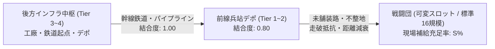
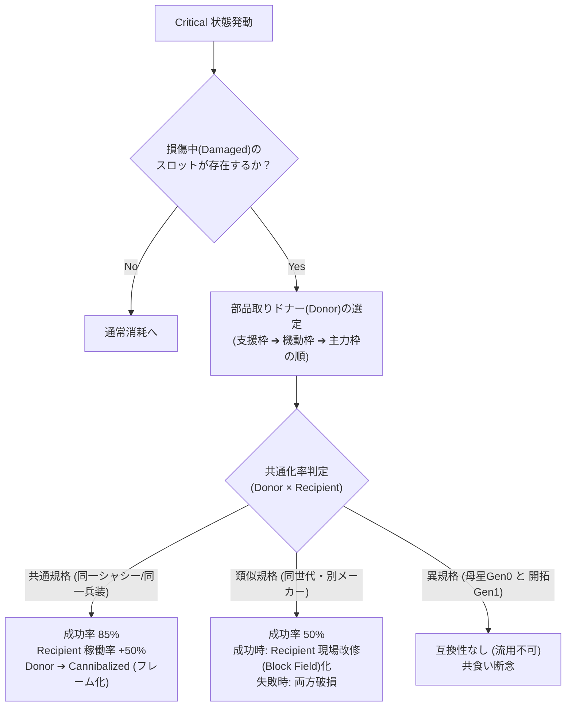

# 戦闘団（TO&E）× 兵站・装備更新統合データ仕様書 (SEC-01)

(Combat Group TO&E, Logistics Infrastructure & Cannibalization Specification)

本作（4X大戦略＋可変スロット戦闘団制＋脱都市タイル進展）における**「戦闘団（標準12〜18スロット規模目安、基準作例16スロット）の内部データ構造、インフラ結合度に応じた自動補給、兵站途絶時の稼働率低下、および現場判断による共食い整備（Cannibalization）のステートマシン」**を定義する統合仕様書である。

---

## 1. 増強師団・諸兵科連合戦闘団（TO&E）データ構造

大戦略マップ上の1コマとして運用される戦闘団は、歩兵・戦車・自走砲・防空・直協航空・工兵・補給が自己完結した**「増強師団／諸兵科連合旅団（約10,000〜15,000名、戦闘・支援車両・航空機 約500〜700両/機規模）」**に相当する。
内部階層は**「4両＝1小隊、4小隊＝1中隊（16両）、2個戦車中隊＋2個装甲化歩兵中隊＝1個大隊（約64両）」**という2進数倍々補完（2-2構成）を基底とする。

> [!NOTE]
> **スロット構成のシステム設計（動的コレクション・可変長）**:
> システム的には**「16スロット固定」や「最大16スロット上限」といったハードリミット制約は一切設けない**。
> 部隊規模（独立旅団の8〜12スロットから、重増強軍の20スロット前後まで）やドクトリンに応じ、戦闘団エンティティが保持するスロット群は可変長リスト（`Vec<CombatSlot>`）として実装される。
> 「16スロット」はあくまで**標準的な増強機甲・諸兵科連合師団における代表的な編成作例（部隊単位に即した標準目安モデル）**である。

```text
┌─────────────────────────────────────────────────────────────────────────────┐
│       増強師団・諸兵科連合戦闘団 (Combined Arms Combat Group TO&E) 構造     │
├─────────────────────────────────────────────────────────────────────────────┤
│                                                                             │
│  【基幹打撃群 (Core Strike / 装甲・重突撃)】 (スロット 1〜4)               │
│    ・Slot 01: 主力装甲小隊 A (戦車/重歩行機 4両)                            │
│    ・Slot 02: 主力装甲小隊 B (戦車/重歩行機 4両)                            │
│    ・Slot 03: 重突撃/駆逐小隊 (戦車駆逐車/突撃砲 3〜4両)                    │
│    ・Slot 04: 随伴歩兵戦闘小隊 (重IFV 4両 + 下車機械化歩兵班)               │
│                                                                             │
│  【機械化歩兵群 (Mechanized Infantry / 機動・面制圧)】 (スロット 5〜8)      │
│    ・Slot 05: 機械化歩兵小隊 A (装輪/装軌APC 4両 + 歩兵)                    │
│    ・Slot 06: 機械化歩兵小隊 B (装輪/装軌APC 4両 + 歩兵)                    │
│    ・Slot 07: 重火器支援小隊 (自走迫撃砲/対戦車ミサイル車 4両)              │
│    ・Slot 08: 戦闘工兵小隊 (地雷啓開・架橋・陣地構築車 3〜4両)              │
│                                                                             │
│  【間接火力・防空群 (Support & Air Defense / 特科)】 (スロット 9〜12)       │
│    ・Slot 09: 自走野戦砲兵小隊 (榴弾砲/滑腔破砕砲 3〜4両)                   │
│    ・Slot 10: 戦術誘導打撃小隊 (TELミサイルランチャー/長距離ロケット 2〜3両)│
│    ・Slot 11: 野戦複合防空小隊 (自走機関砲・短距離地対空ミサイル 3〜4両)    │
│    ・Slot 12: 機動偵察小隊 (装輪偵察車/軽多脚 4両)                          │
│                                                                             │
│  【情報・無人・兵站群 (Logistics & Autonomous / 支援核)】 (スロット 13〜16) │
│    ・Slot 13: 自律ドローン群統括小隊 (UAV/UGVマザーキャリア 2両)            │
│    ・Slot 14: 電子戦・戦術指揮小隊 (EW妨害・戦術C4I指揮車 2両)              │
│    ・Slot 15: 前方回収・整備修理小隊 (装甲回収車ARV 3両 + 整備工兵)         │
│    ・Slot 16: 師団補給・燃料弾薬小隊 (大型補給トラック群・機動タンク)       │
│                                                                             │
└─────────────────────────────────────────────────────────────────────────────┘
```

### 1.1 スロット単位のデータ構造（Rust / Bevy ECS想定）

```rust
/// 各スロットの車両・部隊エンティティ状態
#[derive(Debug, Clone, PartialEq)]
pub struct VehicleSlot {
    pub slot_id: u8,                   // 1..=16
    pub category: SlotCategory,        // MainCombat, Maneuver, FireSupport, Specialized
    pub chassis_id: String,            // 車台ID (例: "Std-T4", "Std-W6", "Std-L4")
    pub weapon_module_id: String,      // 兵装ID (例: "WPN-01", "WPN-02")
    pub powerpack_id: String,          // 動力ID (例: "PWR-01", "PWR-02")
    pub armor_module_id: String,       // 装甲ID (例: "ARM-01", "ARM-02")
    pub generation: Generation,        // Gen0(遺産), Gen1(開拓), Gen2(現地重工)...
    pub status: SlotHealthStatus,      // スロット健全度状態
    pub field_modified: bool,          // 現場現地改修 (Block Field) フラグ
}

#[derive(Debug, Clone, Copy, PartialEq, Eq)]
pub enum SlotCategory {
    CoreStrike,          // 基幹打撃群（スロット 1〜4: 主力戦車・突撃砲・重IFV）
    MechanizedInf,       // 機械化歩兵群（スロット 5〜8: APC・迫撃砲・戦闘工兵）
    SupportAirDefense,   // 間接火力・防空群（スロット 9〜12: 自走砲・TELミサイル・防空・偵察）
    LogisticsSupport,    // 情報・無人・兵站群（スロット 13〜16: ドローン母車・EW指揮・ARV・補給梯団）
}

#[derive(Debug, Clone, Copy, PartialEq)]
pub enum SlotHealthStatus {
    Operational { efficiency: f32 },   // 健全〜軽微損傷 (稼働効率 0.70..=1.00)
    Damaged { repair_turns: u8 },      // 要整備・現場修理中 (戦闘力半減)
    Cannibalized,                      // 部品取り済・稼働不能 (フレームのみ残存)
    Destroyed,                         // 完全撃破・欠損 (スロット空席)
}
```

---

## 2. インフラ結合度による自動プッシュ補給モデル

本作では前線部隊に「燃料切れ」や「弾薬運び」を1手ずつ命じることはせず、親タイルの**「インフラ結合度（Infrastructure Connectivity: 0.00〜1.00）」**と**「補給線距離（Supply Line Distance）」**に基づいて自動算出される。



### 2.1 補給充足率（Supply Satisfaction: $S$）の計算式

戦闘団が所在するタイルにおいて、毎ターン受け取れる補給充足率 $S$（0.00〜1.00）は以下で決定される：

$$S = \text{Clamp}\left( C_{\text{tile}} \times \left(1.0 - D_{\text{dist}} \times R_{\text{terrain}}\right) \times B_{\text{cap}}, \; 0.0, \; 1.0 \right)$$

* $C_{\text{tile}}$: 所在タイルのインフラ結合度（自国本国直結の舗装路・送電網＝1.00、道路端＝0.50、未開拓荒野＝0.05）。
* $D_{\text{dist}}$: 最寄り「補給拠点（Tier 1以上の設営地・港湾）」からの親タイル距離（1タイルごとに 0.15 減衰）。
* $R_{\text{terrain}}$: 地形走破抵抗係数（平原: 1.0、森林/山岳: 1.5、泥濘/湿地: 2.0、瘴気地帯: 2.5）。
* $B_{\text{cap}}$: 兵站帯域幅係数（同一親タイルに過密駐留する部隊数に応じた分配率。1部隊なら 1.00、2部隊で 0.75、3部隊以上で 0.50）。

---

## 3. 兵站途絶時のステートマシン（State Machine）

補給充足率 $S$ の推移および連続補給途絶ターン数に応じて、戦闘団全体の「兵站稼働ステート」が自律的に遷移する。

```text
┌─────────────────────────────────────────────────────────────────────────────┐
│                      兵站ステートマシン遷移図                               │
├─────────────────────────────────────────────────────────────────────────────┤
│                                                                             │
│      [Normal: 通常稼働] (S ≧ 0.70)                                          │
│             │                                                               │
│             ▼ (S < 0.70 が2ターン継続、または補給路遮断)                    │
│      [Strained: 兵站圧迫]                                                   │
│        ・弾薬節約射撃（火力 -25%）                                          │
│        ・最高移動力 -1マス                                                  │
│             │                                                               │
│             ▼ (S < 0.30 が2ターン継続)                                      │
│      [Critical: 補給危機] ──────────────────────────┐                       │
│        ・通常修理停止                               │ (共通化率 ≧ 50%)       │
│        ・現場判断による【自動共食い整備】発動 ◀─────┘                       │
│             │                                                               │
│             ▼ (S == 0.00 かつ 共食い不能)                                  │
│      [Exhausted: 兵站崩壊・活動不能]                                        │
│        ・移動不可、対空/支援射撃不能                                        │
│        ・敵接触時の降伏・自己自爆（Scuttling）判定                          │
│                                                                             │
└─────────────────────────────────────────────────────────────────────────────┘
```

### 3.1 ステート別挙動詳細

| ステート名 | 判定条件 | 戦術・大戦略ペナルティ | 現場整備小隊（Slot 16）の自律動作 |
| :--- | :--- | :--- | :--- |
| **Normal** | $S \ge 0.70$ | なし（稼働率 100%）。全火器自由射撃。 | 定期点検を実施。軽微損傷スロットを毎ターン全快。 |
| **Strained** | $0.30 \le S < 0.70$ | 移動速度 -20%、支援砲撃の弾薬割当量 -30%。 | 消耗部品の延命措置。重要スロット（1〜4）へ優先配分。 |
| **Critical** | $S < 0.30$ | 移動速度 -50%、反撃のみ許可（攻勢不可）。 | **共食い整備（Cannibalization）の自律実行**。破損車をパーツ取りに回し主力車を復旧。 |
| **Exhausted** | $S = 0.00$（3ターン） | 移動不能、全武装弾薬枯渇（白兵・自衛のみ）。 | 整備不能。敵性部隊と交戦時、名誉・ドクトリンに応じた投降/遺棄自爆を実行。 |

---

## 4. 共食い整備（Cannibalization）ロジック

`Critical` 状態に陥った戦闘団において、整備小隊（または現場兵士）は部隊の全滅を防ぐため、**「損傷の激しいスロットを犠牲にし、その部品を取り外して別スロットを稼働状態に戻す」**自律処理を行う。



### 4.1 非再生産・初期高度装備（Gen 0等）の共食い整備メカニクス

国内に金型や工作機械ラインが存在しない「非再生産装備（初期積載の高度MIL-SPEC品や鹵獲先進兵器など）」の共食い整備は、産業自立度と規格互換性の観点から以下の普遍的メカニクスで処理される。

1. **同型機からの部品取り（同一規格ドナー）**:
   * 抽出部品により受領機体は 100% 稼働状態に復旧する。
   * 一方で、ドナーとなった機体は部品を剥ぎ取られて**「恒久欠損（廃車・解体）」**となり、国内に該当金型ラインが新設・リバースエンジニアリングされるまで再生産・補充が効かない。
   * 大戦略ダッシュボードにおいて「非再生産資産の消耗アラート」が通知される。
2. **現地暫定規格（Gen 1等の低精度部品）の流用・無理な溶接**:
   * 規格不一致のため、流用成功率は基礎値 **25%** に低迷。
   * **成功時**: 車両は「現場改修型（Block Field）」となり、稼働率は復旧するが整備工数係数が増加し、スペック（電子戦・出力）が一定割合低下する。
   * **失敗時**: 駆動部・電子系統のショート等により、移植先スロットも致命的損傷を被る。
3. **本メカニクスのゲーム的意義**:
   * これは「母星だから特別扱い」なのではなく、**「国内にサプライチェーンが存在しない高度機材を、無理に前線維持させるか、後方温存して技術解析に回すか」という普遍的な資源・装備管理の意思決定**として機能する。

---

## 5. 国家整備ドクトリン（ステアリング介入）

プレイヤーは個々の共食い整備を手動でポチポチ指示することはできないが、**「国家整備ドクトリン（Maintenance Steering）」**をマクロ設定することで、全軍の整備方針を誘導できる。

```text
┌─────────────────────────────────────────────────────────────────────────────┐
│                 国家整備ドクトリン（ステアリング設定値）                    │
├─────────────────────────────────────────────────────────────────────────────┤
│                                                                             │
│  [1. 前線維持最優先 (Survival First)]                                       │
│    ・共食い整備の閾値を緩和（Strained 段階から部品流用を開始）              │
│    ・Gen 0 の共食い解体を許可（機動・火力スロットの頭数を死守）             │
│    ・効果: 包囲戦・遠征時の継戦能力 +40%、Gen 0 喪失ペースが加速            │
│                                                                             │
│  [2. プラットフォーム温存 (Platform Preservation - 標準)]                  │
│    ・Critical 状態でのみ同型間共食いを許可                                  │
│    ・Gen 0 の部品取り解体を原則禁止（稼働率低下を受け入れ後方回送）         │
│    ・効果: 兵器耐用年数の最大化、長期的な軍事資産の保全                     │
│                                                                             │
│  [3. 共通化厳格準拠 (Strict Modular Discipline)]                           │
│    ・規格外・類似モジュールの無理な現場溶接（Block Field化）を厳禁          │
│    ・故障車は共食いさせず、正規インフラ（工廠デポ）への牽引搬送を徹底       │
│    ・効果: 部隊共通化率 100% を維持、兵站が繋がっている際の修理速度 +30%     │
│                                                                             │
└─────────────────────────────────────────────────────────────────────────────┘
```

---

## 6. 実装用コンポーネント・システム対応（Bevy ECS）

```rust
use bevy::prelude::*;

/// 戦闘団の兵站・補給ステータスコンポーネント
#[derive(Component, Debug)]
pub struct CombatGroupLogistics {
    pub supply_satisfaction: f32,      // 0.00..=1.00
    pub strained_turns: u8,            // 連続兵站圧迫ターン数
    pub state: LogisticsState,         // Normal, Strained, Critical, Exhausted
    pub doctrine: MaintenanceDoctrine, // SurvivalFirst, Preservation, StrictModular
}

#[derive(Debug, Clone, Copy, PartialEq, Eq)]
pub enum LogisticsState {
    Normal,
    Strained,
    Critical,
    Exhausted,
}

#[derive(Debug, Clone, Copy, PartialEq, Eq)]
pub enum MaintenanceDoctrine {
    SurvivalFirst,
    PlatformPreservation,
    StrictModularDiscipline,
}

/// 毎ターンの兵站評価および自律共食い整備システム
pub fn evaluate_combat_group_logistics_system(
    mut query: Query<(&mut CombatGroupLogistics, &mut Vec<VehicleSlot>)>,
    tile_infrastructure_query: Query<&TileInfrastructureGrid>,
) {
    // 1. 各タイルのインフラ結合度・距離から supply_satisfaction を算出
    // 2. ステートマシンの遷移判定 (Normal ➔ Strained ➔ Critical ➔ Exhausted)
    // 3. Critical 時、ドクトリンに応じた自動共食い整備 (Cannibalization) の実行
}
```
