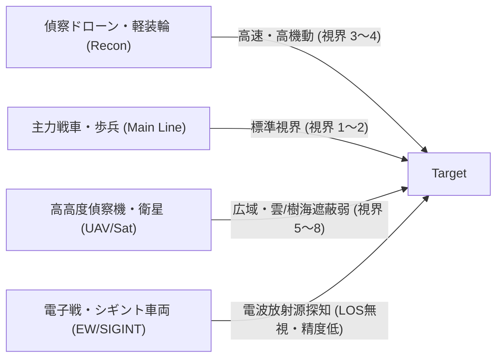
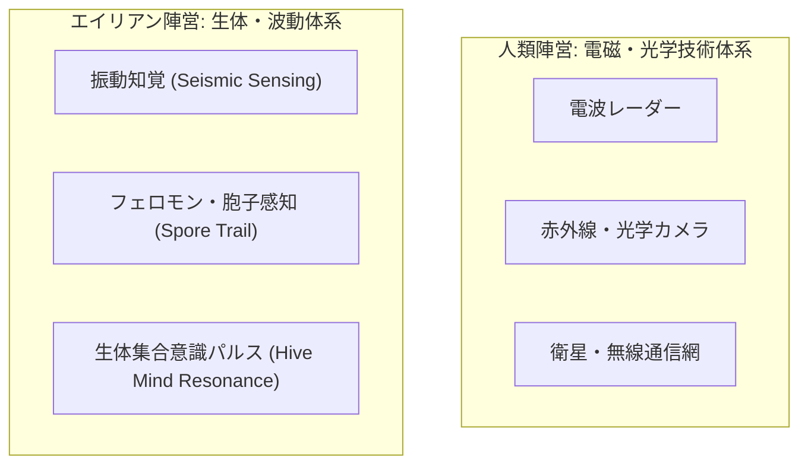

# 戦場の霧・索敵・視界システム仕様書 (Fog of War & Reconnaissance Mechanics)

本作における**「戦場の霧（Fog of War: FoW）」**、**「索敵・センサー・電子戦（ISR & EW）」**、**「大戦略マップとサブタイル戦術戦闘における多層視界構造」**、および**「エイリアン生態・ステルス・不完全情報ゲームメカニクス」**を規定する基本仕様書である。

---

## 1. 基本設計思想：不完全情報と「探知のグラデーション」

従来の4Xゲームの多くは、マップ状態を「未踏（完全な黒塗り）」「視界外（地形のみ見える半透明）」「視界内（敵ユニットが完全に見える）」という単純な3値で処理してきた。
しかし、本作の目指す**「リアルなSFミリタリー戦略」**および**「未知のエイリアン性状の解明」**においては、以下のような**「探知のグラデーション（多層情報）」**が不可欠となる。

```mermaid
flowchart TD
    L0["レベル0: 未踏・暗黒 (Unexplored / Terra Incognita)"] -->|探査ユニット進入・衛星| L1["レベル1: 地図情報 (Explored / Shrouded)"]
    L1 -->|基礎視界内 (Line of Sight)| L2["レベル2: 動体・熱源反応 (Unidentified Contact)"]
    L2 -->|精密センサー・至近距離・電子戦解析| L3["レベル3: 識別完了 (Identified Unit)"]
    L3 -->|軍事諜報・深層スキャン・戦闘接触| L4["レベル4: 完全情報 (Full Telemetry / TO&E解析)"]
```

1. **多段階の探知レベル (Contact Levels)**:
   - 単に「いる / いない」ではなく、「何らかの巨大な振動・電波源がある（正体不明の点）」「正規軍装甲部隊かエイリアン中型群か」「残存兵力・装備モジュール構成」へと、索敵深度に応じて判明情報が深まる。
2. **大戦略とサブタイル（343マス）の視界連動**:
   - 大戦略（マクロ）タイルの視界範囲は、内部のサブタイル戦術戦闘における初期展開や砲兵支援のLOS（射線）に直結する。
3. **電磁・音響・生体シグネチャの非対称性**:
   - 人類勢力は「レーダー・光学・無線通信」に頼り、エイリアンは「地中振動・フェロモン・生体パルス・胞子雲」に反応する。

---

## 2. マップ上の視界状態（Visibility States）

各大戦略タイル（`HexCoord`）およびサブタイル（Sub-Hex）は、各勢力ごとに以下の視界状態を持つ。

| 視界区分 | 呼称 | 地形・インフラの表示 | 敵・エイリアン部隊の表示 | 備考 |
| :--- | :--- | :--- | :--- | :--- |
| **State 0: 暗黒** | **Terra Incognita (未踏)** | 非表示（漆黒の霧） | 非表示 | ゲーム開始時の未踏査領域。高度・塩分・資源も一切不明。 |
| **State 1: 地図記憶** | **Explored / Shrouded (過去踏査)** | 最後に観測した状態（静止情報） | 原則非表示（幽霊影の可能性あり） | 地形、河川、過去の都市・施設位置のみ表示。直近の部隊移動や施設破壊は非更新。 |
| **State 2: 動体捕捉** | **Sensor Contact (未識別接触)** | リアルタイム更新 | **「？」アイコンまたは波形** | レーダー外縁や音響ブイで捕捉。大まかな規模（小隊/大隊/巨大生物）のみ判明。 |
| **State 3: 視認・照合** | **Visual Contact (視認・識別)** | リアルタイム更新 | **部隊種別・国籍・現在HP** | 直接視線（LOS）内。部隊シルエット、大隊種別（例: 第1装甲戦闘団）が判明。 |
| **State 4: 完全走査** | **Full Telemetry (詳細走査)** | リアルタイム更新 | **搭載モジュール・弾薬残量・士気** | 電子偵察機・近接交戦・監視ドローンによる。弱点属性や残弾数まで把握可能。 |

---

## 3. 視界伝播アルゴリズム（Line of Sight & Elevation）

### 3.1 標高と遮蔽（Elevation & Obstacles）

地形にはそれぞれ「標高（Height）」と「遮蔽度（Opacity）」が設定されている。

```text
  [観測側: 丘陵/山岳]  ──── 射線 (LOS) ────▶  [低地の森林の背後]
       (高所有利)                                (遮蔽により不可視)
          ▲
         / \          [平原]          [森林/密林]       [標的]
        /   \           ＿               ▲▲▲             ■
       /     \＿＿＿＿＿/  \＿＿＿＿＿＿＿/   \＿＿＿＿＿＿＿/
```

- **視界判定の基本原則**:
  1. **低地から高地**: 遮蔽に関わらず高台表面は視認可能だが、高台の「向こう側の低地」は見通せない。
  2. **高地から低地**: 高所（Hills: 0.55, Mountains: 0.95）に陣取るユニットは、平原越しの視界範囲が +1〜+2 タイル拡大し、低地の森林（Forest: 0.35）の内部も看破しやすくなる。
  3. **森林・密林（Forest / Jungle）**:
     - 内部に進入した部隊は、外部からの探知距離が著しく減少する（密林カモフラージュ）。
     - 森林越しにその奥のタイルを見る場合、LOSが遮断される。

### 3.2 地形・環境ごとの視界補正

| 地形・環境 | 基礎視界（平地基準=1.0） | 遮蔽性能（隠蔽ボーナス） | 特殊視界ルール |
| :--- | :---: | :---: | :--- |
| **平原 (Plains)** | 1.0 (標準) | なし | 視界良好。全センサーがカタログスペック通りに機能。 |
| **丘陵 (Hills)** | 1.5 (広域) | 中 | 高台ボーナス（視界 +1）。逆側斜面は死角を形成。 |
| **温帯林 (Forest)** | 0.8 (遮蔽) | 高 | 進入部隊の被探知率 -30%。外部からの見通しをブロック。 |
| **熱帯樹海 (Jungle)** | 0.6 (重遮蔽) | 極高 | 進入部隊の被探知率 -60%。航空・光学スキャンをほぼ無力化。 |
| **山岳 (Mountains)** | 2.0 (超高所) | 完全遮蔽 | 通行不可。頂上観測所・レーダー施設があれば絶大な視界を提供。 |
| **瘴気湿地 (Toxic Swamp)**| 0.7 (電波障害) | 特殊（ガス遮蔽） | 生体パルス・レーダー減衰。視界 -1。通信障害リスク。 |
| **外洋・湖沼 (Ocean/Lake)**| 1.2 (平滑) | なし（水上）/ 完全（水中） | 水上艦は遠距離視認可能。潜水艦・海中エイリアンはソナー必須。 |

---

## 4. 索敵アセットと階層（Reconnaissance Assets）

軍団・師団および各種インフラは、それぞれ固有の索敵範囲・探知手段を持つ。

### 4.1 ユニット種別ごとの索敵特性



1. **地上偵察部隊（軽装輪車台・斥候・歩兵偵察班）**:
   - 視界: 2〜3ヘックス。
   - 特性: 森林・都市の内部に潜む敵を看破可能（「隠密看破」値が高い）。
2. **師団直協無人機（Recon Drone / UAV）**:
   - 視界: 3〜4ヘックス（飛行高度により地形遮蔽を無視）。
   - 特性: 天候や対空火器に脆弱。密林キャノピー下の歩兵は見落とす場合がある。
3. **高高度戦略偵察・軌道衛星（Orbital / High-Altitude Recon）**:
   - 視界: 広域（直径5〜8ヘックス）。
   - 特性: 大戦略マップ全体の動向・敵大部隊の移動を把握できるが、天候（嵐・瘴気雲）で遮られる。
4. **電子戦・信号探知（EW / SIGINT）**:
   - 視界: 見通し外（NLOS）探知。
   - 特性: 敵の無線通信・レーダー照射を捉えて「未識別動体（State 2）」としてプロット。敵が電波封止（無線沈黙）を行っている場合は探知不可。

### 4.2 固定インフラ・センサー網

| 施設名 | 設置要件 | 索敵・視界機能 | 維持費（毎ターン） |
| :--- | :--- | :--- | :--- |
| **前哨レーダーポスト (Radar Post)** | 土地利用: 軍事Tier 1 | 周囲 2ヘックスの常時視界（State 2以上） | 電力 1.0, 構造鉱物 0.2 |
| **地表波警戒レーダー (Planetary Radar)**| 土地利用: 軍事Tier 2, 技術: TECH_C_03 | 周囲 4ヘックスの見通し内探知、対空警戒 | 電力 3.0, 弾薬/部品 0.5 |
| **ソナー監視ブイ網 (Sonar Array)** | 沿岸・海洋・海峡タイル | 水中・水上移動体の常時探知（潜水艦・水棲エイリアン） | 電力 0.5, 構造鉱物 0.1 |
| **国境監視センサー杭 (Acoustic/IR Fence)**| 境界エッジ（Edge） | 境界を越境したユニットの即時アラート発報 | 電力 0.2 |

---

## 5. 電子戦・ステルス・偽装（EW, Camouflage & Stealth）

### 5.1 ステルス・カモフラージュ率（Stealth Rating）

各ユニットには `stealth_value: f32` (0.0 〜 1.0) が定義される。
探知側の `sensor_penetration` がこの値を上回らない限り、探知レベルは「State 1（不可視）」または「State 2（未識別反応）」にとどまる。

- **光学迷彩 / ギリースーツ / 熱シールド**:
  - 歩兵・軽特殊部隊が保持。森林・市街地で停止している場合、隣接マス（距離1）に入られるまで完全不可視。
- **レーダー吸波構造（RAM / ステルス機）**:
  - 航空機・高級戦闘車両。長距離防空レーダーの探知範囲を 1/3 に圧縮する。

### 5.2 電子戦・妨害（Jamming & Deception）

- **ノイズ・ジャミング（Area Jamming）**:
  - 敵のレーダー視界を奪い、State 3（視認）から State 2（未識別）または State 1（暗黒）へ退行させる。
- **欺瞞ジャミング・偽デコイ（Ghost Signatures）**:
  - レーダー画面上に「存在しない大部隊の影（ダミーシグナル）」を意図的に投影し、敵の防衛配置を欺く。

---

## 6. エイリアン勢力の非対称索敵（Alien Sensing & Ambush）

人類とエイリアン（先住知的種族 / 原生生物群）では、感覚器および索敵メカニズムが根本的に異なる。



### 6.1 エイリアンの知覚特性

1. **地中振動感知（Seismic Tremors）**:
   - 重戦車、自走砲、重列車、採掘プラントなどの**高重量・大出力機関**は、3〜4タイル離れていてもエイリアンに察知される。
   - 逆に、軽量な歩兵やホバー・浮上ユニット、電気駆動バギーは振動を出さないため近接可能。
2. **胞子雲・瘴気ネットワーク（Creep / Spore Vision）**:
   - 瘴気帯（Toxic Swamp）や巣窟（Nest）の周辺では、大気中の胞子全体が感覚網として機能し、人類の侵入者を常時視認（State 3）する。
3. **生態的擬態・環境同化（Biological Camouflage & Ambush）**:
   - スーパーロボット的な「地中潜行（土を掘って潜る）」ではなく、**「死角・地形の亀裂・原生樹海の林冠や腐植土壌への擬態・同化」**によって潜伏する。
   - 体表の外骨格や表皮を湿地泥・苔・岩石に偽装し、体温・心拍を極限まで落として休眠状態で待ち伏せる。至近距離（隣接マス）に入るか、高解像度の生体スキャナーを通さない限り視認できない。

---

## 7. 大戦略とサブタイル（343マス）の視界統合

戦術戦闘が発生した場合、大戦略マップでの視界状況が初期条件を決定する。

```text
┌─────────────────────────────────────────────────────────────────────────┐
│              大戦略マップの索敵状態 ──▶ サブタイル戦術マップへの反映      │
├─────────────────────────────────────────────────────────────────────────┤
│                                                                         │
│  【大戦略での探知レベル】                 【戦術戦闘開始時の初期配置】    │
│                                                                         │
│  State 4 (完全走査):                     全サブタイル (343マス) が完全可視 │
│  - 電子偵察機・直協ドローン支援あり        敵の全配置・兵科・予備隊が判明   │
│                                                                         │
│  State 3 (通常視認):                     自軍周囲のサブタイルのみ可視     │
│  - 前哨部隊による接触                     敵前衛のみ表示、森林・後方は暗黒 │
│                                                                         │
│  State 2 (未識別接触):                   初期配置時に敵が「？」影で表示   │
│  - 索敵不十分での接敵・奇襲遭遇           先制射撃不可、接近して視認が必要 │
│                                                                         │
│  State 1 / 0 (奇襲・不意打ち):           自軍周囲 2〜3マス以外完全暗黒     │
│  - 待ち伏せを受けた場合                   敵の初期先制奇襲ボーナス発生     │
│                                                                         │
└─────────────────────────────────────────────────────────────────────────┘
```

1. **支援砲撃の観測班（Forward Observer: FO）**:
   - 隣接大戦略タイルに展開する重砲・長距離ミサイルが戦術マップへ支援弾着を行うには、戦術マップ上の誰かが標的タイルを直接視認（LOS確保）している必要がある。
   - 視界が途切れた場合、砲撃散布界（CEP）が 2〜3 倍に拡大し、誤爆率が激増する。

---

## 8. データ構造設計案（Rust / Bevy ECS）

本作の ECS アーキテクチャ（Bevy 0.20系）に適合するコンポーネントおよびリソースの設計案である。

```rust
use bevy::prelude::*;
use std::collections::HashMap;
use crate::map::hex::HexCoord;
use crate::faction::types::FactionId;

/// 各タイルに対する探知段階
#[derive(Debug, Clone, Copy, PartialEq, Eq, PartialOrd, Ord, Hash, Reflect, Default)]
pub enum FogState {
    #[default]
    TerraIncognita, // 完全未踏（黒塗り）
    Shrouded,       // 地形記憶（半透明・過去情報）
    SensorContact,  // 未識別動体（波形・？）
    Visible,        // 完全視認
    DeepScan,       // 詳細走査（TO&E・残弾・HP完全判明）
}

/// 勢力ごとのマップ視界マップ（リソース）
#[derive(Resource, Debug, Clone, Default)]
pub struct FactionFogMap {
    /// 勢力ID -> (タイル座標 -> 視界状態)
    pub visibility: HashMap<FactionId, HashMap<HexCoord, FogState>>,
    /// 勢力ID -> 最後に観測された部隊の残影 (Ghost Contacts)
    pub ghost_markers: HashMap<FactionId, Vec<GhostContact>>,
}

/// 視界外に消えた部隊の最後の観測情報（残影）
#[derive(Debug, Clone, Reflect)]
pub struct GhostContact {
    pub coord: HexCoord,
    pub last_seen_turn: u32,
    pub estimated_faction: Option<FactionId>,
    pub contact_level: FogState,
}

/// ユニットや施設が持つ視界・索敵コンポーネント
#[derive(Component, Debug, Clone, Reflect)]
pub struct ReconEmitter {
    /// 基本視界半径（ヘックス数）
    pub base_radius: u32,
    /// 標高補正を無視できるか（航空機・UAV・高高度）
    pub ignore_terrain_height: bool,
    /// 隠蔽看破能力 (0.0 〜 1.0)
    pub sensor_penetration: f32,
    /// 電子戦探知（電波放射源を探知可能か）
    pub can_detect_radio: bool,
    /// 音響・振動センサー（潜水艦・重機甲の移動探知）
    pub seismic_sonar: bool,
}

/// ユニットの被探知・隠蔽特性コンポーネント
#[derive(Component, Debug, Clone, Reflect)]
pub struct StealthProfile {
    /// 光学・赤外線カモフラージュ度 (0.0=丸見え, 1.0=完全透明)
    pub optical_camo: f32,
    /// レーダー反射断面積 (RCS) 低減率
    pub radar_stealth: f32,
    /// 発生させる地中振動・騒音シグネチャ (重量・エンジン出力依存)
    pub acoustic_signature: f32,
    /// 電波封止（EMCON: Emission Control）発令中か
    pub emcon_active: bool,
}
```

---

## 9. 検討事項・オープンクエスチョン（Discussion Points）

1. **ターン更新時の「地図記憶（Shrouded）」情報の鮮度**:
   - 敵の都市や要塞は一度見つかれば大きく移動しないが、インフラTierの向上や破壊、防衛タレットの増設などをいつまで「過去の情報のまま」表示するか。
   - 案: 偵察衛星や定期偵察を行わない限り、古い建設計画のまま表示され、攻撃時に「知らぬ間に要塞化されていた」サプライズを許容する。
2. **マルチプレイヤーおよびAIの計算負荷（Performance）**:
   - 6大勢力 ＋ エイリアン巣窟群 × 数百〜数千ヘックスの視界線（LOS）計算を毎フレーム行うとCPU負荷が跳ね上がる。
   - 対策: タイル視界の更新は「部隊移動完了時」「ターン開始/終了時」のみ行い、空間インデックス（BVH / Chunking）で近傍のみ計算する。
3. **未識別接触（Contact Marker）のゲーム体験**:
   - 画面が「？」マークだらけになるとUIが煩雑になる恐れがある。
   - スケールに応じた表示の集約（例: 個別部隊ではなく「未確認動体群（Swarm Contact）」としてエリア表示）が必要。

