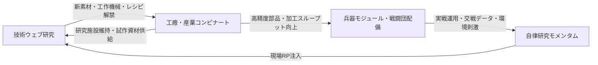

# 産業システムおよび技術ツリー試案仕様書 (Industrial & Technology Tree System Draft Specification)

本ドキュメントは、本作（4X大戦略＋脱・都市中心タイル進展＋諸兵科連合戦闘団制）における**「産業システム（Industrial System）」**および**「技術ツリー（Technology Web & Progression）」**の総合試案仕様書である。

本試案は、既存の確定仕様書（[`RESOURCE_ECONOMY_SYSTEM.md`](./RESOURCE_ECONOMY_SYSTEM.md)、[`RESOURCE_ITEM_DICTIONARY.md`](./RESOURCE_ITEM_DICTIONARY.md)、[`LAND_USE_SYSTEM.md`](./LAND_USE_SYSTEM.md)、[`TECHNOLOGY_WEB_DATA_TREE.md`](./TECHNOLOGY_WEB_DATA_TREE.md)）および各種詳細検討文書群を包括・統合し、実機ゲームループおよびデータ構造に落とし込んだものである。

---

## 第1部：産業システム試案 (Industrial System)

### 1.1 産業の基本理念：3層構造モデル

本作の産業は、単なる「都市の生産力ハンマー」ではなく、現実の高度製造業・防衛産業を反映した**3層構造（Layered Industrial Base）**としてモデル化される。

```text
+-------------------------------------------------------------------------+
| [Layer 3: 新興テック・特化モジュール (Emerging Tech Modules)]           |
|  - 自律AI、高度電子戦、エイリアン生体神経同調、指向性エネルギー          |
|  - 役割：「特異能力・尖った付加価値」の提供（ソフトウェア/アビオニクス）   |
+-------------------------------------------------------------------------+
                                    │ 統合・協業 (Integration)
+-------------------------------------------------------------------------+
| [Layer 2: 重工プラットフォーム (Prime Heavy Industry)]                  |
|  - 車体/機体フレーム、大型動力炉（水素直噴/ガスタービン）、大口径火砲    |
|  - 役割：「基礎スペック・耐久力・量産規模」の担保（プラットフォーム）    |
+-------------------------------------------------------------------------+
                                    │ 立脚・支台 (Underpinned by)
+-------------------------------------------------------------------------+
| [Layer 1: 基礎産業基盤・町工場群 (Industrial Base & Supply Chain)]       |
|  - 特殊鋼、微細加工、樹脂、規格ボルト、熟練工・治具プール                |
|  - 役割：タイルの工業集積度（コンビナート規模）によって自動計算される基礎値 |
+-------------------------------------------------------------------------+
```

1. **Layer 1: 基礎産業基盤（目に見えない下請け・サプライチェーン）**:
   - サブタイルの工業化レベルやインフラ結合度から自動集計される背景パラメータ。
   - 辺境前哨ではこれが低いため、高度な設計図があっても部品精度が出ず、最新兵器の稼働率・整備性が低下する。
2. **Layer 2: 重工プラットフォーム（ベース車体・機体・艦殻）**:
   - 装軌車体、8×8装輪車体、大型航空フレーム、艦体など。
   - 複数の兵種（戦車、歩兵戦闘車、自走迫撃砲など）が共通車体から派生することで、量産コストを大幅に抑制する。
3. **Layer 3: 新興・特化モジュール（協業コンポーネント）**:
   - 重工の堅牢な車体の上に、新興テック企業や現場工兵が開発したRWS、高精度センサ、生体キチン外殻をアドオン搭載する。

---

### 1.2 資源・加工サプライチェーン（3段階フロー）

資源は抽象通貨ではなく、質量（トン: $t$）およびエネルギー（$\text{MWh}$）に基づく物理加工フローをとる。

```text
[一次資源: 採掘・採取]
  ├── エネルギー (Energy / MWh): 発電所・地熱・核融合
  ├── 構造鉱物 (Structural Ore / t): 鉄・チタン・粗鉱石
  ├── 機能性鉱物 (Rare Minerals / t): レアアース・半導体結晶（特殊資源タイル）
  └── バイオ原質 (Biomass / t): 現地植物・藻類・瘴気菌類
            │
            ▼ 【工廠・コンビナート加工】(加工ロス・歩留まり反映)
[二次中間財: 部材・部材プール]
  ├── 基礎機械部品 (Standard Parts / t): 構造鉱物 1.2t + 0.5 MWh
  ├── 電子・論理コア (Logic Cores / kg): 機能鉱物 0.2t + 1.5 MWh
  ├── 複合装甲板 (Composite Armor / t): 構造鉱物 0.8t + 機能鉱物 0.3t + 1.0 MWh
  └── 規格化レーション (Standard Rations / t): バイオ原質 1.1t + 0.2 MWh
            │
            ▼ 【最終製品化・兵站集積】
[三次製品: 兵器モジュール & 兵站消費財]
  ├── C規格弾薬 (Munitions / t): 基礎機械部品 + エネルギー
  ├── 推進燃料 (Fuel / t): バイオ原質 + エネルギー
  ├── 野戦交換部品 (Field Spares / t): 基礎機械部品 + 電子コア
  └── 車台・兵装・モジュール (Chassis & Modules): 基礎機械部品 + 複合装甲 + 電子コア
```

---

### 1.3 工廠ライン管理と工学フリクション

戦況に応じて瞬時に別兵器を100%出力で量産できる非現実的なスイッチングを排し、現実の製造業における**「段取り替えフリクション」**と**「学習曲線」**をシステム化する。

#### ① 段取り時間と金型転換ラグ (Tooling Friction)

- 工場ラインの生産品目を変更（例: 民間建機から装甲戦闘車、履帯戦車から装輪装甲車）する際、一定ターン数の「段取り（Setup）期間」が発生する。
- **転換工期（ターン数）**は、前節で定義された産業類似度（0.0〜1.0）に反比例する：
  $$\text{転換所要ターン} = \text{基礎工期} \times (1.0 - \text{類似度})$$
  - 同一車体のバリアント換装（例: IFVから自走迫撃砲）: 1ターン（段取りほぼ即時）。
  - 同一ジャンル異車体（例: トラックから装輪装甲車）: 2〜3ターン。
  - 異分野転換（例: 造船ドックから航空機フレーム）: 5ターン以上（莫大な設備改修）。

#### ② 学習曲線と歩留まり（Yield Curve）

- 新製品の生産立ち上げ直後は、治具の微調整や作業員の習熟不足により**歩留まり（Yield）が低迷（60〜70%）**し、原材料の消費に対して完成品数が目減りする。
- 生産ロットを継続して回すことで歩留まりは徐々に向上し、**最大歩留まり（95〜98%）**へと漸近する。

#### ③ 部品共通化率（Commonality Bonus）

- 戦闘団（師団）内で同一メーカーの車体やC規格火器、共通モジュールが多く採用されている場合、**部品共通化率（0〜100%）**が上昇。
- 共通化率に応じて、部隊の野戦修理速度（交換部品消費効率）が最大+40%向上し、工廠側の予備部品ライン維持コストが逓減する。

---

### 1.4 機械を作る機械：ブートローダー工廠と工作機械プール

入植初期の人類は母星の超精密工作機械を持たず、限られた初期遺産（Gen 0）からスタートする。

1. **工作機械プール（Machine Tool Pool）**:
   - 国家全体の工業力の上限を規定する「母機（マザーマシン）」の保有総数。
   - 工場を新設するには、既存の工作機械プールから工作機械を拠出しなければならない。
2. **自己増殖サイクル（Bootstrapping）**:
   - 初期は粗製旋盤・フライス盤で簡易工作機械を自ら削り出し、徐々に工廠の生産枠（スループット）を拡大していく。
   - 高度なNC工作機械や半導体露光装置は、相応の技術ツリー（Tier 2以上）を解禁しなければ再生産できない。

---

## 第2部：技術ツリー試案 (Technology Web & Progression)

### 2.1 放射状ウェブ構造（Radial Tech Web）

ツリーは一本道ではなく、中央の「降着基盤（Landing Core / Tier 0）」から全方位へ同心円状に広がる放射状ウェブ構造をとる。

```text
                       【調和・共生 (Harmony)】
                     （異星生体融合・瘴気環境適応）
                                  ▲
                                  │
                               [Tier 3]
                                  │
                               [Tier 2]
                                  │
  【超越・自律 (Supremacy)】 ── [Tier 1] ── 【純血・母星化 (Purity)】
  （完全無人・量子知性・AI）     │     (Landing Core)    （重化学工業・テラフォーミング）
                             [Tier 0]
                                  │
                               [Tier 1]
                                  │
                               [Tier 2]
                                  │
                               [Tier 3]
                                  ▼
                       【極限物理・深層開発】
```

- **網羅の不可能性**: 1回のゲームですべての技術を獲得することは不可能であり、国家が進んだ研究ベクトルがその文明の兵器外見・産業特性・都市環境を決定づける。
- **幹技術（Trunk）と葉技術（Leaf）**:
  - **幹技術 (Trunk)**: 包括的な学問・パラダイム転換。研究コスト（RP）が高く、新時代の前提となる。
  - **葉技術 (Leaf)**: 幹から分岐する具体的モジュール、生産レシピ、特殊バフ。研究コストが低く即効性がある。

---

### 2.2 3大アフィニティとハイブリッド進化

技術を獲得するごとに、国家の3大思想パラメータ（アフィニティレベル 1〜10）が蓄積される。

| アフィニティ                | 思想と世界観                                             | 産業・工学の特徴                                         | 兵器・部隊の進化                                          | 固有勝利条件                                       |
| :-------------------------- | :------------------------------------------------------- | :------------------------------------------------------- | :-------------------------------------------------------- | :------------------------------------------------- |
| **Purity（純血・母星化）**  | 地球人類の形と尊厳を保ち、惑星を母星環境へと力づくで改変 | 重化学工業、高張力鋼、大口径C規格火砲、大気スクラバー    | 重機甲軍団、超重戦車、陸上戦艦、重自走榴弾砲              | **テラフォーミング完了**（地球環境復元と母星入植） |
| **Harmony（調和・共生）**   | 惑星の生態系と一体化し、遺伝子改変と生体触媒で生き抜く   | 異星生体組織解剖、生体触媒精錬、フェロモン誘導、生体外皮 | 多種族混成軍団、キチン装甲、瘴気自動回復、タイタン使役    | **惑星意識同調**（集合意識ハイブマインド統合）     |
| **Supremacy（超越・自律）** | 肉体と自然を捨て、完全自動化・量子知性・サイバネに進化   | 超微細ファブ、AESAセンサ、分散データリンク、無人化ドック | 完全無人戦闘団、二脚/多脚自律歩行機、指向性エネルギー兵器 | **全土電脳統御**（惑星全インフラの自律AI集権統合） |

#### デュアル・ハイブリッドアフィニティ

2つのアフィニティを並行して高めることで、固有の混成技術・シナジーが解禁される：

1. **Harmony × Supremacy（生体サイバネティクス / Bio-Cyber）**:
   - 生体神経とシリコン回路の融合。エイリアン生体への遠隔統御インプラント、自己増殖型ナノバイオ素材。
2. **Purity × Harmony（強化母星生態系 / Bio-Foundry）**:
   - 母星作物への異星毒素耐性付与（超耐性ハイブリッド作物）、高強度キチン鋼複合装甲。
3. **Purity × Supremacy（自動重火工 / Mecha-Purity）**:
   - 母星型重火砲・重装甲プラットフォームに完全自律射撃管制（FCS）と無人自動装填を統合した超精密要塞化ドクトリン。

---

### 2.3 技術ウェブ・ノードカタログ試案

#### Tier 0: 降着基盤 (Landing Core)

| ノードID    | ノード種別 | 技術名 (和名 / 英名)                      | 前提技術 | 必要RP | 解禁要素 (モジュール / 施設 / レシピ)               | アフィニティ付与 |
| :---------- | :--------- | :---------------------------------------- | :------- | :----- | :-------------------------------------------------- | :--------------- |
| `TECH_CORE` | Trunk      | 降着基盤工学 (Colony Landing Core)        | なし     | 0      | 基礎インフラ、探査バギー、初期工作機械、6C/8C小火器 | なし             |
| `TECH_C_01` | Leaf       | 船体解体冶金 (Salvage Metallurgy)         | `CORE`   | 50     | 構造鉱物回収、簡易溶接装甲、基礎機械部品レシピ      | Purity +1        |
| `TECH_C_02` | Leaf       | 密閉水耕循環 (Hydroponic Recirc)          | `CORE`   | 50     | 規格化レーション、初期温室ドーム、食料自給          | なし             |
| `TECH_C_03` | Leaf       | 地表波レーダー (Planetary Radar Survey)   | `CORE`   | 50     | 視界確保、資源探査、瘴気・地質タイルの可視化        | Supremacy +1     |
| `TECH_C_04` | Leaf       | 原生生体サンプリング (Biosphere Sampling) | `CORE`   | 50     | バイオ原質採取、解毒剤パック、生体分析              | Harmony +1       |

#### Tier 1: 基礎拡張・産業規格化 (Frontier Standardization)

| ノードID      | ノード種別 | 技術名 (和名 / 英名)                          | 前提技術      | 必要RP | 解禁要素 (モジュール / 施設 / レシピ)               | アフィニティ付与 |
| :------------ | :--------- | :-------------------------------------------- | :------------ | :----- | :-------------------------------------------------- | :--------------- |
| `TECH_TRK_P1` | Trunk      | 高張力重工冶金 (Heavy Machinery Engineering)  | `TECH_C_01`   | 180    | Gen 1 車台、粗製溶接装甲、装軌/装輪工廠             | Purity +2        |
| `TECH_LF_P11` | Leaf       | 共通ボルト・規格化令 (Standardized Fasteners) | `TECH_TRK_P1` | 90     | 部品共通化ボーナス+15%、工廠段取り替え工期 -1ターン | Purity +1        |
| `TECH_LF_P12` | Leaf       | C規格火器・迫撃砲架 (Caliber-C Munitions)     | `TECH_TRK_P1` | 100    | 120C自走迫撃砲、C規格弾薬専用加工ライン             | Purity +2        |
| `TECH_TRK_H1` | Trunk      | 原生生物ゲノム解析 (Alien Biome Sequencing)   | `TECH_C_04`   | 180    | 瘴気観測所、キチン外骨格切削、バイオ採取リグ        | Harmony +2       |
| `TECH_LF_H11` | Leaf       | 瘴気解離エアロゾル (Miasma Dissociation)      | `TECH_TRK_H1` | 90     | 携帯型除染キット、軽装歩兵の瘴気ダメージ低減        | Harmony +1       |
| `TECH_LF_H12` | Leaf       | 現地生体飼料精製 (Bio-Feedstock Extraction)   | `TECH_TRK_H1` | 100    | 異星動植物からのレーション変換（食料生産+25%）      | Harmony +2       |
| `TECH_TRK_S1` | Trunk      | 分散計算知性 (Distributed Cybernetics)        | `TECH_C_03`   | 180    | 電子・論理コア加工、基礎データリンク、NC工作機械    | Supremacy +2     |
| `TECH_LF_S11` | Leaf       | 自律工作機械群 (Automated NC Machine Tools)   | `TECH_TRK_S1` | 90     | 下請け町工場の生産スループット+20%                  | Supremacy +1     |
| `TECH_LF_S12` | Leaf       | 無人監視センサ網 (Unmanned Surveillance Net)  | `TECH_TRK_S1` | 100    | 監視杭、無人小型偵察ドローン小隊、早期警戒視界      | Supremacy +2     |

#### Tier 2: アフィニティ特化・構造転換 (Paradigm Divergence)

| ノードID      | ノード種別 | 技術名 (和名 / 英名)                          | 前提技術                     | 必要RP | 解禁要素 (モジュール / 施設 / レシピ)                | アフィニティ付与  |
| :------------ | :--------- | :-------------------------------------------- | :--------------------------- | :----- | :--------------------------------------------------- | :---------------- |
| `TECH_TRK_P2` | Trunk      | 結晶合金・重装甲技術 (Crystalline Metallurgy) | `TECH_TRK_P1`                | 450    | Gen 2/3 主力戦車車台、複合装甲板量産、160C重榴弾砲   | Purity +4         |
| `TECH_LF_P21` | Leaf       | 大気改変スクラバー (Atmospheric Scrubber)     | `TECH_TRK_P2`                | 220    | 固定式大気浄化塔、隣接タイルの瘴気永久消滅           | Purity +3         |
| `TECH_LF_P22` | Leaf       | 電熱化学砲ETC (Electro-Thermal Chemical Gun)  | `TECH_TRK_P2`, `TECH_TRK_S1` | 250    | 120C ETC戦車砲、貫徹力大幅向上（Mecha-Purity）       | Purity +2, Sup +2 |
| `TECH_TRK_H2` | Trunk      | 生体触媒・神経共鳴 (Biocatalytic Synapse)     | `TECH_TRK_H1`                | 450    | 有機触媒リアクター、常温精錬、多種族混成軍団編成     | Harmony +4        |
| `TECH_LF_H21` | Leaf       | キチン重工複合材 (Chitin-Steel Composite)     | `TECH_TRK_H2`, `TECH_TRK_P1` | 240    | キチン複合装甲（耐熱・耐酸+50%、Bio-Foundry）        | Harm +2, Pur +2   |
| `TECH_LF_H22` | Leaf       | 誘引フェロモン弾 (Pheromone Ordnance)         | `TECH_TRK_H2`                | 220    | フェロモン弾（野生エイリアンを敵国タイルへ誘導）     | Harmony +3        |
| `TECH_TRK_S2` | Trunk      | 光論理演算・統合射撃網 (Optical C4I Networks) | `TECH_TRK_S1`                | 450    | 超微細半導体ファブ、全域統合データリンク、歩行戦闘機 | Supremacy +4      |
| `TECH_LF_S21` | Leaf       | 自律二脚駆動系 (Autonomous Bipedal Actuator)  | `TECH_TRK_S2`                | 240    | 二脚歩行戦闘機モジュール、段差・不整地踏破           | Supremacy +3      |
| `TECH_LF_S22` | Leaf       | サイバネ神経直結 (Neural Cyber-Link)          | `TECH_TRK_S2`, `TECH_TRK_H1` | 250    | エイリアン遠隔統御、無人機即時リンク（Bio-Cyber）    | Sup +2, Harm +2   |

#### Tier 3: 極限物理・惑星特異点 (Apex Singularities)

| ノードID      | ノード種別 | 技術名 (和名 / 英名)                           | 前提技術      | 必要RP | 解禁要素 (モジュール / 施設 / レシピ)                 | アフィニティ付与 |
| :------------ | :--------- | :--------------------------------------------- | :------------ | :----- | :---------------------------------------------------- | :--------------- |
| `TECH_TRK_P3` | Trunk      | 惑星テラフォーミング (Planetary Remodeling)    | `TECH_TRK_P2` | 1200   | 巨大陸上戦艦、軌道アンカー、惑星改造中枢プラント      | Purity +6        |
| `TECH_LF_P31` | Leaf       | 210C 電磁投射砲 (EM-210C Railgun)              | `TECH_TRK_P3` | 600    | 超大型レールガン、大戦略2タイル先へのスタンドオフ砲撃 | Purity +4        |
| `TECH_TRK_H3` | Trunk      | 惑星集合意識覚醒 (Planetary Gaia Awakening)    | `TECH_TRK_H2` | 1200   | 生体タイタン共鳴神経、タイタン級使役、完全生体融合    | Harmony +6       |
| `TECH_LF_H31` | Leaf       | 生体自己修復外皮 (Regenerative Bio-Armor)      | `TECH_TRK_H3` | 600    | 戦闘中・非戦闘時の損耗自動急速再生、酸噴射砲          | Harmony +4       |
| `TECH_TRK_S3` | Trunk      | 完全自律オムニ知性 (Omni-Autonomous Intellect) | `TECH_TRK_S2` | 1200   | 搭乗員ゼロ完全無人戦闘団、量子ドローン網、AI司令部    | Supremacy +6     |
| `TECH_LF_S31` | Leaf       | 指向性高出力レーダー網 (DEW Interceptor Grid)  | `TECH_TRK_S3` | 600    | 高出力レーザー迎撃、ドローンスウォーム一括無力化      | Supremacy +4     |

---

### 2.4 自律研究モメンタムと国家ステアリング

研究開発は、プレイヤーによる万能な神視点選択ではなく、**「現場の自律的な研究進展（ボトムアップ）」**と**「指導者の政策誘導（トップダウン）」**の力学として進行する。

```text
┌─────────────────────────────────────────────────────────────────────────────┐
│                       自律研究とステアリングの力学                          │
├─────────────────────────────────────────────────────────────────────────────┤
│                                                                             │
│  [現場の産業・交戦・環境刺激] ───> 【基礎研究モメンタム (Research Momentum)】 │
│  （鉱山多 = 冶金が自然進捗）          │                                     │
│  （エイリアン交戦多 = 生体が加速）    ▼                                     │
│                              【研究スロット】                               │
│                                     ▲                                       │
│  [指導者ステアリング] ──────────────┘                                       │
│  （重点特許指定、研究奨励金、産学官ドクトリン）                             │
│                                                                             │
└─────────────────────────────────────────────────────────────────────────────┘
```

1. **現場起因の自律研究モメンタム (Research Momentum)**:
   - **交戦刺激**: 実戦で重砲を多用すれば火薬・火工品技術、エイリアンと多頻度交戦すれば生体防護技術へ毎ターン自律的にRPがプールされる。
   - **産業構造刺激**: 鉱山や製鉄コンビナートが多い国家では冶金技術、過酷な地震・火山帯に都市がある場合は免震・耐震技術が自然進捗する。
2. **指導者によるステアリング介入 (Steering Controls)**:
   - **重点特許の指定 (Priority Focus)**: 指定技術へ国家予算を注入し、研究速度を+50〜+100%加速。
   - **研究奨励金 (Grants)**: 3大アフィニティのいずれかに税制優遇を与え、民間学術機関をその方向へ誘導。
   - **研究転換フリクション (R&D Friction)**: 重工業ばかり進めていた国家が突如生体共生へステアリングを切り替えた場合、研究者コミュニティの再編のため数ターンの移行ラグ（進捗鈍化）が発生する。

---

### 2.5 戦場残骸解析（Forensics）とリバースエンジニアリング

戦闘終了時、激戦地タイルに残された残骸から知見を獲得する。

- **残骸法医学 (Battlefield Forensics)**:
  - 工兵・調査戦闘団を残骸タイルに派遣・調査させることで、敵兵器の装甲・FCSコード・弾薬規格データを抽出。
  - 自国より進んだ世代（Tier）の技術に対して**固定値RPボーナス（10〜25%）**を獲得。
- **リバースエンジニアリングの制約**:
  - 知見を得ても、自国の工作機械プールや素材サプライチェーン（Layer 1/2）が追いついていなければ、即座に量産することはできない。

---

## 第3部：産業と技術ツリーの相互連動モデル

産業と技術は独立しておらず、互いに相手のボトルネックを解消し発展をドライブする閉ループを形成する。



1. **技術から産業への還元**:
   - 葉技術の獲得により、新しい中間財レシピ（キチン複合装甲、ETC給電ユニット）や新工作機械が工廠ラインに投入可能となる。
   - 規格化令（Standardization）の獲得により、段取り替え工期や部品共通化率が直接改善される。
2. **産業から技術への還元**:
   - サブタイルの工業集積度（コンビナートTier）が高まることで、国家の基礎研究ポイント（RP）出力が増大する。
   - 特殊素材（機能鉱物、バイオ原質）が安定供給されて初めて、先端技術の実証実験・プロトタイプ製造が可能となる。

---

## 第4部：Rust / Bevy ECS 実装データアーキテクチャ案

ゲームエンジン（Bevy ECS）上で本システムを実装するための設計定義。

```rust
use bevy::prelude::*;
use std::collections::{HashMap, HashSet};

// ==========================================
// 1. 産業システム (Industrial ECS)
// ==========================================

/// 工廠の製造ライン
#[derive(Component, Debug, Clone, Reflect)]
pub struct IndustrialProductionLine {
    /// 生産対象のモジュール/兵器ID
    pub target_item_id: String,
    /// 産業ジャンル (IND-1 〜 IND-8)
    pub genre: u8,
    /// 目標生産数 (個数またはトン)
    pub target_quantity: u32,
    /// 現在の完成数
    pub completed_quantity: u32,
    /// 1ターンあたりの最大スループット (t/ターン)
    pub max_throughput_tons: f32,
    /// 現在の歩留まり率 (0.60 〜 0.98)
    pub current_yield_ratio: f32,
    /// 治具・金型転換状態
    pub tooling_state: ToolingState,
}

/// 金型・段取り替えの状態
#[derive(Debug, Clone, Reflect)]
pub enum ToolingState {
    /// 安定稼働中
    Ready,
    /// 段取り替え中（残り所要ターン数, 転換元アイテムID）
    Reconfiguring { remaining_turns: u8, previous_item_id: String },
}

/// 国家・拠点の工作機械プール
#[derive(Resource, Debug, Clone, Default, Reflect)]
pub struct MachineToolPool {
    /// 汎用工作機械総数
    pub total_machine_units: u32,
    /// 現在ラインに割り当てられている数
    pub allocated_machine_units: u32,
    /// NC・高精度工作機械の比率 (0.0 〜 1.0)
    pub advanced_precision_ratio: f32,
}

// ==========================================
// 2. 技術ツリー・研究開発 (Technology ECS)
// ==========================================

/// 3大アフィニティ蓄積ポイント
#[derive(Component, Debug, Clone, Copy, Default, Reflect)]
pub struct AffinityScore {
    pub purity: u32,
    pub harmony: u32,
    pub supremacy: u32,
}

/// 技術ノード定義
#[derive(Debug, Clone, Reflect)]
pub struct TechNodeDefinition {
    pub id: String,
    pub name: String,
    pub tier: u8,
    pub is_trunk: bool,
    pub prerequisites: Vec<String>,
    pub required_rp: u32,
    pub affinity_gain: AffinityScore,
    pub unlocked_recipes: Vec<String>,
    pub unlocked_modules: Vec<String>,
}

/// 全技術ノード辞書
#[derive(Resource, Debug, Clone, Default)]
pub struct TechWebRegistry {
    pub nodes: HashMap<String, TechNodeDefinition>,
}

/// 国家の研究進捗コンポーネント
#[derive(Component, Debug, Clone, Default, Reflect)]
pub struct FactionResearchProgress {
    /// 解禁済み技術ID一覧
    pub unlocked_techs: HashSet<String>,
    /// 各技術の蓄積研究ポイント (RP)
    pub accumulated_rp: HashMap<String, u32>,
    /// 現場起因の自律研究モメンタム (毎ターン蓄積される自然進捗)
    pub research_momentum: HashMap<String, f32>,
    /// 指導者が重点指定したステアリング対象技術ID
    pub steering_target: Option<String>,
    /// ステアリング移行ラグ（停滞ターン）
    pub steering_friction_turns: u8,
}

// ==========================================
// 3. ターン更新システム設計 (Execution Systems)
// ==========================================

/// 産業ラインの毎ターン進捗・歩留まり更新システム
pub fn industrial_production_update_system(
    mut lines: Query<&mut IndustrialProductionLine>,
    // 資源在庫リソースや電力状況を参照
) {
    for mut line in lines.iter_mut() {
        match &mut line.tooling_state {
            ToolingState::Reconfiguring { remaining_turns, .. } => {
                if *remaining_turns > 1 {
                    *remaining_turns -= 1;
                } else {
                    line.tooling_state = ToolingState::Ready;
                    line.current_yield_ratio = 0.65; // 転換直後の初期歩留まり
                }
            }
            ToolingState::Ready => {
                // 生産実行 & 歩留まり向上（学習曲線）
                line.current_yield_ratio = (line.current_yield_ratio + 0.05).min(0.98);
                // 投入資源量 × 歩留まり に応じて製品完成
            }
        }
    }
}

/// 自律研究モメンタムと国家ステアリングによるRP更新システム
pub fn research_progression_system(
    registry: Res<TechWebRegistry>,
    mut researches: Query<(&mut FactionResearchProgress, &mut AffinityScore)>,
) {
    for (mut research, mut affinity) in researches.iter_mut() {
        // 1. 現場モメンタムによる自律加算
        for (tech_id, momentum) in research.research_momentum.iter() {
            let entry = research.accumulated_rp.entry(tech_id.clone()).or_insert(0);
            *entry += *momentum as u32;
        }

        // 2. 指導者ステアリングの集中注入
        if let Some(target_id) = &research.steering_target {
            if research.steering_friction_turns > 0 {
                research.steering_friction_turns -= 1;
            } else {
                let entry = research.accumulated_rp.entry(target_id.clone()).or_insert(0);
                *entry += 50; // 国家重点配分RP
            }
        }

        // 3. 技術完了判定
        let mut newly_unlocked = Vec::new();
        for (tech_id, rp) in research.accumulated_rp.iter() {
            if let Some(def) = registry.nodes.get(tech_id) {
                if *rp >= def.required_rp && !research.unlocked_techs.contains(tech_id) {
                    newly_unlocked.push(tech_id.clone());
                }
            }
        }

        for tech_id in newly_unlocked {
            research.unlocked_techs.insert(tech_id.clone());
            if let Some(def) = registry.nodes.get(&tech_id) {
                affinity.purity += def.affinity_gain.purity;
                affinity.harmony += def.affinity_gain.harmony;
                affinity.supremacy += def.affinity_gain.supremacy;
            }
        }
    }
}
```

---

## 第5部：ドキュメント相互参照

- [GAME_DESIGN.md](../GAME_DESIGN.md) - ゲーム基本設計書
- [specs/RESOURCE_ECONOMY_SYSTEM.md](./RESOURCE_ECONOMY_SYSTEM.md) - 資源・経済・サプライチェーン体系目録
- [specs/RESOURCE_ITEM_DICTIONARY.md](./RESOURCE_ITEM_DICTIONARY.md) - 資源・部品・弾薬マスター定義書
- [specs/LAND_USE_SYSTEM.md](./LAND_USE_SYSTEM.md) - 土地利用・開発システム仕様書
- [specs/TECHNOLOGY_WEB_DATA_TREE.md](./TECHNOLOGY_WEB_DATA_TREE.md) - 技術ウェブ・研究開発データツリー仕様書
- [discussion/industry_logistics/concept_industry_structure.md](../discussion/industry_logistics/concept_industry_structure.md) - 産業構造の検討
- [discussion/world_progression/concept_technology_tree_structure.md](../discussion/world_progression/concept_technology_tree_structure.md) - 研究開発・技術ウェブ設計仕様書
- [discussion/world_progression/concept_three_pillar_tech_progression.md](../discussion/world_progression/concept_three_pillar_tech_progression.md) - 3大並列技術体系仕様書
- [discussion/industry_logistics/concept_bootloader_and_national_supply_chains.md](../discussion/industry_logistics/concept_bootloader_and_national_supply_chains.md) - ブートローダー産業仕様書
