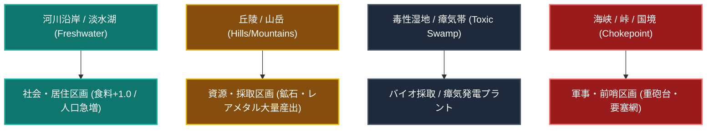

# 土地利用・開発システム仕様書 (Land Use & Development System Specification)

本ドキュメントは、本作（4X大戦略＋脱・都市中心タイル進展＋諸兵科連合戦闘団制）における**「土地利用（Land Use）」、「区画整備（Zoning & Development）」、「地目転換」、「地形改変・環境適応」**の総合メカニクスおよびデータ構造を規定する仕様書です。

※ルールに従い、本ドキュメント内の内部リンクはすべてリポジトリ内相対パス（例: `./docs/...`, `../src/...`）で記述されています。

---

## 1. 思想的背景と設計理念

### 1.1 「脱・都市中心」から「土地利用（Land Use）」への昇華

本作では、従来の4Xに見られる「万能な都市を1マス建てて周囲を勝手に支配する」モデルを廃止し、**全タイルが対等な土地であり、人間の介在とインフラによって役割を獲得する「タイル個別化（Tile-Centric System）」**を採用しています（参照: [concept_tile_centric_expansion.md](../discussion/map_tile/concept_tile_centric_expansion.md), [concept_tile_progression_system.md](../discussion/map_tile/concept_tile_progression_system.md)）。

本仕様書が定義する「土地利用システム」は、この思想を実用的なゲームメカニクスとして落とし込み、**「どのタイルを、どのような地目・産業目的で利用し、どのように相互接続・高度化させるか」**という国土計画・地域経営の楽しさを提供します。

```text
【土地利用サイクルの本質】
 自然地形・潜在資源 (Potential)
       │
       ▼  工兵・インフラ延伸 (Artery Connectivity)
 区画指定・地目決定 (Land Zoning: 4大カテゴリ)
       │
       ▼  資材・維持エネルギー投入
 段階的発展 (Tier 0:未開地 ➔ Tier 1:前哨 ➔ Tier 2:運用 ➔ Tier 3:集積 ➔ Tier 4:要塞中枢)
       │
       ├─【繁栄】隣接シナジー・クラスター複合化（メガロポリス・コンビナート）
       └─【危機】兵站遮断・戦災 ➔ 稼働率崩壊 ➔ 荒廃・自然回帰・私設民兵化
```

---

## 2. 土地利用の4大基本カテゴリ（Land Zoning Categories）

各親タイルは、自然地形（平原・丘陵・森林・水域等）の上に、以下の**4つの土地利用区分（Land Use Category）**のいずれか1つを指定して開発・運用されます。

| 区分 | 英語名 | 主要機能・目的 | 代表的産出・効果 | 主な立地適性・地形 |
| :--- | :--- | :--- | :--- | :--- |
| **① 産業・生産** | **Industrial** | 兵器モジュール組立、弾薬・交換部品製造、精錬加工、町工場集積 | 構造鉱物（生産力）、C規格弾薬、野戦交換部品、工廠枠 | 平原、河川沿い、道路・鉄道幹線結節点 |
| **② 資源・採取** | **Extraction** | 鉱床掘削、深部地熱、バイオマス採取、高塩分塩湖リチウム採掘 | 粗原料（構造鉱物、機能鉱物、エネルギー、バイオ原質） | 山岳・丘陵、森林、毒性湿地、塩湖・海洋 |
| **③ 社会・居住** | **Habitation** | 人口収容、人工子宮（Ectogenesis）、研究学術、行政統治、農業 | 食料（バイオマス）、科学（研究）、実効支配度、人口枠 | 平原、淡水湖・河川沿岸（灌漑ボーナス） |
| **④ 軍事・防衛** | **Military** | 警戒防空、前線兵站デポ（FOB）、弾薬集積、長距離砲陣地、要塞 | 視界確保、迎撃火力、修理・補給速度、不屈防衛値 | 隘路、丘陵、国境・前線境界、海峡・島嶼 |

> [!NOTE]
> **未開発地 (Wilderness / Tier 0)**:
> 人の手が入っていない原野・自然状態。地目指定は未設定であり、インフラ網が隣接・到達した段階で工兵部隊または大戦略命令によって地目が指定（ゾーニング）されます。

---

## 3. 地形・水系と土地利用の適性（Suitability Matrix）

自然地形および水系（[WATER_AND_SALINITY_SYSTEM.md](./WATER_AND_SALINITY_SYSTEM.md)）は、土地利用の生産性や初期コストに強い影響を与えます。



### 3.1 地形別適性一覧

1. **平原 (Plains)**:
   - 整地コストが低く、あらゆる用途（居住、軽工業、農業）に万能。特に幹線インフラの敷設が容易。
2. **丘陵 (Hills) / 山岳 (Mountains)**:
   - 資源採取（鉱山）に極めて高い適性。山岳は通常通行不能だが、Tier 1以上の資源採取リグまたは観測所を開削可能。
   - 軍事利用時、高所からの視界・射程ボーナスと強固な掩体壕防御を提供。
3. **森林 (Forest) / 密林 (Jungle)**:
   - バイオマス採取・木材建材に優れる。森林を伐採して産業・居住区へ転換するか、原生生態系の研究・共生採取を行うかの選択。
4. **毒性湿地 (Toxic Swamp)**:
   - 人類の居住には不適（環境負荷・医療費大）だが、特異な瘴気エネルギー採取やバイオ兵器・耐環境研究区画として高いポテンシャルを持つ。
5. **水域（淡水湖・汽水・外洋・塩湖）**:
   - **淡水湖 (Fresh)**: 周辺タイルの居住区・農業に強力な灌漑ボーナス（食料+1.0）。
   - **高塩分・塩湖 (Hypersaline)**: 晶出塩・リチウム採取プラント（高生産力）。
   - **外洋・海洋 (Ocean)**: 海洋工学（埋立・固定式プラットフォーム・メガフロート）により海上工業・洋上風力/潮汐発電サイトへ発展可能。

---

## 4. 土地利用の発展段階（Tier 0 〜 Tier 4）と機能進化

すべての地目は、共通の5段階の進展度（Progression Tier）に沿って発展します。

```text
[Tier 0: 未開地] ──(設営命令)─→ [Tier 1: 仮設・前哨] ──(インフラ結合)─→ [Tier 2: 本格運用]
                                                                               │
[Tier 4: 要塞中枢複合] 敷地占有80% ←──(極限特化)─── [Tier 3: 高度集積] 敷地占有50% ───┘
```

### 4.1 Tier別 具体的展開マッピング

| 地目カテゴリ | Tier 1 (仮設・前哨) | Tier 2 (本格運用) | Tier 3 (高度集積) | Tier 4 (要塞・中枢複合) |
| :--- | :--- | :--- | :--- | :--- |
| **① 産業・生産** | **移動式修理デポ**・基礎部品交換・軽微な整備回復 | **標準モジュール工廠**・装輪・装軌車両組立・C規格弾薬量産 | **町工場・コンビナート**・下請け工房群自律集積・高精度部品・歩留まり向上 | **重工メガコンプレックス**・超大型陸上戦艦・二脚製造・ナノ鍛造・完全自働化工廠 |
| **② 資源・採取** | **露天試掘リグ**・粗原料の低効率回収・地質調査 | **自律採掘プラント**・鉱石・エネルギー安定搬出・パイプライン直結 | **原料精錬・破砕炉群**・高純度インゴット化・副産物（希ガス・希土類）抽出 | **深部地殻コア採掘網**・無尽蔵の資源抽出・地熱メガジェネレーター内包 |
| **③ 社会・居住** | **開拓設営テント群**・作業員応急宿営・簡易通信アンテナ | **加圧居住ドーム**・基礎市民自活・行政・初期水耕温室ファーム | **居住・研究学術特区**・人工子宮（Ectogenesis）稼働・適応技術研究所・商業区 | **惑星首府・大都市中枢**・超高層バイオドーム都市・国家大議会・宇宙港管制中枢 |
| **④ 軍事・防衛** | **警戒レーダーポスト**・視界確保・無線中継・小隊規模の野営 | **前線補給デポ (FOB)**・弾薬補給・野戦給油・防護タレット・有刺鉄線 | **要塞複合陣地**・多層防空ミサイルサイロ・重砲台・地下格納庫 | **不落の永久要塞 (Citadel)**・大型シールド発生器・地下核シェルター・要塞司令部 |

---

## 5. 地目転換と再開発（Land Re-zoning & Redevelopment）

戦況の推移や経済の発展に伴い、既存の土地利用を別の地目へと転換（リゾーニング）することが可能です。

### 5.1 地目転換のルールとフリクション（摩擦）

1. **転換のコストと時間（工期）**:
   - 既存の建造物群を解体・撤去し、新たな基盤を造成するため、**「解体・整地ターン（転換ラグ）」**が発生します。
   - Tierが高い施設ほど転換に要するターン数と資材コストが膨大になります。
2. **Tierの縮退（ペナルティ）**:
   - 地目を転換した場合、既存のTierは維持されず、**「Tier 1（前哨）」へリセット**されます。
   - ただし、整地率（Groundbreaking Score）や敷設済み幹線インフラ（道路・送電線・光ファイバー）は維持されるため、新規開拓地よりも迅速にTier 2・Tier 3へと再進展させることが可能です。
3. **産業スクラップと資源回収**:
   - 産業・資源施設を解体する際、投じた構造鉱物の一部（約30〜50%）が一時的な解体資源（Scrap Metal）として回収されます。

```text
【地目転換の推移フロー】
[現在: Tier 3 資源採掘区画]
       │
       ▼  指令: 「産業・生産区画へ地目転換」
[解体・再整地フェーズ (2ターン)] ── 産出停止・維持費半減・スクラップ回収
       │
       ▼
[転換後: Tier 1 産業仮設デポ] ── インフラ直結により通常より高速でTier 2へ昇格
```

---

## 6. 隣接シナジーと集積効果（Spatial Agglomeration）

単一のタイルだけでなく、隣接するタイルの土地利用同士が影響し合うことで、強力な**相乗効果（シナジー）**や**公害・排斥（デバフ）**が発生します。

### 6.1 プラスのシナジー（集積経済）

- **工業コンビナート（産業 × 資源）**:
  - 「産業タイル」に「資源採取タイル」が隣接している場合、輸送ロスがゼロとなり、部品製造の歩留まり向上・生産力+20%。
- **大都市圏クラスタリング（居住 × 居住）**:
  - 「居住タイル」同士が隣接することで「都市圏（Metropolitan Area）」を形成。人口成長率および科学研究ポイントに相互ボーナス。
- **水系灌漑（居住/農業 × 河川/淡水湖）**:
  - 淡水アクセスを持つ居住タイルは、食料生産が大幅に増加（バイオマス+1.0〜+2.0）。
- **縦深防御陣地（軍事 × 軍事）**:
  - 軍事タイル同士が隣接している場合、相互防空傘と重砲兵の交差射撃支援網が形成され、敵の突破確率が半減。

### 6.2 マイナスの干渉（環境・治安フリクション）

- **公害・排熱摩擦（重工業 × 居住）**:
  - Tier 3以上の重工業メガコンプレックスに隣接する居住タイルは、環境負荷（Environmental Hazard）が増大し、市民の不満度・風土病リスクが上昇。
- **エイリアン刺激（資源/重工業 × 瘴気帯/巣窟）**:
  - 大規模な採掘や排熱を伴う工業活動は、隣接するエイリアンの巣窟（Nest）の活性化度（Aggro）を急上昇させ、周期的なスウォーム襲来（報復攻撃）を誘発。

---

## 7. 実装データアーキテクチャ（Rust / Bevy ECS）

ゲームエンジン上で土地利用システムを表現するためのデータ構造定義です。

```rust
use bevy::prelude::*;
use crate::map::hex::HexCoord;
use crate::faction::FactionId;

/// 土地利用の大区分 (Land Use Category)
#[derive(Debug, Clone, Copy, PartialEq, Eq, Hash, Component, Reflect, Default)]
#[reflect(Component)]
pub enum LandZoning {
    /// 未開拓地（自然状態）
    #[default]
    Wilderness,
    /// ① 産業・生産 (Industrial & Manufacturing)
    Industrial,
    /// ② 資源・採取 (Resource & Extraction)
    Extraction,
    /// ③ 社会・居住 (Habitation & Civic)
    Habitation,
    /// ④ 軍事・防衛 (Military & Defense)
    Military,
}

/// タイル進展度階層 (Progression Tier 0〜4)
#[derive(Debug, Clone, Copy, PartialEq, Eq, PartialOrd, Ord, Hash, Component, Reflect, Default)]
#[reflect(Component)]
pub enum ProgressionTier {
    #[default]
    Tier0Wilderness,  // 未開地
    Tier1Outpost,     // 仮設・前哨
    Tier2Operational, // 本格運用
    Tier3Integrated,  // 高度集積
    Tier4FortifiedHub,// 要塞・中枢複合
}

/// タイルの土地利用・開発状態コンポーネント
#[derive(Component, Debug, Clone, Reflect)]
#[reflect(Component)]
pub struct TileDevelopment {
    /// 現在の土地利用地目
    pub zoning: LandZoning,
    /// 現在の進展Tier
    pub tier: ProgressionTier,
    /// 次のTierへの蓄積進捗 (0.00 〜 1.00)
    pub progress: f32,
    /// インフラ結合度 (0.00 〜 1.00: 道路・送電・通信)
    pub infrastructure_connectivity: f32,
    /// 実効稼働率 (0.00 〜 1.00: 補給や電力供給に依存)
    pub operational_efficiency: f32,
    /// 土地造成・整地率 (0.00 〜 1.00)
    pub groundbreaking_ratio: f32,
    /// 地目転換中フラグ（転換中なら残り所要ターン数）
    pub rezoning_countdown: Option<u8>,
}

impl TileDevelopment {
    pub fn new_wilderness() -> Self {
        Self {
            zoning: LandZoning::Wilderness,
            tier: ProgressionTier::Tier0Wilderness,
            progress: 0.0,
            infrastructure_connectivity: 0.0,
            operational_efficiency: 0.0,
            groundbreaking_ratio: 0.0,
            rezoning_countdown: None,
        }
    }

    /// タイルが有効に機能しているか
    pub fn is_active(&self) -> bool {
        self.tier > ProgressionTier::Tier0Wilderness && self.operational_efficiency > 0.1
    }
}
```

---

## 8. 関連ドキュメント・リンク

- 企画マスター設計書: [GAME_DESIGN.md](../GAME_DESIGN.md)
- タイル個別化・脱都市型拡張: [concept_tile_centric_expansion.md](../discussion/map_tile/concept_tile_centric_expansion.md)
- タイル共通進展度・1タイル1部隊制: [concept_tile_progression_system.md](../discussion/map_tile/concept_tile_progression_system.md)
- 水域・塩分濃度システム仕様書: [WATER_AND_SALINITY_SYSTEM.md](./WATER_AND_SALINITY_SYSTEM.md)
- 資源・経済・サプライチェーン体系目録: [RESOURCE_ECONOMY_SYSTEM.md](./RESOURCE_ECONOMY_SYSTEM.md)
- 大戦略動脈インフラ・中心サブタイル通過: [concept_infrastructure_grid_and_transit_artery.md](../discussion/map_tile/concept_infrastructure_grid_and_transit_artery.md)
