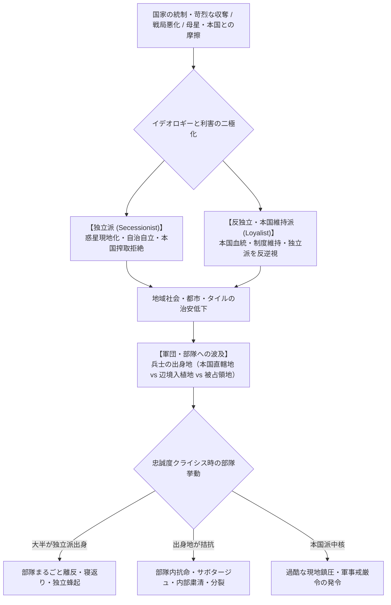
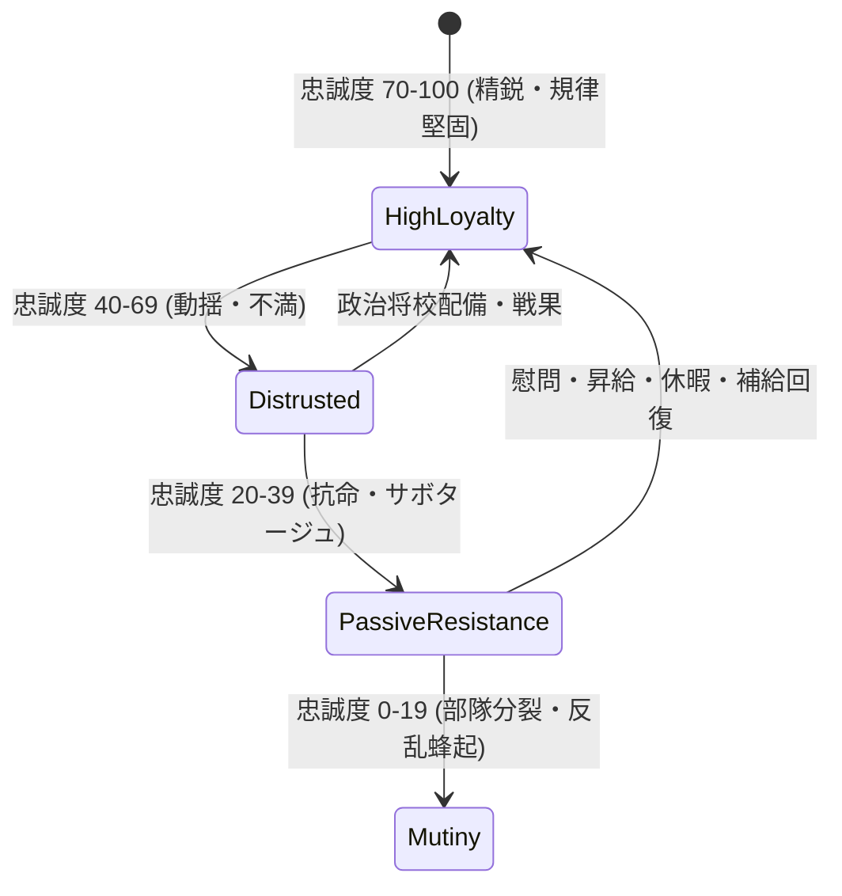
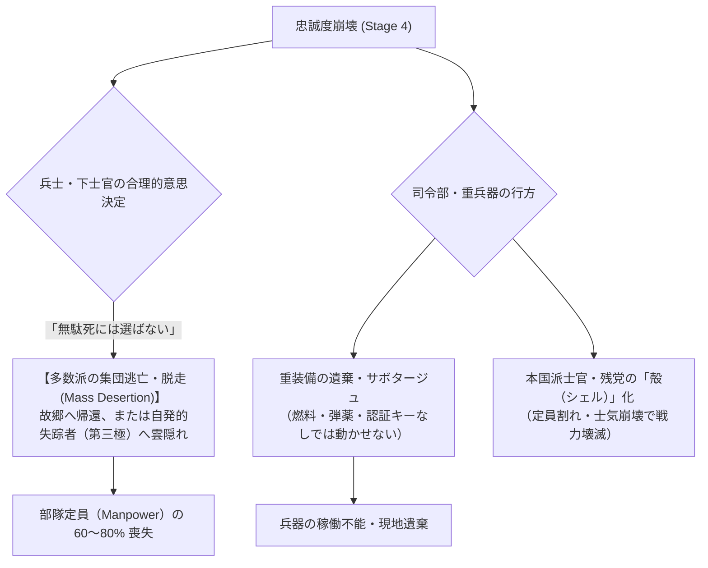

# 反乱・忠誠度・出身地別反乱力学仕様書 (Rebellion, Loyalty & Origin Dynamics Specification)

本作（4X大戦略＋諸兵科連合戦闘団制＋脱都市タイル進展）における**「市民・部隊の忠誠度（Loyalty）」**、**「独立派（Independence / Secessionist）と反独立派・本国維持派（Loyalist / Unionist）の派閥分裂」**、**「部隊人員の出身地構成（Homeland Demographics）と反乱・抗命・離反ダイナミクス」**、および**「反乱の発生プロセス・ゲームメカニクス」**を規定する基本仕様書である。

---

## 1. 基本設計思想：均質な反乱ではなく「多層的・出身地連動の分裂」

従来の4Xゲームにおける反乱は、「幸福度（不満度）が一定値を下回ると、ランダムに中立の反乱軍ユニットが湧く」という単純な乱数イベントになりがちであった。
しかし、本作の目指す**「過酷な入植惑星における政治的・軍事的リアリティ」**においては、反乱は以下の原則に基づいて発生する。



1. **二大政治潮流の対立（独立派 vs 反独立派）**:
   - **独立派（Secessionist / Planet-First）**: 「母星本国や国家中枢への朝貢・物資供出を止め、この過酷な入植惑星で自立・生存すべき」と主張。辺境開拓民、過酷労働者、現地生まれ（第2世代以降）が支持。
   - **反独立派 / 本国維持派（Loyalist / Unionist）**: 「母星本国との絆や国家の統合体制こそが唯一の正統性であり、独立は国家への反逆・野蛮への退行」と主張。特権官僚層、本国直轄軍、重工業コンツェルン幹部が支持。
2. **部隊人員の出身地（Demographics / Origins）連動**:
   - 軍団（Corps: 約1.2万〜1.5万人）や師団は、単なる記号的な戦闘力ではなく、**「どこで徴募・編成された人員か」**の人口動態データを持つ。
   - 故郷のタイルが独立派に傾いている時、その出身兵で構成された部隊に「故郷への武力鎮圧」を命じると、抗命・サボタージュ、最悪の場合は部隊ごと反乱軍に転落する。

---

## 2. 政治対立軸：独立派と反独立派の思想構造

各都市・親タイルおよび国家内部には、**「独立派（Secessionist）」**と**「本国維持派（Loyalist）」**の勢力比率（比率合計 1.0）が存在する。

| 派閥 | 思想・主張 | 主な支持層 | 不満が高まる要因 | 蜂起時の行動形態 |
| :--- | :--- | :--- | :--- | :--- |
| **独立派 (Secessionist)** | 「母星への資源収奪・本国至上命令を拒絶し、現地主権を確立せよ」 | 辺境開拓民、現地出身兵、炭鉱・農場労働者、急進派技術者 | 過酷な徴税・供出、強制徴募、自国優先ドクトリン、前線での消耗 | 独立自治政府の樹立宣言、自発的失踪者（第三極）との合流、ゲリラ戦 |
| **反独立派 / 本国維持派 (Loyalist)** | 「母星・国家中枢への忠誠こそ秩序の源。離反者は反逆者であり殲滅すべし」 | 本国派遣軍高官、官僚、旧貴族/党幹部、エリート工廠員 | 妥協的な自治承認、エイリアン共生・融和策、敗北主義的講和条約 | 軍事クーデター、強硬派戒厳令、独立派指導者の暗殺・粛清 |

---

## 3. 人員あたりの出身地体系（Manning Origins）

各軍団・師団（`concept_personnel_and_manning_standards.md` に基づく約14,000名）は、以下の出身地構成比率（`OriginDistribution`）を内部データとして保持する。

```text
┌─────────────────────────────────────────────────────────────────────────────┐
│                    軍団の人員出身地プロファイル（例）                       │
├─────────────────────────────────────────────────────────────────────────────┤
│  [第4機甲軍団 (4th Armored Corps)] - 総員 14,200名                          │
│                                                                             │
│  ├─ 本国直轄中枢 (Core Capital):          20% (約 2,840名) - 幹部・基幹士官 │
│  ├─ 西部旧開拓地 (Province A - 安定地):    35% (約 4,970名) - 熟練戦車兵/下士官│
│  ├─ 辺境新興鉱山区 (Colony B - 独立派強): 30% (約 4,260名) - 一般歩兵/整備兵 │
│  └─ 旧敵国・被占領地 (Occupied Zone C):    15% (約 2,130名) - 徴発兵/輜重隊   │
└─────────────────────────────────────────────────────────────────────────────┘
```

### 3.1 出身地カテゴリ

1. **本国直轄・首都圏出身（Core Citizen）**:
   - 忠誠度が高く、反独立派・本国維持派の比率が極めて高い。
   - 司令部要員（HHC）、憲兵、航空パイロットに多い。
2. **地方・旧開拓地域出身（Settler Common）**:
   - 地域の治安・経済安定を重視。情勢が安定していれば忠実だが、極端な困窮に弱い。
3. **辺境・新興未開拓地出身（Frontier Pioneer）**:
   - 現地自立・フロンティア精神が強く、独立派に共鳴しやすい。
   - 軽歩兵、偵察部隊、工兵隊に多い。
4. **被占領・併合地域出身（Occupied / Conscript）**:
   - 忠誠度は初期から危険水域。自国に対する帰属意識は低く、民族主義・独立派の温床。
   - 被占領地での治安維持に投入すると、即座に現地ゲリラと内通するリスクがある。

---

## 4. 部隊忠誠度と反乱発生力学（Mutiny Dynamics）

### 4.1 部隊忠誠度（Unit Loyalty: 0 〜 100）の決定要素

部隊の忠誠度は、以下の要因でターン毎に変動する：

$$\text{Loyalty Change} = \Delta \text{Logistics} + \Delta \text{Casualties} + \Delta \text{HomeSatisfaction} - \text{AtrocityPenalty}$$

1. **兵站・補給の維持度 ($\Delta \text{Logistics}$)**:
   - 弾薬・燃料・食料の欠乏（飢餓、立ち往生）が3ターン以上続くと忠誠度が急落。
2. **損耗率・見殺し感 ($\Delta \text{Casualties}$)**:
   - 友軍の支援砲撃や救援がないまま連隊が壊滅した場合、「上層部に見捨てられた」不満が蓄積。
3. **出身地の情勢・治安 ($\Delta \text{HomeSatisfaction}$)**:
   - 兵士の出身タイルが敵の空爆を受けたり、本国の過酷な搾取で暴動が発生している場合、当該出身兵の士気・忠誠度が急落。
4. **同胞鎮圧命令ペナルティ ($\text{AtrocityPenalty}$)**:
   - 独立運動を起こした地域に対して、**その地域出身の兵士を含む部隊に武力鎮圧を命じた場合**、巨大な忠誠度ペナルティ（-30〜-50）が発生。

### 4.2 忠誠度低下時の4段階エスカレーション



| 段階 | 状態 | ゲーム的影響 | プレイヤーの対処手段 |
| :--- | :--- | :--- | :--- |
| **Stage 1: 規律堅固** | 忠誠度 70〜100 | 全能力100%発揮。命令に忠実に従う。 | 通常運用。 |
| **Stage 2: 動揺・不満** | 忠誠度 40〜69 | 移動力・戦闘力 -10%。補給消費が微増（横流しの発生）。 | 出身地への福祉投資、補給の優先、ボーナス支給。 |
| **Stage 3: 抗命・サボタージュ** | 忠誠度 20〜39 | **低確率で命令拒否（Pass）**。工廠での整備不良、弾薬横流し、移動速度低下。 | 憲兵隊（MP）の増強、指揮官の更迭、後方への後退休養。 |
| **Stage 4: 統制崩壊・解体 (Crisis)** | 忠誠度 0〜19 | **集団逃亡・離脱・機能麻痺。**（詳細は第5章） | 自治権付与、恩赦、あるいは残余部隊の再編・回収。 |

---

## 5. 統制崩壊時の現実的力学：なぜ「完全な離反」は起きず「多数派逃亡」になるのか

軍事リアリズムおよび人間心理の観点から、**「1個軍団（1万人超）が兵器と組織を完全維持したままそっくり敵対勢力へ寝返る（完全離反）」ことは極めて成立しにくい**。



### 5.1 「無駄死にの拒絶」と集団逃亡（Mass Desertion）

1. **死に場所としての「叛乱」を選ばない**:
   - 兵士や下士官にとって、圧倒的な国家軍事機構（空爆や後続軍団）を相手に「反乱軍の旗を掲げて正面から突撃する」のは自殺行為である。
   - 人間が最も選ぶ現実的な生存戦略は、**「暗夜に乗じた集団脱走（Desertion）」「小火器と食料だけを持ち出し、近隣の失踪者集落や故郷へ帰還・潜伏する」**ことである。
2. **重装備の運用限界（兵站と電子キーの壁）**:
   - 主力戦車や自走砲、航空機は「補給物資（C規格弾薬・燃料・交換部品）」と「電子暗号キー（IFF認証）」がなければ数日と戦えない。
   - 逃亡兵は重装備を現地に乗り捨てる（または追手への妨害として履帯を切断・エンジンを破壊して遺棄する）ため、反乱軍がそのまま戦車部隊として動き出すことはない。

### 5.2 統制崩壊時の部隊状態遷移（4大帰結パターン）

忠誠度が Stage 4 に達した部隊は、内部の出身地比率と状況に応じて以下のいずれかに直面する。

```text
┌─────────────────────────────────────────────────────────────────────────────┐
│                    統制崩壊（Crisis）時の4大現実的帰結                      │
├─────────────────────────────────────────────────────────────────────────────┤
│                                                                             │
│  [1. 多数派の夜間集団逃亡 (Mass Desertion)] ── 最も高頻度 (独立派多数時)    │
│      現象: 歩兵・下車人員の 60〜80% が小火器を持って逃走・失踪。             │
│      結果: 重兵器は遺棄され、残された本国派士官のみが「定員割れの殻」として残る│
│            （戦力値が 10〜20% へ激減、即座に再編成が必要）。               │
│                                                                             │
│  [2. 兵営内抗命・サボタージュ麻痺 (Base Mutiny)] ── 拮抗時                 │
│      現象: 「故郷への出撃命令」を全員でサボタージュ（座り込み・無線切断）。  │
│      結果: 同タイル内で移動・攻撃・防御が完全停止。憲兵による逮捕か、        │
│            指導層の更迭・宥和を行わない限り 1コマとして機能しない。          │
│                                                                             │
│  [3. 拠点防衛型・武装自治化 (Local Holdout)] ── 故郷タイル駐留時のみ例外    │
│      現象: 部隊が「故郷のタイル」に駐留している場合のみ、家族と街を守るため  │
│            重装備を据え付けた「自治防衛隊」へ移行（外部へは出撃しない）。    │
│                                                                             │
│  [4. 司令部クーデター・独走 (Headquarters Coup)] ── 本国派多数時            │
│      現象: 弱腰な政府講和や撤退命令を拒絶し、現地軍司令官が独断で戦闘続行。  │
│      結果: プレイヤーの操作を受け付けず、敵拠点へ勝手に進撃を開始する。     │
│                                                                             │
└─────────────────────────────────────────────────────────────────────────────┘
```

1. **集団逃亡（Mass Desertion）の影響**:
   - 逃亡した数千名の人員は、近隣の辺境タイルに**「自発的失踪者（Frontier Dissidents）」コミュニティを形成・拡大**させる。
   - プレイヤーは失踪者集落への接触（恩赦・帰順交渉）を通じて、将来的に労働力や準軍事組織として再回収する道が残される。
2. **座り込み・受動的抵抗（Passive Sit-down）**:
   - 前線で消耗した兵士たちは、反旗を翻して撃ち合うのではなく、「通信機の故障を装う」「エンジンオイルを抜いて動かないと主張する」といった**組織的サボタージュ**によって戦闘を拒絶する。

---

## 6. タイル・都市の独立運動と自治要求（Secession & Autonomy）

部隊だけでなく、タイル（都市・工業区）単位でも独立・反独立の力学が働く。

### 6.1 独立危機の発生プロセス

1. **自治要求（Demand for Autonomy）の提示**:
   - タイルの独立派支持率が 70% を超え、かつ治安度が低い場合、住民代表から「税・物資供出の 50% 削減」および「地方議会の設立」が要求される。
2. **プレイヤーの選択肢**:
   - **A: 自治を承認（Concession）**: 産出の吸い上げは減るが、反乱リスクが低下し、独自の民兵部隊が防衛を担当してくれる。
   - **B: 武力鎮圧・戒厳令（Martial Law）**: 本国維持派部隊を派遣して指導者を投獄。短期的には収奪を維持できるが、地下ゲリラ化し、部隊の出身地摩擦が激化する。
   - **C: 分割統治（Divide and Rule）**: 反独立派の地元住民に武器を供与し、独立派と抗争させる。インフラが損傷するが、政府の直接負担を抑える。

---

## 7. Bevy ECS 実装データ構造案

```rust
use bevy::prelude::*;
use std::collections::HashMap;
use crate::faction::types::FactionId;
use crate::map::hex::HexCoord;

/// 出身地カテゴリ
#[derive(Debug, Clone, Copy, PartialEq, Eq, Hash, Reflect)]
pub enum OriginRegionType {
    CoreMetropolis,   // 本国直轄大都市圏（本国維持派強）
    OldSettlement,    // 安定開拓州
    FrontierOutpost,  // 辺境・過酷採掘地（独立派強）
    OccupiedTerritory,// 旧他国・被占領地
}

/// 部隊の人員動態・出身地構成
#[derive(Component, Debug, Clone, Reflect)]
pub struct UnitDemographics {
    /// 総人員数（通常 10,000 〜 15,000人）
    pub total_manpower: u32,
    /// 出身地域別の構成比率 (合計 1.0)
    pub origin_shares: HashMap<OriginRegionType, f32>,
    /// 独立派支持比率 (0.0 〜 1.0)
    pub secessionist_bias: f32,
}

/// 部隊の忠誠度および規律ステータス
#[derive(Component, Debug, Clone, Reflect)]
pub struct UnitLoyalty {
    /// 現在の忠誠度 (0.0 〜 100.0)
    pub loyalty: f32,
    /// 忠誠度トレンド（毎ターンの増減要因）
    pub loyalty_momentum: f32,
    /// 抗命・サボタージュ累積度
    pub mutiny_pressure: f32,
}

/// タイル・都市の政治派閥バランス
#[derive(Component, Debug, Clone, Reflect)]
pub struct PoliticalFactions {
    /// 独立派支持率 (0.0 〜 1.0)
    pub secessionist_share: f32,
    /// 本国維持派支持率 (0.0 〜 1.0)
    pub loyalist_share: f32,
    /// 治安・法秩序維持度 (0.0 〜 100.0)
    pub public_order: f32,
    /// 自治権付与レベル (0: 直轄植民地, 1: 制限自治, 2: 完全自治州)
    pub autonomy_level: u8,
}
```

---

## 8. 検討事項・オープンクエスチョン（Discussion Points）

1. **多国籍連合部隊（Multinational / Coalition Forces）での出身地摩擦**:
   - 同盟条約や属国軍を指揮下に組み入れた場合、母国の政治情勢（本国が他国と開戦した等）によって前線部隊が突如敵対化するリスクをどこまでシミュレートするか。
2. **独立派勢力の「新たなプレイ可能国家」への昇格**:
   - 反乱が成功して独立を宣言した地域が、単なる野良の反乱軍ではなく、「新たな小国家（第7の勢力）」として外交テーブルに着くメカニクスを組み込むべきか。
3. **プレイヤーへのストレスと納得感のバランス**:
   - 前線で戦わせている部隊が突然裏切ると理不尽に感じられやすいため、UI上に「兵士たちの不穏な噂」「出身地への手紙の検閲結果」などの予兆（インジケーター）を明瞭に表示する仕組みが必須。
