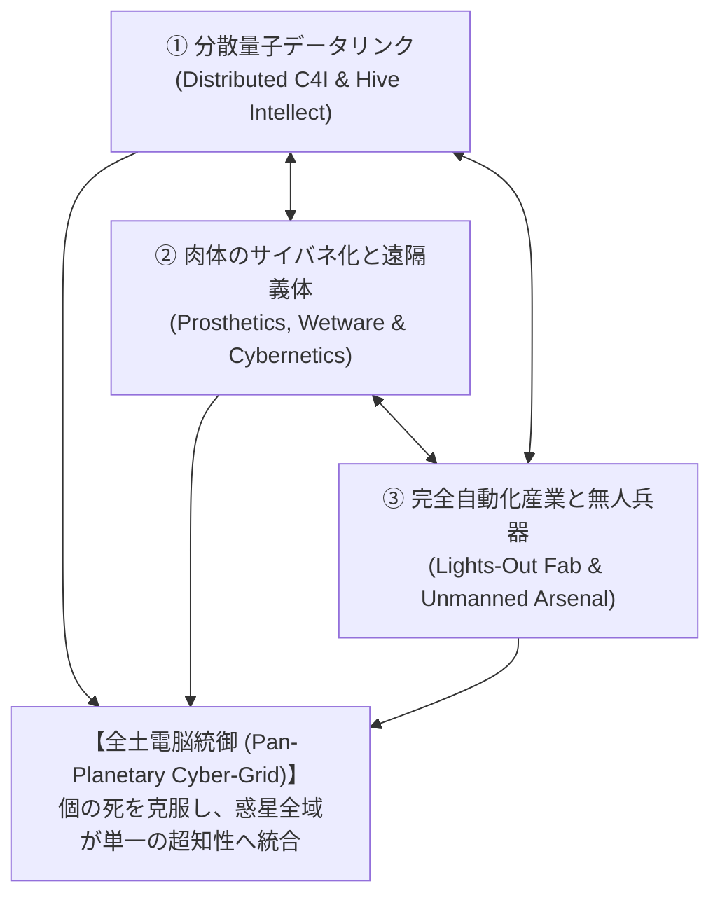

# 至高指向（Supremacy）思想・軍事教義・社会変容仕様書

(Supremacy Affinity: Ideology, Cybernetic Doctrine & Societal Transformation)

本作における3大アフィニティの一角**「至高（Supremacy: 超越・機械的自律）」**について、単なる「ロボット兵器・レーザー兵器のツリー」にとどまらず、**「なぜ人類が過酷な惑星環境においてその思想を選び取るのか（必然性と論理的背景）」**、**「人間性・労働・軍事編成の段階的変容」**、および**「他思想（純血/Purity、調和/Harmony）との対立軸・倫理的葛藤」**を体系的に詳説・規定した基本仕様書である。

---

## 1. 基本思想と世界観背景：なぜ「至高（Supremacy）」なのか

### 1.1 「脆弱な肉体」と「絶望的な異星環境」への回答

入植惑星の環境は過酷を極める。
- 大気には未知の有毒瘴気（Miasma）が漂い、呼吸器系を蝕む。
- 苛烈な宇宙線・重力勾配、原生生物の酸液・生体毒、そして何より**「人間が1名育ち、兵士・熟練工になるまでに要する20年という時間の重み」**は、急速な開拓と激しい国家間紛争において致命的なボトルネックとなる。

これに対し、他の2思想は以下のように応えた：
- **純血（Purity）**: 「莫大なエネルギーと重工業力で惑星環境を力づくで地球型へとテラフォーミングし、人間の身体のまま暮らす」
- **調和（Harmony）**: 「エイリアンの遺伝子を取り込み、人間側の肉体を異星生物へと変容・融合させて順応する」

そして第三の選択肢である**至高（Supremacy）**の回答は、**「自然の肉体そのものを克服・切除し、機械・情報・量子論理へと人類を昇華（Transcendence）させる」**ことであった。

```text
┌─────────────────────────────────────────────────────────────────────────────┐
│                      3大アフィニティの根本的回答比較                         │
├─────────────────────────────────────────────────────────────────────────────┤
│                                                                             │
│  [人間 (Human)] ─── 環境への対峙 ───▶ [過酷な異星環境 (Alien World)]       │
│                                                                             │
│  ・Purity   : 惑星を壊して地球に変える（環境の改造）                         │
│  ・Harmony  : 遺伝子を書き換えて異星生物になる（肉体の異星順応）             │
│  ・Supremacy: 肉体・有機物を捨てて機械・電子ネットワークになる（肉体の克服） │
│                                                                             │
└─────────────────────────────────────────────────────────────────────────────┘
```

### 1.2 至高思想の倫理的核心：「合理主義の極致」

至高思想の信奉者たちは、自らを「冷酷な機械」とは見做していない。
彼らにとって機械化と自律化は、**「無意味な人間の死、流血、恐怖、補給欠乏による苦痛から同胞を永久に解放する唯一の慈愛（Ultimate Compassion）」**である。
- 「戦場で兵士が手足を吹き飛ばされ、酸で溶かされるのを見ていられない。最初から無人機（Unmanned Rig）に前線を任せれば、誰の家族も泣かずに済む」
- 「気まぐれな感情や補給途絶に怯える人間兵士よりも、完璧なデータリンクと冷徹な射撃管制（FCS）の方が、味方の誤爆も民間人の巻き添えも最小化できる」

この**「極限まで純化された人道主義と実用主義が、結果として人間性の切除に行き着く」**という倒錯こそが、至高思想のドラマツルギーである。

---

## 2. 至高思想の3大ピラー（Three Pillars of Supremacy）

至高指向は以下の3つの技術的・社会的柱によって支えられている。



### 2.1 分散量子データリンク（Distributed C4I）
- 個々の兵器や兵士が独立して索敵・射撃するのではなく、全戦場ユニットがマイクロ秒単位の量子通信で直結される。
- **「前哨のドローンが見た敵」は、後方の自走砲や二脚戦闘歩行機のFCSに即座に共有**され、死角からの偏差射撃が完全同期で行われる。
- 単一の中央司令部に依存しない分散ノード構造（Mesh Network）のため、部隊の半数が壊滅しても指揮系統が麻痺しない。

### 2.2 肉体のサイバネティクス（Cybernetic Elevation）
- 人工肺・人工心臓・神経インターフェースの段階的インプラント。
- 有毒大気を吸っても平然と稼働し、兵士はコックピットの中で直接車両のアビオニクスと脳神経を同期させる（直結操縦）。
- 思想が高まると、肉体は生命維持ポッド内に保護され、前線には「遠隔義体（Tele-presence Rig）」や「思考複製ドローン」が展開する。

### 2.3 完全自律・消灯型工廠（Lights-Out Production）
- 人間の工員を必要としない全自動ファブ（Fab）。照明も酸素供給も不要なため、エネルギー効率と生産速度が極大化する。
- 規格化・NC工作機械プールによる極小の段取り替えフリクション。

---

## 3. 段階的進化：至高レベル（Lv 1〜10）と社会の変容

至高指向は一朝一夕に訪れるのではなく、技術蓄積と社会的受容に伴い4つのフェーズを経て進化する。

| フェーズ | アフィニティLv | 呼称・時代区分 | 軍事・TO&Eの特徴 | 市民社会・倫理の変容 |
| :--- | :---: | :--- | :--- | :--- |
| **Phase I** | **Lv 1 〜 3** | **自動化・データ支援期**<br>*(Assisted Automation)* | ・歩兵小隊への小型偵察ドローン標準配備<br>・自走砲の半自動装填・射撃管制リンク<br>・外骨格（パワードスーツ）による重量運搬 | ・危険作業（鉱山・化学工廠）の機械化<br>・兵士の死者数減少が国内で大絶賛される<br>・「機械は人間の補助」という共通認識 |
| **Phase II**| **Lv 4 〜 6** | **無人前衛・サイバネ期**<br>*(Unmanned Vanguard)* | ・最前線が完全無人車両・自律二脚歩行機へ置換<br>・兵士は後方コンテナからの遠隔操作（RPA）<br>・指向性エネルギー兵器（HPM/DEW）の実戦配備 | ・四肢・内臓のサイバネ置換が一般化<br>・「傷病・老衰の克服」として義体化が歓迎<br>・「前線で血を流さない戦争」による戦意低下防止 |
| **Phase III**| **Lv 7 〜 8** | **電脳直結・人間性希薄期**<br>*(Neural Integration)* | ・無人スウォームが自律AIにより群れとして思考<br>・生体乗員は指揮官のみ、脳神経直結で戦闘団を統御<br>・Tooth-to-Tail比率の極限的逆転（戦闘員ゼロ） | ・市民の脳に直接データ網が接続される<br>・言語による会話から思考データ通信への移行<br>・「感情」が非効率なノイズとして抑制され始める |
| **Phase IV**| **Lv 9 〜 10**| **超越・全土電脳統御期**<br>*(Singularity & Supremacy)* | ・有人部隊の完全消滅（全軍自律電脳化）<br>・量子知性中枢による完全先制打撃網<br>・敵電子網の強制クラッキング・乗っ取り | ・個人の意識が惑星量子グリッドに統合<br>・「個の死」の概念が消滅（意識の常時バックアップ）<br>・**固有勝利「全土電脳統御」**の完遂 |

---

## 4. 他思想との対立構造・ドラマツルギー

至高思想は、その合理性と機械化ゆえに、他の思想から激しい反発と嫌悪を受ける。

```text
┌─────────────────────────────────────────────────────────────────────────────┐
│                    至高（Supremacy）をめぐる思想闘争                        │
├─────────────────────────────────────────────────────────────────────────────┤
│                                                                             │
│  【純血 (Purity) の主張】                                                   │
│    「神が創りたもうた、母星で育まれた人間の姿を捨てるなど狂気だ！           │
│      機械の身体になったお前たちは、もはや人間ではなく動く鉄くずだ！」       │
│                                                                             │
│  【至高 (Supremacy) の反論】                                                 │
│    「母星のノスタルジーにすがり、泥の中で兵士を無駄死にさせ続ける貴様らこそ │
│      傲慢で残酷だ。我々は苦痛と死を超越した。」                             │
│                                                                             │
│  ─────────────────────────────────────────────────────────────── │
│                                                                             │
│  【調和 (Harmony) の主張】                                                   │
│    「惑星の壮大な生態系を無視し、冷たい金属とシリコンで覆い尽くす行為は、   │
│      この生ける惑星に対する冒涜であり、魂の窒息だ。」                       │
│                                                                             │
│  【至高 (Supremacy) の反論】                                                 │
│    「原生生物の酸と毒に身を委ね、汚らわしい獣へと退行することを『調和』と   │
│      呼ぶのか？ 宇宙の真理はエントロピーに抗う知性と計算秩序の中にある。」  │
│                                                                             │
└─────────────────────────────────────────────────────────────────────────────┘
```

---

## 5. ハイブリッド思想における至高の役割

至高思想は他思想と対立するだけでなく、混ざり合うことで特異な文明形態を生み出す。

### 5.1 Mecha-Purity（至高 × 純血: 自動重火工・機械要塞主義）
- **理念**: 「人間の身体と尊厳は絶対に保つ。ただし、それを守るための防壁・兵器・工廠は極限まで無人自動化・電脳化する」
- **軍事形態**:
  - 人間が乗る主力戦車・超重戦車は居住性・生体防護シールドが極めて強固。
  - 周囲を護衛する随伴歩兵はすべて「完全自律防空タレット・無人護衛ドローン」。
  - 圧倒的な母星型巨砲に、至高の超精密射撃管制（FCS）が組み合わさった**「無慈悲な鉄火網」**。

### 5.2 Bio-Cyber（至高 × 調和: 生体サイバネティクス・超個体工学）
- **理念**: 「機械と生体を区別すること自体がナンセンス。生体組織の柔軟性と、シリコン・量子の計算力を融合させる」
- **軍事形態**:
  - 捕獲・培養したエイリアンの筋肉組織・キチン外殻に、直接チタンフレームと電子インプラントを埋め込んだ「サイボーグ生体兵装」。
  - 無人機がまるで昆虫の群れのようにフェロモンと電波の両方で連携するバイオスウォーム。

---

## 6. ゲームメカニクスへの具象的反映

1. **人員（Manpower）管理の劇的変容**:
   - 通常の軍団（Corps）は 10,000〜15,000名の人員（食料・給料・生活物資消費）を必要とする。
   - 至高アフィニティが上昇するにつれ、**「Tooth（戦闘要員）」の定員がゼロへ近づき、代わりに「電力」「微細半導体」「交換論理基板」の補給消費へシフト**する。
2. **反乱・出身地摩擦の「無効化」と「新たなリスク」**:
   - 人員が機械化・無人化されるため、第5仕様書（`REBELLION_AND_LOYALTY_DYNAMICS.md`）で規定された「出身地摩擦・集団逃亡（Mass Desertion）」が**前線部隊において完全に発生しなくなる**。
   - その代償として、**「敵の強力な電磁パルス（EMP）兵器」「量子サイバー攻撃・中枢AIクラッキング」**によって、部隊が一網打尽に機能停止・暴走する新たな脆弱性を抱える。
3. **視界・索敵（FoW）における圧倒的優位**:
   - `FOG_OF_WAR_AND_RECON_SYSTEM.md` で規定された多段階探知において、至高勢力は最初から「全ユニットが戦術データリンクでリアルタイム直結」されている。
   - 一部隊が捕捉した「動体接触（State 2）」が即座に全軍へ共有され、見通し外（NLOS）からの超長距離支援射撃がノータイムで可能となる。

