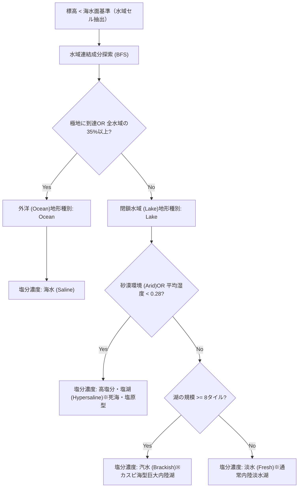

# 水域・塩分濃度システム仕様書 (Water & Salinity Mechanics Specification)

本ドキュメントは、本作における**水域タイルの分類（外洋と湖沼）および塩分濃度（Salinity）システム**の設計、判定アルゴリズム、ゲームシステム・資源経済への影響を規定する基本仕様書です。

※リポジトリ内ドキュメント規則（path_privacy.md）に従い、内部リンクはすべてリポジトリ内相対パスで記載されています。

---

## 1. 設計思想と背景

従来の4Xゲームでは、水域は単に「通行不能な青いタイル（海洋/Ocean）」として一括りに扱われることが多く、内陸湖や塩湖の個性、淡水確保による都市成長の差別化が不十分でした。
本作では、惑星環境のリアリティと戦略性を高めるため、以下の2段階で水域を構造化しています：

1. **水域トポロジーによる大分類**: 外洋（`Ocean`）と閉鎖水域（`Lake`）のグラフ自動判定
2. **塩分濃度（Salinity）による細分類**: 実用塩分単位（PSU / ‰）に基づく4段階の水質定義（淡水・汽水・海水・塩湖）
3. **河川システム（River Networks）**: 山岳・丘陵を水源とし、内陸湖を経由しながら海へ下るヘックス境界（Edge）水系シミュレーションと淡水灌漑ボーナス

---

## 2. 塩分濃度区分（WaterSalinity）

水域タイルは、以下のいずれかの塩分区分（`WaterSalinity`）を保持します。

| 塩分区分                       | 塩分濃度（PSU / ‰） | 代表的な地球上の例                             | 基礎産出（食料/生産/電力/科学） | 主なゲーム特性・戦略価値                                                                                                              |
| ------------------------------ | ------------------- | ---------------------------------------------- | :-----------------------------: | ------------------------------------------------------------------------------------------------------------------------------------- |
| **淡水 (Fresh)**               | < 0.5‰              | バイカル湖、五大湖、標準湖沼                   |      (2.0, 0.0, 0.0, 0.0)       | **都市水源・最大バイオマス産出**。生活用水・農業灌漑に直結し、隣接都市の成長を強力に後押し。                                          |
| **汽水 (Brackish)**            | 0.5 〜 30‰          | **カスピ海**（約12‰）、バルト海、大河河口      |      (1.5, 0.0, 0.5, 0.0)       | **カスピ海型内陸水域**。淡水と塩分が混じり合う独自の魚介生態系（食料1.5）と、緩やかな潮汐・水力エネルギー（電力0.5）。                |
| **海水 (Saline)**              | 30 〜 50‰           | 外洋（海洋平均 約35‰）                         |      (1.0, 0.0, 1.0, 0.0)       | **海洋航路・海流発電**。海流・潮汐力によるエネルギー産出（電力1.0）と、艦隊展開・海上制海権の要所。                                   |
| **高塩分・塩湖 (Hypersaline)** | > 50‰               | **死海**（約300‰）、グレートソルト湖、乾燥塩原 |      (0.0, 2.0, 0.0, 0.0)       | **晶出塩・リチウム・化学原料（高生産力）**。生息生物は極めて限定的だが、蒸発岩や高純度塩化鉱物の採取により構造鉱物（生産2.0）を産出。 |

---

## 3. マップ生成と自動判定ロジック

マップ生成時（`src/map/generation.rs`）において、標高（`elevation`）が海水面基準（`sea_threshold`）未満のセルに対して以下の順序で自動分類が行われます。



### 3.1 外洋（Ocean）と湖沼（Lake）の判定

- **外洋 (Ocean)**:
  - マップの南北両極（`row = -half_h` または `row = half_h`）に接続している。
  - または、全水域タイル数の 35% 以上を占める大洋コンポーネント。
- **湖沼 (Lake)**:
  - 周囲が陸地によって完全に囲まれた独立閉鎖水域。

### 3.2 湖沼の塩分濃度決定基準

1. **高塩分・塩湖 (`Hypersaline`)**:
   - 惑星環境が `PlanetEnvironment::Arid`（乾燥砂漠惑星）、またはその水域コンポーネントの平均湿度ノイズが `0.28` 未満の乾燥地帯に存在する場合。激しい蒸発濃縮により塩湖化する。
2. **汽水 (`Brackish`)**:
   - タイル数が **8タイル以上の巨大内陸水域**。流入河川と古い海洋堆積の均衡によりカスピ海型の汽水域を形成。
3. **淡水 (`Fresh`)**:
   - 通常規模（7タイル以下）の湿潤・温帯内陸湖沼。

---

## 4. 河川システムと流量階層 (River Networks & River Scales)

河川は、山岳・高地から湖沼・外洋へと流れる**ヘックス境界（HexEdge）**の水流網としてモデル化されています（[`docs/discussion/map_tile/future_concept_subtile_industry.md`](../discussion/map_tile/future_concept_subtile_industry.md#L107-L138) 準拠）。

### 4.1 河川の生成アルゴリズム（流向シミュレーション）

1. **水源（Headwaters）の選定**:
   - 標高が高く（`Mountains` / `Hills`）、かつ湿度（`moisture`）が高いセルを水源候補として抽出。
2. **傾斜流下と合流（Flow Accumulation）**:
   - 水源から最も標高の低い隣接エッジを選択しながらステップ前進（重力流下）。
   - 他の支流と合流するごとに流路の累積流量（`flow`）が増加し、河川規模（`RiverScale`）が昇格。
3. **湖沼経由と最終流入先（内海または外洋）**:
   - 河川は途中で内陸湖（`Lake`）を通過・貫通可能。
   - 最終的に**閉鎖水域（内海・湖沼）**または**外洋（海洋）**の境界に到達した時点で注水完了となり、流下が終了する。

### 4.2 河川規模・流量階層 (`RiverScale`)

| 河川規模                     | 累積流量 | 3D線幅 | 渡河移動コスト |  渡河強襲攻撃補正   | 主な役割・ゲーム内性質                                                               |
| :--------------------------- | :------: | :----: | :------------: | :-----------------: | :----------------------------------------------------------------------------------- |
| **支流・小河川 (`Minor`)**   |    1     |  0.12  |     +1 MP      | -15% 補正 (`×0.85`) | 山間部・高地水源付近。歩兵や車両でも比較的軽微なペナルティで渡河可能。               |
| **本流・中河川 (`Major`)**   |   2〜3   |  0.20  |     +2 MP      | -35% 補正 (`×0.65`) | 支流合流後の本流。平時移動力の大半を消費。天然の防衛線として機能。                   |
| **大河・国際河川 (`Great`)** |  4以上   |  0.32  |     +3 MP      | -50% 補正 (`×0.50`) | 流域下流・河口付近。大部隊の移動を大きく拒絶。架橋工兵や立体跳躍兵装が渡河に不可欠。 |

### 4.3 河川の内政・工業利用

- **淡水灌漑・農業ボーナス**:
  - 河川エッジに隣接する陸地タイル（平原・森林等）は**淡水アクセス（Freshwater River Front）**を獲得し、**バイオマス（食料）産出 +1.0** を得る。
- **工業冷却水・電力**:
  - 後期工業施設（製鉄所・核融合発電所等）において、河川沿岸は冷却水アクセスを無償提供。
- **内陸水運**:
  - 運河や本流・大河沿いでは、陸上輸送と比較して輸送エネルギー効率が向上。

### 4.4 渡河力学と戦闘補正 (River Crossing Mechanics)

- **移動BFSへの反映**:
  - ユニットの移動可能範囲計算時、河川エッジを横断する際に `RiverScale` に応じた追加移動力コスト（+1〜+3 MP）が適用される。
- **渡河白兵突撃の減衰**:
  - 河川を跨いで隣接する敵ユニットに近接攻撃を行う場合、攻撃側の与ダメージが `-15%` 〜 `-50%` 減衰。防御側は自然の要害として有利を享受する。
- **特殊兵装・工兵による克服**:
  - 戦術サブタイルの工兵架橋、または立体跳躍型歩行兵器（Jump-Flight Bipedal Walker）はスラスタ跳躍により河川ペナルティを無効化して強襲可能。

---

## 5. 運河システム (Canal Transit & Isthmus Navigation)

運河は、地峡（Isthmus）の開削や大河口の改修によって海洋と海洋、または海洋と内陸水域を連結する人工水路網です（[`docs/discussion/map_tile/concept_infrastructure_grid_and_transit_artery.md`](../discussion/map_tile/concept_infrastructure_grid_and_transit_artery.md#L12-L52) 準拠）。

### 5.1 地峡運河の検出と開削

- **地峡の幾何的判定**:
  - 幅1〜2ヘックスで複数の異なる水域（外洋や内陸海・巨大湖）に挟まれた陸地狭窄部を検出し、初期開削候補または運河回廊（`HexEdge`）として設定。
- **海洋ユニット・船舶の航行**:
  - 通常は陸地によって隔てられた外洋同士を運河エッジを介して直通航行可能とし、大陸周回航路を劇的に短縮。

### 5.2 運河と陸上インフラの並行配置規約（サブタイル階層）

親タイルおよびサブタイル（343マス）において、以下の都市工学・軍事土木規約が適用されます：

1. **右側（東側）インフラ集約規約**:
   - 運河が親タイル内を通過する場合、リニア・高速道路・重軌道鉄道などの陸上交通動脈は**必ず運河サブタイルの「右側（東側）」に並行集約**して配置される。
   - これにより、港湾・船車転換（インターモーダル輸送）の結節点を一元化し、対岸（西側）に広大な居住・工業・司令拠点を確保する。
2. **渡河・運河横断の制限**:
   - 運河は防波堤と深い掘削水深を持つため、地上ユニットが運河を横断する場合は **移動コスト +2 MP**、渡河攻撃時は **-40% 補正 (`×0.60`)** の強固な防御壁となる。

---

## 6. ビジュアル・レンダリング表現

水質、塩分濃度、河川、運河は3Dマップおよびミニマップ上で直感的に識別できるようレンダリングされます。

```text
淡水 (Fresh)       : エメラルド・アクアブルー (Color::srgb(0.14, 0.40, 0.50)) - 澄んだ透明感
汽水 (Brackish)    : 深緑蒼色 (Color::srgb(0.12, 0.32, 0.48))                - カスピ海調の深い青緑
海水 (Saline)      : 外洋ディープブルー (Color::srgb(0.10, 0.25, 0.48))       - 濃紺
塩湖 (Hypersaline) : 結晶白濁ターコイズ (Color::srgb(0.20, 0.45, 0.46))      - 塩結晶の反射光沢
河川水流 (River)   : 透明感アクアブルー (srgba(0.20, 0.65, 0.88, 0.90))      - 幅: 0.12 / 0.20 / 0.32
運河水路 (Canal)   : 人工深碧グリーンブルー (srgba(0.10, 0.75, 0.70, 0.92))  - 護岸・直線的航路
```

- **3Dマテリアル特性**: 塩湖タイルは塩の結晶堆積を表現するため、光沢の粗さ（`perceptual_roughness = 0.35`）と反射率（`reflectance = 0.6`）を個別に調整。
- **ミニマップ**: `src/ui/minimap/render_core.rs` により、ミニマップ上のピクセル色にも上記グラデーションがリアルタイムで反映。

---

## 7. UIおよびプレイヤー向け情報表示

プレイヤーが水域タイルをクリックした際、左下 HUD（`PLANET SURVEYOR` / `src/ui/info_panel.rs`）に詳細情報が表示されます。

### 表示例：カスピ海型汽水湖をクリックした場合

```text
【ヘックス座標】
  col: 14, row: 2 (q: 13, r: 2)
  中心からの距離: 2

【領有勢力】
  未領有・未開拓域 (Neutral Territory)

【地形種別】
  湖沼 (Lake)
【基礎産出】: バイオマス(食料): 1.5 / 構造鉱物(生産): 0.0 / エネルギー: 0.5 / 科学: 0.0
【移動コスト】: N/A
【地上移動】: 通行不能 (特殊部隊/航空機のみ)

【水質・塩分特性】
  汽水 (Brackish / 0.5-30‰)
  カスピ海型内陸水域。淡水と塩分が混じり合い特有の魚介生態系と水力エネルギーを保持。

【環境特性】
  エイリアン活動兆候あり
  資源探査可能
```

---

## 8. 関連コードファイル

- 地形および塩分型定義: `src/map/terrain.rs`
- マップグリッドおよび河川・運河型定義: `src/map/types.rs`
- 地形・水域・河川クラスタリング・地峡運河生成: `src/map/generation.rs`
- 3Dオーバーレイ（河川・運河メッシュ描画）: `src/map/interaction.rs`
- 渡河移動コスト計算・渡河戦闘補正: `src/unit/interaction.rs`
- ミニマップ水域描画: `src/ui/minimap/render_core.rs`
- HUD情報パネル表示: `src/ui/info_panel.rs`
