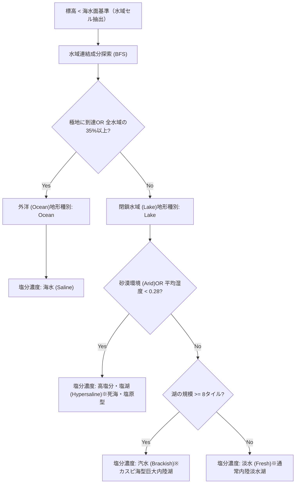

# 水域・塩分濃度システム仕様書 (Water & Salinity Mechanics Specification)

本ドキュメントは、本作における**水域タイルの分類（外洋と湖沼）および塩分濃度（Salinity）システム**の設計、判定アルゴリズム、ゲームシステム・資源経済への影響を規定する基本仕様書です。

※リポジトリ内ドキュメント規則（[path_privacy.md](../.agents/rules/path_privacy.md)）に従い、内部リンクはすべてリポジトリ内相対パスで記載されています。

---

## 1. 設計思想と背景

従来の4Xゲームでは、水域は単に「通行不能な青いタイル（海洋/Ocean）」として一括りに扱われることが多く、内陸湖や塩湖の個性、淡水確保による都市成長の差別化が不十分でした。
本作では、惑星環境のリアリティと戦略性を高めるため、以下の2段階で水域を構造化しています：

1. **水域トポロジーによる大分類**: 外洋（`Ocean`）と閉鎖水域（`Lake`）のグラフ自動判定
2. **塩分濃度（Salinity）による細分類**: 実用塩分単位（PSU / ‰）に基づく4段階の水質定義（淡水・汽水・海水・塩湖）

---

## 2. 塩分濃度区分（WaterSalinity）

水域タイルは、以下のいずれかの塩分区分（`WaterSalinity`）を保持します。

| 塩分区分 | 塩分濃度（PSU / ‰） | 代表的な地球上の例 | 基礎産出（食料/生産/電力/科学） | 主なゲーム特性・戦略価値 |
| --- | --- | --- | :---: | --- |
| **淡水 (Fresh)** | < 0.5‰ | バイカル湖、五大湖、標準湖沼 | (2.0, 0.0, 0.0, 0.0) | **都市水源・最大バイオマス産出**。生活用水・農業灌漑に直結し、隣接都市の成長を強力に後押し。 |
| **汽水 (Brackish)** | 0.5 〜 30‰ | **カスピ海**（約12‰）、バルト海、大河河口 | (1.5, 0.0, 0.5, 0.0) | **カスピ海型内陸水域**。淡水と塩分が混じり合う独自の魚介生態系（食料1.5）と、緩やかな潮汐・水力エネルギー（電力0.5）。 |
| **海水 (Saline)** | 30 〜 50‰ | 外洋（海洋平均 約35‰） | (1.0, 0.0, 1.0, 0.0) | **海洋航路・海流発電**。海流・潮汐力によるエネルギー産出（電力1.0）と、艦隊展開・海上制海権の要所。 |
| **高塩分・塩湖 (Hypersaline)** | > 50‰ | **死海**（約300‰）、グレートソルト湖、乾燥塩原 | (0.0, 2.0, 0.0, 0.0) | **晶出塩・リチウム・化学原料（高生産力）**。生息生物は極めて限定的だが、蒸発岩や高純度塩化鉱物の採取により構造鉱物（生産2.0）を産出。 |

---

## 3. マップ生成と自動判定ロジック

マップ生成時（`src/map/generation.rs`）において、標高（`elevation`）が海水面基準（`sea_threshold`）未満のセルに対して以下の順序で自動分類が行われます。



### 3.1 外洋（Ocean）と湖沼（Lake）の判定

- **外洋 (Ocean)**:
  - マップの南北両極（`row = -half_h` または `row = half_h`）に接続している。
  - または、全水域タイル数の 35% 以上を占める大洋コンポーネント。
- **湖沼 (Lake)**:
  - 周囲が陸地によって完全に囲まれた独立閉鎖水域。

### 3.2 湖沼の塩分濃度決定基準

1. **高塩分・塩湖 (`Hypersaline`)**:
   - 惑星環境が `PlanetEnvironment::Arid`（乾燥砂漠惑星）、またはその水域コンポーネントの平均湿度ノイズが `0.28` 未満の乾燥地帯に存在する場合。激しい蒸発濃縮により塩湖化する。
2. **汽水 (`Brackish`)**:
   - タイル数が **8タイル以上の巨大内陸水域**。流入河川と古い海洋堆積の均衡によりカスピ海型の汽水域を形成。
3. **淡水 (`Fresh`)**:
   - 通常規模（7タイル以下）の湿潤・温帯内陸湖沼。

---

## 4. ビジュアル・レンダリング表現

水質と塩分濃度は、3Dマップおよびミニマップ上でも直感的に識別できるよう色調と質感が差別化されています。

```text
淡水 (Fresh)       : エメラルド・アクアブルー (Color::srgb(0.14, 0.40, 0.50)) - 澄んだ透明感
汽水 (Brackish)    : 深緑蒼色 (Color::srgb(0.12, 0.32, 0.48))                - カスピ海調の深い青緑
海水 (Saline)      : 外洋ディープブルー (Color::srgb(0.10, 0.25, 0.48))       - 濃紺
塩湖 (Hypersaline) : 結晶白濁ターコイズ (Color::srgb(0.20, 0.45, 0.46))      - 塩結晶の反射光沢
```

- **3Dマテリアル特性**: 塩湖タイルは塩の結晶堆積を表現するため、光沢の粗さ（`perceptual_roughness = 0.35`）と反射率（`reflectance = 0.6`）を個別に調整。
- **ミニマップ**: `src/ui/minimap/render_core.rs` により、ミニマップ上のピクセル色にも上記グラデーションがリアルタイムで反映。

---

## 5. UIおよびプレイヤー向け情報表示

プレイヤーが水域タイルをクリックした際、左下 HUD（`PLANET SURVEYOR` / `src/ui/info_panel.rs`）に詳細情報が表示されます。

### 表示例：カスピ海型汽水湖をクリックした場合

```text
【ヘックス座標】
  col: 14, row: 2 (q: 13, r: 2)
  中心からの距離: 2

【領有勢力】
  未領有・未開拓域 (Neutral Territory)

【地形種別】
  湖沼 (Lake)
【基礎産出】: バイオマス(食料): 1.5 / 構造鉱物(生産): 0.0 / エネルギー: 0.5 / 科学: 0.0
【移動コスト】: N/A
【地上移動】: 通行不能 (特殊部隊/航空機のみ)

【水質・塩分特性】
  汽水 (Brackish / 0.5-30‰)
  カスピ海型内陸水域。淡水と塩分が混じり合い特有の魚介生態系と水力エネルギーを保持。

【環境特性】
  エイリアン活動兆候あり
  資源探査可能
```

---

## 6. 関連コードファイル

- 地形および塩分型定義: [`src/map/terrain.rs`](../src/map/terrain.rs)
- マップグリッドおよびタイルコンポーネント: [`src/map/types.rs`](../src/map/types.rs)
- 地形・水域クラスタリング生成: [`src/map/generation.rs`](../src/map/generation.rs)
- ミニマップ水域描画: [`src/ui/minimap/render_core.rs`](../src/ui/minimap/render_core.rs)
- HUD情報パネル表示: [`src/ui/info_panel.rs`](../src/ui/info_panel.rs)
