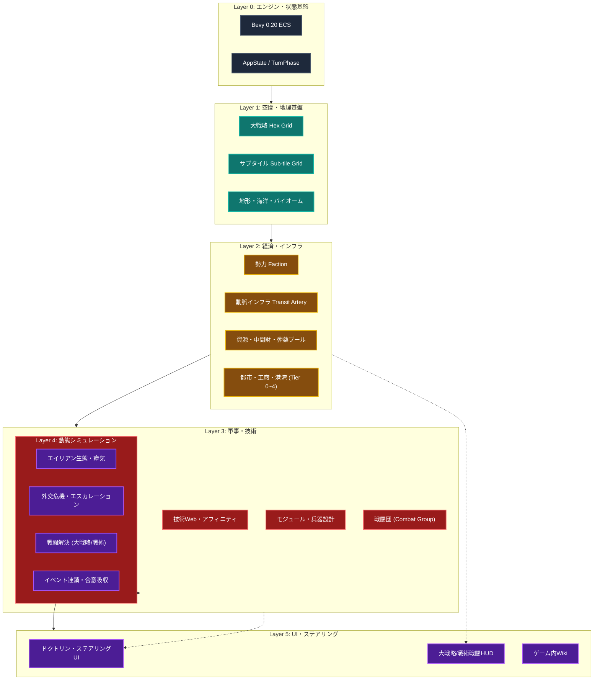

# 全体実装依存関係・アーキテクチャ仕様書 (System Architecture & Implementation Dependencies)

本作（4X大戦略＋サブタイル戦術・戦闘団制＋自律サプライチェーン）における**システム全体の構成レイヤー、モジュール間依存関係（何が何に依存して成立するか）、および推奨実装ロードマップ**を体系化した技術統括仕様書である。

---

## 1. 全体実装レイヤー構造（6層アーキテクチャ）

本作のシミュレーションシステムは、下層（基盤）ほど純粋なデータ・グリッドであり、上層へ向けて順次組み上げられる6層の依存階層で構成される。

```text
┌────────────────────────────────────────────────────────────────────────┐
│ Layer 5: 操作・提示・誘導層 (UI / Steering / Wiki)                      │
│   - 国家ドクトリン・ステアリングUI (誘導スライダー・移行ラグ視覚化)      │
│   - ゲーム内Wiki & ライブビューア (仕様辞書・動的パラメータ監視)       │
│   - 大戦略操作HUD & サブタイル戦術戦闘HUD                                │
├────────────────────────────────────────────────────────────────────────┤
│ Layer 4: 動態シミュレーション・AI層 (Dynamics / Combat / Diplomacy)    │
│   - 戦闘解決システム (大戦略一括解決 & サブタイル戦術展開・盤外砲撃)    │
│   - エイリアン生態系 (巣窟ライフサイクル・瘴気動的侵食・フェロモン)    │
│   - 外交危機・エスカレーション・ラダー (偶発事象・グレーゾーン・合意)   │
│   - イベントカタログ連鎖 & 歴史的不可逆選択                             │
├────────────────────────────────────────────────────────────────────────┤
│ Layer 3: 軍事・戦闘団・技術開発層 (Military / Fleet / Tech Web)        │
│   - 放射状Web技術ツリー (自律研究ベクトル・3大アフィニティ・実戦知見)   │
│   - 兵器モジュール & シャーシ規格 (多脚・装軌・無人機・残骸互換)         │
│   - 戦闘団 (Combat Group: 増強師団制・非表示スタック管理)               │
│   - 非ユニット輸送体系 (海上輸送船腹プール SLC・非戦闘車両牽引)         │
├────────────────────────────────────────────────────────────────────────┤
│ Layer 2: 勢力・インフラ・経済サプライチェーン層 (Economy & Infra)       │
│   - 6大勢力基本データ (母星由来・思想・初期体制)                        │
│   - 物理インフラ動脈 (Transit Artery・送電網・パイプライン)             │
│   - 3層資源体系 (一次資源・二次中間財・弾薬/燃料消費財・食料)           │
│   - 拠点・工廠・タイル進展 (Tier 0〜4・ブートローダー産業・港湾)        │
├────────────────────────────────────────────────────────────────────────┤
│ Layer 1: 空間・地理・グリッド基盤層 (Spatial Grid Base)                │
│   - 大戦略親ヘックスグリッド (Macro Hex Grid)                           │
│   - 親タイル内包サブタイルグリッド (Sub-tile Grid: 1親あたり12〜15)     │
│   - 地形・バイオーム・海洋工学 (埋立・固定式・メガフロート)             │
├────────────────────────────────────────────────────────────────────────┤
│ Layer 0: エンジン・アプリケーション基盤層 (Engine & App State)         │
│   - Bevy 0.20 App / Schedule / FixedUpdate / ECS World                 │
│   - ゲーム進行ステート (AppState / TurnPhase / SelectionState)         │
│   - 2D/3Dハイブリッドカメラコントローラ                                │
└────────────────────────────────────────────────────────────────────────┘
```

---

## 2. モジュール間依存関係マトリクス

上位システムが稼働するために、どの下位システムが先行して定義・実装されていなければならないかを定義する。



### 依存詳細テーブル

| 開発領域                                                                                                                                                                                                                             | 依存先（前提コンポーネント）             | 依存元（波及・利用するシステム）                 | 結合インターフェース・要件                                                                                                                                                                  |
| :----------------------------------------------------------------------------------------------------------------------------------------------------------------------------------------------------------------------------------- | :--------------------------------------- | :----------------------------------------------- | :------------------------------------------------------------------------------------------------------------------------------------------------------------------------------------------ |
| **空間・地理基盤** (`src/map/`)                                                                                                                                                                                                      | Bevy ECS                                 | インフラ、移動判定、都市、戦闘                   | 親タイル（大戦略）とサブタイル（12〜15小タイル）の二重解像度マッピング。                                                                                                                    |
| **動脈インフラ・施設** ([concept_infrastructure_grid_and_transit_artery.md](../discussion/map_tile/concept_infrastructure_grid_and_transit_artery.md))                                                                               | 地形グリッド、勢力                       | 資源輸送、部隊移動力、後方補給線                 | 線路・道路・パイプラインのネットワーク連結度（ボトルネック検知）。                                                                                                                          |
| **資源・サプライチェーン** ([concept_resource_economy_and_logistics.md](../discussion/industry_logistics/concept_resource_economy_and_logistics.md))                                                                                 | 施設（工廠）、動脈インフラ               | 兵器生産、維持コスト、技術開発                   | 3層品目（一次/二次/消費材）。弾薬規格（C規格・口径）の分化と事実上の標準化。                                                                                                                |
| **兵器・戦闘団** ([concept_combat_group_structure_and_rfp_cycle.md](../units/force/concept_combat_group_structure_and_rfp_cycle.md) / [COMBAT_GROUP_LOGISTICS_INTEGRATION.md](../units/force/COMBAT_GROUP_LOGISTICS_INTEGRATION.md)) | 資源、工廠、技術モジュール、動脈インフラ | 戦闘解決、非ユニット輸送、領土確保、兵站ステート | 1タイル1戦闘団（増強師団制）。非表示スタック管理、兵站ステータス（`CombatGroupLogistics` / `LogisticsState`）、共食い整備（Cannibalization）、国家整備ドクトリン（`MaintenanceDoctrine`）。 |
| **非ユニット輸送** ([concept_non_unit_sea_and_vehicle_transport.md](../discussion/military_tactics/concept_non_unit_sea_and_vehicle_transport.md))                                                                                   | 港湾施設、海上回廊、非戦闘車両           | 部隊行軍、通商破壊、展開遅延                     | コマを出さない海上輸送船腹プール（SLC）消費と徒歩部隊の車両牽引（展開ラグ付与）。                                                                                                           |
| **サブタイル戦術戦闘** ([concept_subtile_combat_and_tactical_rules.md](../discussion/map_tile/concept_subtile_combat_and_tactical_rules.md))                                                                                         | サブタイル構造、戦闘団兵装、盤外インフラ | 施設破壊、残骸生成、領土占領進行                 | 大戦略1ターン内で小規模ターン交戦。盤外砲撃・増援遅延・施設破壊の即時大戦略反映。                                                                                                           |
| **外交危機・合意** ([concept_diplomatic_incidents_and_crises.md](../discussion/events/concept_diplomatic_incidents_and_crises.md))                                                                                                   | 勢力、国境未定地、海上シーレーン         | イベント発生、開戦事由、領土移管                 | 偶発事象からのエスカレーション・ラダー（警告→制裁→代理紛争→全面戦争）。                                                                                                                     |
| **ドクトリン・ステアリングUI** ([concept_doctrine_steering_ui.md](../discussion/ui_wiki/concept_doctrine_steering_ui.md))                                                                                                            | 産業・軍事・研究パラメータ               | プレイヤー入力・方針誘導                         | 直接操作を排した「誘導スライダー＋移行ラグ」。国家整備ドクトリン（前線維持/温存/厳格準拠）、工廠ライン転換と前線整備ペナルティ。                                                            |

---

## 3. 実装移行フェーズ（ボトムアップ・開発ロードマップ）

破綻や大規模なリファクタリングを防ぐため、以下の順序でボトムアップに実装を進める。

```text
┌────────────────────────────────────────────────────────────────────────┐
│ Phase 1: 空間とコアリソース・サプライチェーン基盤（データ層の確立）       │
│   1. 大戦略親タイル ＋ サブタイル構造体のデータモデル実装               │
│   2. 資源・中間財・弾薬（3層品目）のインベントリおよび消費流通ループ    │
│   3. 工廠施設（Tier 0〜4）の生産キューとブートローダー型自律更新       │
├────────────────────────────────────────────────────────────────────────┤
│ Phase 2: 戦闘団編成と非ユニット輸送（マクロ機動の確立）                │
│   1. モジュール換装型「戦闘団（Combat Group）」データ構造の実装         │
│   2. 道路動脈移動ボーナス ＆ 徒歩部隊の非戦闘車両牽引（モーターライズ）  │
│   3. 港湾間海上回廊（シーレーン）と海上輸送船腹プール（SLC）処理       │
├────────────────────────────────────────────────────────────────────────┤
│ Phase 3: 戦術戦闘と動態環境（インタラクション層の確立）                │
│   1. サブタイル戦術戦闘シミュレータ（盤外砲撃・増援ラグ・施設破損）     │
│   2. エイリアン巣窟ライフサイクル・瘴気動的拡散ロジック              │
│   3. 外交緊張度メーターとエスカレーション・イベントトリガー             │
├────────────────────────────────────────────────────────────────────────┤
│ Phase 4: 国家ドクトリン・ステアリングUI（操作・体験層の完成）          │
│   1. ドクトリン方針カード ＆ 投資誘導スライダーUI                      │
│   2. 移行ラグ・現場改修ペナルティの視覚化ダッシュボード                │
│   3. ゲーム内Wikiと動的実況ビューアの統合                              │
└────────────────────────────────────────────────────────────────────────┘
```

---

## 4. 関連ドキュメント

- コア企画設計書: [`../GAME_DESIGN.md`](../GAME_DESIGN.md)
- 資源・経済インデックス: [`../specs/RESOURCE_ECONOMY_SYSTEM.md`](../specs/RESOURCE_ECONOMY_SYSTEM.md)
- 非ユニット輸送仕様書: [`../discussion/military_tactics/concept_non_unit_sea_and_vehicle_transport.md`](../discussion/military_tactics/concept_non_unit_sea_and_vehicle_transport.md)
- サブタイル戦術戦闘仕様書: [`../discussion/map_tile/concept_subtile_combat_and_tactical_rules.md`](../discussion/map_tile/concept_subtile_combat_and_tactical_rules.md)
- 国家ドクトリン・ステアリングUI仕様書: [`../discussion/ui_wiki/concept_doctrine_steering_ui.md`](../discussion/ui_wiki/concept_doctrine_steering_ui.md)
