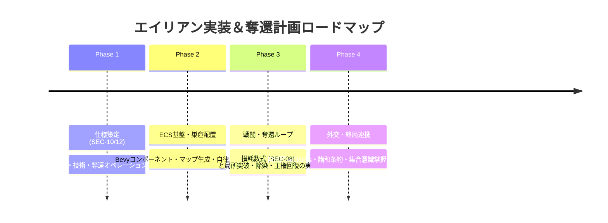

# エイリアン実装・野生生態系制御および全土奪還計画書 (Alien Master Implementation & Native Biosphere Reclamation Plan)

本ドキュメントは、本作（4X大戦略＋諸兵科連合戦闘団制＋脱都市タイル進展）における**野生・固有エイリアン（原住惑星原生生物／生体生態群）の包括的仕様体系**と、**「エイリアンは文明種族ではなく、純粋な野生の惑星生態系である」**という根本原則に基づき、**人類勢力が異星生体技術（フェロモン・神経共鳴）を用いて野生生物の情報を取得・誘導・共生利用し、敵対勢力に奪われた領土や荒野を惑星規模で制圧・奪還する「全土奪還計画（Planetary Reclamation Operations）」**の立案・実施メカニクスを体系化した実装設計書である。

---

## 1. 全体設計俯瞰：非文明・野生生態系としてのエイリアン

エイリアンは国家、法律、外交条約、公的主権などの人間的文明概念を持たない。
彼らの行動原理は**「縄張り防衛、捕食、繁殖、および外来刺激・汚染に対する過剰な生体免疫反応」**にすぎない。
しかし、惑星環境全体が彼らの生息地（全土縄張り）であるため、**人類側が異星技術（Xeno-Tech）によってそのフェロモン・神経周波数を解読・掌握することで、野生スウォームを誘導・使役し、敵対勢力の拠点を押し流す「奪還作戦」**を可能にする。

```text
┌─────────────────────────────────────────────────────────────────────────────┐
│                 野生生態系 ＆ 人類生体技術による全土奪還構造                │
├─────────────────────────────────────────────────────────────────────────────┤
│  ①【生態・自然層】(Native Biosphere & Ecology)                              │
│     ・非文明種族：言語・条約・政治主権は存在せず、純粋な群生本能と縄張り意識│
│     ・全土生息域（Inherent Habitat: 惑星全土が彼らの自然な生息環境）        │
│     ・巣窟（Nest）は生態系の繁殖拠点であり、侵略・汚染への「免疫反応節」    │
│     ・瘴気（Miasma）は自生環境を維持・回復するための「惑星大気成分」        │
│                                                                             │
│  ②【戦力・TO&E層】(Wild Swarms & Bio-Phenomena)                            │
│     ・陸上軍団（6種: 小型侵食〜超大型コロッサス・長距離ニードル砲撃）        │
│     ・航空編隊（10種: 迎撃・制空〜空中生体戦艦・生体母艦）                  │
│     ・海上艦隊（6種: 哨戒〜超弩級生体戦艦・深海潜航リヴァイアサン）         │
│     ・非対称生体兵装（格闘破壊の時間差、指揮種の不在、例外的大空兵装）      │
│                                                                             │
│  ③【人類側技術による情報取得・誘導】(Xeno-Tech & Pheromone Steering)       │
│     ・未解読時は完全な自然災害・黒い霧（巣窟状態・移動目標不可視）          │
│     ・異星生体工学の研究により、巣窟の刺激度可視化、フェロモン誘導弾が解禁  │
│     ・「多種族協調部隊」＝調教・神経インプラントによる使役混成部隊          │
│                                                                             │
│  ④【敵対勢力に対する全土奪還計画】(Planetary Reclamation Operations)        │
│     ・穏当かつ計画的な段階的奪還（索敵 ➔ 兵站遮断 ➔ 局所突破 ➔ 生態安定化） │
│     ・フェロモン誘導で敵対拠点を野生スウォームに襲撃させ、外来兵站を圧壊    │
│     ・敵対重汚染の浄化、あるいは生体共生基盤の展開による全土支配            │
│                                                                             │
│  ⑤【終局・集合意識層】(Planetary Hivemind & Direct Control)                 │
│     ・惑星全体の生体ネットワーク（ハイブマインド）との神経同調              │
│     ・「エイリアン直接操作権能」の覚醒：全土の原生生物を意のままに使役      │
└─────────────────────────────────────────────────────────────────────────────┘
```

---

## 2. エイリアン戦力体系（TO&E・生体兵装・混成）

各作戦領域におけるエイリアン戦力は、策定済みの部隊編成（[`INDEX_TOE.md`](./INDEX_TOE.md)）と厳密に整合している。

### 2.1 作戦領域別の戦力対応

| 作戦領域 | 野生・固有エイリアン（TO&E） | 主な役割・特徴 | 人類側の対応兵科・部隊 |
| :--- | :--- | :--- | :--- |
| **陸上** | **[陸上・エイリアン軍団](../toe_indexes/ground_alien.md)** (全6種)・小型侵食 / 中型強襲 / 生体重戦車・ニードル砲撃 / 飛翔近接 / コロッサス | ・津波のような質量突進・指揮官の不在（フェロモン自律連鎖）・格闘種による装甲解体（破壊所要時間の差）・全高20m級決戦巨獣の踏み潰し | 機甲師団 / 機械化歩兵師団 / 特科砲撃軍団 / 陸上戦艦打撃軍団 |
| **航空** | **[航空・エイリアン編隊](../toe_indexes/air_alien.md)** (全10種)・迎撃 / 制空 / 光学ステルス・高高度爆撃 / 生体レーダー / 輸送嚢・空中生体戦艦 / 空中生体母艦 | ・大気循環・気流層を利用した長距離滑空・光学屈折による生体ステルス・超巨大浮遊生体による防空傘と寄生体投下 | 戦闘航空団 / ステルス制空団 / 戦略爆撃団 / 空中戦艦航空団 |
| **海上** | **[海上・エイリアン艦隊](../toe_indexes/naval_alien.md)** (全6種)・生体戦艦 / 生体空母 / 主力水上群・哨戒 / 群体護衛 / 深海潜航群 | ・外洋の超巨大甲殻生物・キャビテーション衝撃波・生体ソナー・超深度無音潜航による通商破壊 | 通常艦隊 / 空母決戦艦隊 / 沿岸哨戒船団 / 水陸両用陸上戦艦 |

### 2.2 生体兵装の基本原則（非対称戦闘ルール）

1. **装甲解体（Tear Down）の物理的遅延**:
   - 戦車型（大型格闘種）は主力戦車を一撃破壊できず、「装甲に組み付き、長時間をかけて装甲板をこじ開ける」。
   - 中型格闘種は軽装甲車（LAV）を短時間で解体するが、主力戦車には傷しかつかず、IFVの解体には長い時間を要する。
   - 小型格闘種は下車歩兵・非装甲トラックの瞬時殺傷に特化。
2. **指揮官・C4Iの完全排除**:
   - 人類のような司令部・通信車は存在せず、**フェロモン連鎖**により全個体が自律行動。
3. **対空機能の例外性**:
   - 地上格闘種は航空機に手が出ないが、**対空専従種**のみ「生体破片弾幕（近接信管）」と「自律追尾生体弾（ミサイル）」を例外的に保持。

---

## 3. 野生生態系使役と敵対勢力に対する「奪還計画（Reconquest Operations）」

エイリアン自身は条約を結ぶ知性を持たないが、**「人類が開発したフェロモン・神経制御技術（Xeno-Tech）によって野生スウォームを誘導・攪乱・使役する」**ことで、敵対勢力によって占拠・汚染された領土や前哨拠点を段階的・計画的に奪還する4段階オペレーションを展開する。

```text
┌─────────────────────────────────────────────────────────────────────────────┐
│                 生態系誘導 ＆ 領土奪還（Reconquest）4大段階                 │
├─────────────────────────────────────────────────────────────────────────────┤
│  [Step 1: 生体索敵と大義の確定 (Bio-Reconnaissance & Casus Belli)]          │
│    ・自然国境に基づく正当な領土主張（Claims）と敵対占拠拠点の特定           │
│    ・解読した生体ソナー・生体レーダーによる敵連絡線・防衛配置の精密可視化   │
│                                  │                                          │
│  [Step 2: フェロモン誘引と兵站遮断 (Pheromone Attraction & Isolation)]      │
│    ・敵対拠点の補給路・舗装動脈へ「フェロモン誘引弾」を投射                │
│    ・野生スウォームの群生本能を敵兵站へ誘導し、弾薬・燃料サプライチェーン破砕│
│                                  │                                          │
│  [Step 3: 諸兵科連合による局所突破 (Combined-Arms Breakthrough)]           │
│    ・盤外特科砲撃（160C）による敵トーチカ破砕 ＋ 重機甲軍団の正面突破       │
│    ・使役した大型格闘種（戦車型）が敵装甲を解体、コロッサス巨獣が陣地圧壊   │
│                                  │                                          │
│  [Step 4: 領土回復と生態安定化 (Territorial Restoration & Stabilization)]   │
│    ・敵対的搾取構造（二重経済）の解体 ➔ 現地住民の保護・自国インフラ再結合   │
│    ・フェロモン鎮静波による野生生物の沈静化 ➔ 安定した土地利用・共生基盤確立 │
└─────────────────────────────────────────────────────────────────────────────┘
```

### 3.1 奪還対象別の具体計画

#### A. 敵対他国（NPC勢力）による不法占領・要塞拠点の奪還

- **状況**: 国境紛争等により、自国の本来の自然国境内のタイルが敵国に占領され、重化学要塞化されている状態。
- **立案**:
  1. **フェロモン攻勢**: 敵拠点の補給ハブへフェロモン誘引弾を着弾させ、周辺の野生エイリアンを殺到させて敵防衛部隊の弾薬を枯渇させる。
  2. **正規軍団による突入**: 消耗した敵陣地へ常設増強機甲軍団や陸上戦艦が突入し、特科火砲の精密支援のもとで拠点を制圧。
  3. **主権回復とインフラ再編**: 敵の搾取機構を解体し、食料・医薬品を給付して自国インフラ網（送電・パイプライン）へ再接続。

#### B. 野生エイリアン巣窟（Nest）の暴走・浸食地域の奪還（原野・資源地帯回復）

- **状況**: 開拓済みの資源タイルや緩衝地帯が、巣窟の活性・繁殖によって瘴気と野生スウォームに飲み込まれた状態。
- **立案**:
  1. **フェロモン鎮静・誘導**: 鎮静フェロモン散布機で周辺スウォームのヘイトを下げ、安全な回廊を確保。
  2. **巣窟コアの外科的破砕**: 長距離誘導ミサイルや航空爆撃により、巣窟深部コアをピンポイント破壊。
  3. **瘴気除染と再開発**: 環境防護工兵が瘴気濃度を安全域まで低下させ、採掘・農業タイルとして再稼働。

---

## 4. エイリアン情報取得・関係構築に必要な技術体系 (Xeno-Tech Web)

人類と原生生物は当初、言語・思考様式・知覚器官が完全に断絶している。
そのため、**「エイリアンからの情報取得（索敵・生態監視・意図探知）」**および**「関係構築・協調（フェロモン外交・共生条約・多種族協調部隊の解禁）」**を行うには、**技術ウェブ（Tech Web）における異星適応・生体工学技術の研究開発が不可欠な前提条件**となる。

```text
┌─────────────────────────────────────────────────────────────────────────────┐
│                 エイリアン情報取得・関係構築 4段階テクノロジー階層          │
├─────────────────────────────────────────────────────────────────────────────┤
│  [Tier 1: 生体音響・フェロモン基礎解析 (Xeno-Bioacoustics)]                │
│    ・技術: 「異星生物学」「フェロモン受容体解析」                           │
│    ・情報取得: 巣窟の活性度（ヘイト値・蓄積バイオマス）の可視化             │
│    ・関係手段: 局所的な威嚇回避、巣窟周辺1タイルでの不可侵・中立化          │
│                                  │                                          │
│  [Tier 2: 神経共鳴と生態データリンク (Neural Resonance & Bio-Link)]        │
│    ・技術: 「共鳴周波数同調」「生体フェロモン合成」「生体ソナー解読」       │
│    ・情報取得: 敵対国家に対するエイリアン大侵入ベクトルの事前察知           │
│    ・関係手段: 「フェロモン誘引弾」の解禁、未精製生体原質の取引・採取協定   │
│                                  │                                          │
│  [Tier 3: 多種族協調プロトコル (Coalition Integration Protocol)]           │
│    ・技術: 「異星神経接続インタフェース」「共生遺伝子同調」                 │
│    ・情報取得: マップ全域の原生生物索敵網の共有（戦場の霧の生体晴らし）     │
│    ・関係手段: 「多種族混成軍団（陸・海・空）」の編成解禁、共生自治区の樹立  │
│                                  │                                          │
│  [Tier 4: 惑星集合意識同調 (Planetary Hivemind Synchronization)]           │
│    ・技術: 「ガイア神経網同調」「原初言語解読」                             │
│    ・情報取得: 惑星全土の完全可視化、外来侵略者の全軍団・兵站線の常時監視   │
│    ・関係手段: 「エイリアン直接操作権能」の全面覚醒、全土暴走侵入の統制     │
└─────────────────────────────────────────────────────────────────────────────┘
```

### 4.1 情報取得能力の段階的解禁 (Intelligence Capabilities)

1. **未研究（初期状態）**:
   - エイリアンは完全な「黒い霧（謎の脅威）」。
   - 巣窟の内部状態（休眠/活性/繁殖）、ヘイト蓄積量、出現タイミングは一切不可視。
2. **Tier 1 研究完了**:
   - 巣窟をクリックすることで、ステージ状態（`NestStage`）および危険度メーターが表示。
3. **Tier 2 研究完了**:
   - 巣窟から発生したスウォームの移動目標タイルおよび大侵入予告カウントダウンが表示。
4. **Tier 3〜4 研究完了**:
   - 大気浮遊クラゲや深海潜航種が人類のC4Iネットワークと同期し、エイリアン視界が自国索敵網として全開。

### 4.2 野生生物制御・調教手段の段階的解禁 (Bio-Steering & Operational Protocols)

| 段階 | 必要技術 | 解禁される制御・使役・作戦手段 |
| :---: | :--- | :--- |
| **初期** | なし | 接近による刺激・攻撃反撃のみ（使役・制御不可）。 |
| **接触期** | **フェロモン受容体解析** | **「刺激マスキング（Scent Masking）」**: 巣窟周辺でのヘイト蓄積停止、移動時の先制攻撃回避。 |
| **連携期** | **生体フェロモン合成** | **「フェロモン誘導兵器（Attraction Warhead）」**: 敵対国家の拠点・連絡線へ野生スウォームを誘導・突入させる。 |
| **調教・使役期** | **共生遺伝子同調** | **「多種族協調編成（Coalition Units）」**: 神経インプラント・調教による原生巨大生物と通常軍団の混成部隊。 |
| **完全同調期** | **ガイア神経網同調** | **「集合意識覚醒（Hivemind Direct Control）」**: 惑星全土の野生エイリアンを直接マウス操作・大侵入統制。 |

---

## 5. Rust/Bevy ECS 実装アーキテクチャ

本仕様をゲームエンジン上で動かすためのデータ構造とシステム定義です。

### 4.1 コンポーネント構造

```rust
use bevy::prelude::*;

/// 奪還作戦（Reconquest Mission）の状態管理コンポーネント
#[derive(Component, Debug, Clone, Reflect)]
pub struct ReconquestOperation {
    pub target_tile: Entity,
    pub target_faction: Option<Entity>, // None = 野生エイリアン占拠
    pub phase: ReconquestPhase,
    pub logistics_readiness: f32,       // 0.00 〜 1.00 (兵站準備率)
    pub suppression_progress: f32,     // 0.00 〜 1.00 (制圧・除染進行度)
}

#[derive(Debug, Clone, Copy, PartialEq, Eq, Reflect)]
pub enum ReconquestPhase {
    Planning,       // 作戦立案・情報収集
    Staging,        // 兵站集積・前進拠点構築
    Execution,      // 突破戦闘・掃討
    Stabilization,  // 除染・インフラ復旧・主権樹立
    Completed,      // 奪還完了
}

/// エイリアン巣窟（Nest）コンポーネント
#[derive(Component, Debug, Clone, Reflect)]
pub struct AlienNest {
    pub stage: NestStage,
    pub biomass_stock: f32,
    pub hate_level: f32,               // 人類の環境破壊・発砲による刺激蓄積
    pub spawn_cooldown: u32,
}

#[derive(Debug, Clone, Copy, PartialEq, Eq, Reflect)]
pub enum NestStage {
    Dormant,   // 休眠（近接まで無害）
    Active,    // 活性（周辺哨戒）
    Breeding,  // 繁殖（スウォーム生産・瘴気拡大）
    Swarming,  // 暴走大侵入
}

/// タイルの実効支配および被侵略・主権状態
#[derive(Component, Debug, Clone, Reflect)]
pub struct TerritorialStatus {
    pub inherent_sovereignty: Entity,   // 本来の正当主権（現地生物連合/原生種族）
    pub current_occupier: Entity,       // 現在占領・展開している勢力（外来侵略者 or 連合）
    pub is_alien_sanctuary: bool,       // 原生聖域フラグ（瘴気と原生生態系が息づく地）
    pub pollution_level: f32,           // 外来重金属・テラフォーミング汚染度 (0.00 〜 1.00)
    pub biosphere_health: f32,          // 原生生態系健全度 (0.00 〜 1.00)
    pub infrastructure_health: f32,     // 施設健全度 (0.00 〜 1.00)
}
```

### 5.2 コアECSシステム

```rust
// 全土奪還作戦の進捗および生態主権復帰システム
pub fn planetary_reclamation_progression_system(
    mut commands: Commands,
    mut operations: Query<(Entity, &mut ReconquestOperation)>,
    mut territories: Query<&mut TerritorialStatus>,
) {
    for (op_entity, mut op) in operations.iter_mut() {
        if let Ok(mut status) = territories.get_mut(op.target_tile) {
            match op.phase {
                ReconquestPhase::Execution => {
                    // 外来敵対防衛線の制圧が完了した場合、生態安定化フェーズへ移行
                    if op.suppression_progress >= 1.0 {
                        op.phase = ReconquestPhase::Stabilization;
                    }
                }
                ReconquestPhase::Stabilization => {
                    // 人工汚染を浄化し、原生生態系が回復したことで全土主権へ復帰
                    if status.pollution_level <= 0.05 && status.biosphere_health >= 0.8 {
                        status.current_occupier = status.inherent_sovereignty;
                        status.is_alien_sanctuary = true;
                        op.phase = ReconquestPhase::Completed;
                        commands.entity(op_entity).despawn();
                    }
                }
                _ => {}
            }
        }
    }
}
```

---

## 6. 段階的実装ロードマップ



| フェーズ | 重点内容 | 成果物 |
| :---: | :--- | :--- |
| **Phase 1**（仕様確定） | **SEC-10（生態・巣窟）および技術・奪還仕様の確定**・巣窟ライフサイクル・瘴気勾配・Xeno-Tech Web情報取得・関係構築ツリー・4段階奪還オペレーションのUI・ステートマシン | `docs/specs/ALIEN_ECOLOGY_AND_NEST_SYSTEM.md``docs/units/INDEX_TOE.md` 連携 |
| **Phase 2**（基盤実装） | **ECS基盤と出現システム**・`AlienNest`, `AlienSwarmUnit`, `TerritorialStatus`・マップ生成時の巣窟配置と瘴気レンダリング | `src/alien/``src/territory/` |
| **Phase 3**（戦闘・奪還） | **戦闘解決と奪還オペレーション**・装甲解体（Tear Down）処理・奪還作戦（ReconquestOperation）の立案・実行ループ・除染工兵による瘴気浄化と主権復帰 | `src/combat/``src/reconquest/` |
| **Phase 4**（終局統合） | **全土危機と集合意識掌握**・全土暴走侵入（Crisis）イベント・エイリアン直接操作権能の解禁と最終秩序樹立 | `docs/specs/VICTORY_AND_CRISIS_CONDITIONS.md` 連携 |

---

## 7. 関連ドキュメント

- [`GAME_DESIGN.md`](../../GAME_DESIGN.md) - コアゲームデザイン設計書
- [`INDEX_TOE.md`](./INDEX_TOE.md) - 内部編成（TO&E）仕様書マスター目録
- [`CHASSIS_AND_MODULE_CATALOG.md`](../../specs/CHASSIS_AND_MODULE_CATALOG.md) - 基本車台・初期兵装カタログ
- [`THIRD_PARTY_AND_TERRITORIAL_CLAIMS.md`](../../specs/THIRD_PARTY_AND_TERRITORIAL_CLAIMS.md) - 自然国境・領土要求仕様書
- [`VICTORY_AND_CRISIS_CONDITIONS.md`](../../specs/VICTORY_AND_CRISIS_CONDITIONS.md) - 動的情勢推移・終局仕様書
