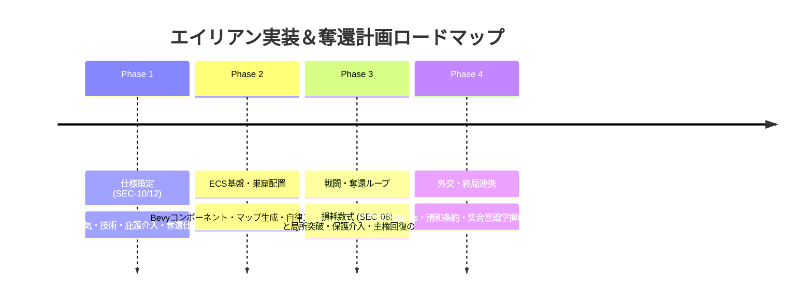

# エイリアン実装・惑星生態総体による自律全土奪還計画書 (Alien Implementation & Autonomous Biosphere Reclamation Plan)

本ドキュメントは、本作（4X大戦略＋諸兵科連合戦闘団制＋脱都市タイル進展）における**野生・固有エイリアン（原住惑星原生生物／生体生態群）の包括的仕様体系**と、**「エイリアンは人間的な個体知性体ではないが、惑星生態系の総体（超個体・集合的無意識）として外来汚染者・侵略者を排除し全土を自律的に取り戻す奪還計画を実施する」**という根本力学を規定する実装設計書である。

人類は彼らの奪還計画の主体ではなく、**「奪還・排除される外来勢力（標的）」**である。人類勢力がこの巨大な生態総体から情報（兆候・索敵・侵入予測）を盗み取り、あるいは干渉・使役・共生関係を結ぶためには、**人類側が独自に生体技術（Xeno-Tech）を開拓・研究することが必須**となる。

---

## 1. 全体設計俯瞰：知性体ではなく「総体としての自律奪還計画」

1. **知性体ではないが総体として計画的**:
   - 個々のエイリアンは昆虫や猛獣のような野生生物にすぎず、人間的な会話や政治思考は存在しない。
   - しかし、惑星全体の生態系ネットワーク（菌糸・フェロモン・地磁気共鳴）を通じ、**「惑星総体（ガイア的超個体）として、外来侵略者の拠点を計画的に孤立・包囲・圧壊する奪還行動」**が自動的に進行する。そこに人類の意思や意図は一切介在しない。
2. **人類側の位置づけと技術の必要性**:
   - 人類にとってエイリアン総体の奪還計画は「予測不能な生体災害・大包囲」。
   - 人類がエイリアンの内部状態（次の奪還目標、巣窟活性度、侵入ベクトル）を知るため、あるいは刺激を避けて共生・誘導するためには、**人類側がバイオテクノロジーを研究開発して初めてその信号を解読・傍受・干渉できるようになる**。

```text
┌─────────────────────────────────────────────────────────────────────────────┐
│          生態総体の自律全土奪還 ＆ 人類生体技術による解読・干渉構造         │
├─────────────────────────────────────────────────────────────────────────────┤
│  ①【生態総体層】(Planetary Superorganism & Inherent Domain)                 │
│     ・非知性体・超個体：個体知性はなく、総体として計画的な全土奪還を自律遂行│
│     ・全土が本来の生息域：人類の拠点は「切除すべき異物・外来汚染」          │
│     ・巣窟（Nest）は惑星総体の「前進免疫節・奪還前進基地」                  │
│     ・瘴気（Miasma）は奪還地を原生環境へ再同期させる「治癒胞子大気」        │
│                                                                             │
│  ②【戦力・TO&E層】(Wild Swarms & Titan Ecology)                             │
│     ・陸上軍団（6種: 小型侵食〜超大型コロッサス・長距離ニードル砲撃）        │
│     ・航空編隊（10種: 迎撃・制空〜空中生体戦艦・生体母艦）                  │
│     ・海上艦隊（6種: 哨戒〜超弩級生体戦艦・深海潜航リヴァイアサン）         │
│     ・非対称生体兵装（格闘破壊の時間差、指揮中枢の不在、例外的大空兵装）    │
│                                                                             │
│  ③【生態総体の自律全土奪還メカニクス】(Autonomous Reclamation)              │
│     ・人類とは無関係に、外来拠点の兵站を自動包囲し、局所突破・原野へ還元    │
│     ・汚染度・入植規模（ヘイト）の高い人類前哨から優先的に標的化・圧壊      │
│                                                                             │
│  ④【人類側の技術体系（Xeno-Tech Web）】(Human Bio-Decryption)               │
│     ・未研究時：総体の奪還動向は完全不可視（突発的大侵入として直撃）        │
│     ・技術研究により、総体のフェロモン・神経信号を「傍受・可視化」          │
│     ・上位技術で刺激遮断（マスキング）、他国への誘導弾、使役混成部隊を解禁  │
│                                                                             │
│  ⑤【終局・集合意識層】(Planetary Hivemind Awaken & Synchrony)               │
│     ・生態総体の中枢「原初の母胎」との直接同調                              │
│     ・人類が総体の奪還計画そのものを掌握・オーバーライド（直接操作権能）    │
└─────────────────────────────────────────────────────────────────────────────┘
```

---

## 2. エイリアン戦力体系（TO&E・生体兵装・混成）

各作戦領域におけるエイリアン戦力は、策定済みの部隊編成（[`INDEX_TOE.md`](./INDEX_TOE.md)）と厳密に整合している。

### 2.1 作戦領域別の戦力対応

| 作戦領域 | 野生・固有エイリアン（TO&E） | 主な役割・特徴 | 人類側の対応兵科・部隊 |
| :--- | :--- | :--- | :--- |
| **陸上** | **[陸上・エイリアン軍団](../toe_indexes/ground_alien.md)** (全6種)・小型侵食 / 中型強襲 / 生体重戦車・ニードル砲撃 / 飛翔近接 / コロッサス | ・津波のような質量突進・指揮官の不在（フェロモン自律連鎖）・格闘種による装甲解体（破壊所要時間の差）・全高20m級決戦巨獣の踏み潰し | 機甲師団 / 機械化歩兵師団 / 特科砲撃軍団 / 陸上戦艦打撃軍団 |
| **航空** | **[航空・エイリアン編隊](../toe_indexes/air_alien.md)** (全10種)・迎撃 / 制空 / 光学ステルス・高高度爆撃 / 生体レーダー / 輸送嚢・空中生体戦艦 / 空中生体母艦 | ・大気循環・気流層を利用した長距離滑空・光学屈折による生体ステルス・超巨大浮遊生体による防空傘と寄生体投下 | 戦闘航空団 / ステルス制空団 / 戦略爆撃団 / 空中戦艦航空団 |
| **海上** | **[海上・エイリアン艦隊](../toe_indexes/naval_alien.md)** (全6種)・生体戦艦 / 生体空母 / 主力水上群・哨戒 / 群体護衛 / 深海潜航群 | ・外洋の超巨大甲殻生物・キャビテーション衝撃波・生体ソナー・超深度無音潜航による通商破壊 | 通常艦隊 / 空母決戦艦隊 / 沿岸哨戒船団 / 水陸両用陸上戦艦 |

### 2.2 生体兵装の基本原則（非対称戦闘ルール）

1. **装甲解体（Tear Down）の物理的遅延**:
   - 戦車型（大型格闘種）は主力戦車を一撃破壊できず、「装甲に組み付き、長時間をかけて装甲板をこじ開ける」。
   - 中型格闘種は軽装甲車（LAV）を短時間で解体するが、主力戦車には傷しかつかず、IFVの解体には長い時間を要する。
   - 小型格闘種は下車歩兵・非装甲トラックの瞬時殺傷に特化。
2. **指揮官・C4Iの完全排除**:
   - 人類のような司令部・通信車は存在せず、**フェロモン連鎖**により全個体が自律行動。
3. **対空機能の例外性**:
   - 地上格闘種は航空機に手が出ないが、**対空専従種**のみ「生体破片弾幕（近接信管）」と「自律追尾生体弾（ミサイル）」を例外的に保持。

---

## 3. 生態総体による自律的な「全土奪還アルゴリズム（Autonomous Reclamation System）」

エイリアンは人類の都合とは無関係に、**「惑星総体としての自律的な防衛・奪還アルゴリズム」**に従って外来入植地を包囲・排除し、自然環境へと還元していく。

```text
┌─────────────────────────────────────────────────────────────────────────────┐
│             生態総体の自律全土奪還（Autonomous Reclamation）4大フェーズ      │
├─────────────────────────────────────────────────────────────────────────────┤
│  [Phase 1: 生体刺激の検知と標的選定 (Stimulus Detection & Target Lock)]    │
│    ・人類側の伐採、重化学工廠、戦闘騒音による「環境ヘイト値」の上昇         │
│    ・総体ネットワークがヘイト最高濃度の外来前哨を「切除対象」として特定     │
│                                  │                                          │
│  [Phase 2: 兵站絞首と前進包囲 (Biosphere Constriction & Encirclement)]      │
│    ・小型侵食種・潜水生体群が外来拠点の周囲へ潜行し、道路・パイプラインを切断│
│    ・前進巣窟から瘴気（Miasma）を送り込み、人類の補給活動・稼働率を低下    │
│                                  │                                          │
│  [Phase 3: 質量津波と防衛線圧壊 (Breeding Swarm Surge & Crushing)]          │
│    ・繁殖期（Breeding）に達した複数巣窟から、軍団規模のスウォームが同時出撃 │
│    ・大型格闘種が装甲車両を解体、コロッサス巨獣が防壁・人工建物を踏み潰す   │
│                                  │                                          │
│  [Phase 4: 原生環境への完全還元 (Ecological Reset & Sanctuary)]             │
│    ・人工施設残骸の生体分解・バイオマス吸収（工廠・舗装タイルの消滅）       │
│    ・高濃度瘴気タイルの定着と新巣窟の自律形成 ➔ 生態総体の領域へ完全復帰   │
└─────────────────────────────────────────────────────────────────────────────┘
```

### 3.1 総体の標的選定ロジック（Target Priority）

生態総体がどの人類拠点を優先して奪還・排除に向かうかは、人類の行動によって蓄積される**「刺激ヘイト（Aggro Index）」**によって厳密に決定される。

| 標的優先度 | 人類側の行動・施設形態 | 生態総体の反応・奪還形態 |
| :---: | :--- | :--- |
| **最優先 (Priority 1)** | **重化学工廠・テラフォーミング中枢** | 惑星環境を改変・汚染する施設に対し、コロッサス巨獣を含む決戦軍団を差し向けて根絶を図る。 |
| **高 (Priority 2)** | **舗装幹線道路・採掘拠点（鉱山）** | 原生土壌を切り裂くインフラに対し、小型・中型侵食種を送り込んで兵站連絡線を継続切断。 |
| **中 (Priority 3)** | **前線軍団の集結地・発砲音** | 160C長距離砲撃や戦闘騒音を感知し、直近の活性巣窟から迎撃・制空スウォームが急行。 |
| **低・休眠 (Dormant)** | **低環境負荷の科学観測杭・未開墾地** | 刺激が閾値未満の場合、総体は奪還対象とみなさず休眠状態（Dormant）を維持。 |

---

## 4. エイリアン情報取得・関係構築に必要な技術体系 (Xeno-Tech Web)

人類と原生生物は当初、言語・思考様式・知覚器官が完全に断絶している。
そのため、**「エイリアンからの情報取得（索敵・生態監視・意図探知）」**および**「関係構築・協調（フェロモン外交・共生条約・多種族協調部隊の解禁）」**を行うには、**技術ウェブ（Tech Web）における異星適応・生体工学技術の研究開発が不可欠な前提条件**となる。

```text
┌─────────────────────────────────────────────────────────────────────────────┐
│                 エイリアン情報取得・関係構築 4段階テクノロジー階層          │
├─────────────────────────────────────────────────────────────────────────────┤
│  [Tier 1: 生体音響・フェロモン基礎解析 (Xeno-Bioacoustics)]                │
│    ・技術: 「異星生物学」「フェロモン受容体解析」                           │
│    ・情報取得: 巣窟の活性度（ヘイト値・蓄積バイオマス）の可視化             │
│    ・関係手段: 局所的な威嚇回避、巣窟周辺1タイルでの不可侵・中立化          │
│                                  │                                          │
│  [Tier 2: 神経共鳴と生態データリンク (Neural Resonance & Bio-Link)]        │
│    ・技術: 「共鳴周波数同調」「生体フェロモン合成」「生体ソナー解読」       │
│    ・情報取得: 敵対国家に対するエイリアン大侵入ベクトルの事前察知           │
│    ・関係手段: 「フェロモン誘引弾」の解禁、未精製生体原質の取引・採取協定   │
│                                  │                                          │
│  [Tier 3: 多種族協調プロトコル (Coalition Integration Protocol)]           │
│    ・技術: 「異星神経接続インタフェース」「共生遺伝子同調」                 │
│    ・情報取得: マップ全域の原生生物索敵網の共有（戦場の霧の生体晴らし）     │
│    ・関係手段: 「多種族混成軍団（陸・海・空）」の編成解禁、共生自治区の樹立  │
│                                  │                                          │
│  [Tier 4: 惑星集合意識同調 (Planetary Hivemind Synchronization)]           │
│    ・技術: 「ガイア神経網同調」「原初言語解読」                             │
│    ・情報取得: 惑星全土の完全可視化、外来侵略者の全軍団・兵站線の常時監視   │
│    ・関係手段: 「エイリアン直接操作権能」の全面覚醒、全土暴走侵入の統制     │
└─────────────────────────────────────────────────────────────────────────────┘
```

### 4.1 情報取得能力の段階的解禁 (Intelligence Capabilities)

1. **未研究（初期状態）**:
   - エイリアンは完全な「黒い霧（謎の脅威）」。
   - 巣窟の内部状態（休眠/活性/繁殖）、ヘイト蓄積量、出現タイミングは一切不可視。
2. **Tier 1 研究完了**:
   - 巣窟をクリックすることで、ステージ状態（`NestStage`）および危険度メーターが表示。
3. **Tier 2 研究完了**:
   - 巣窟から発生したスウォームの移動目標タイルおよび大侵入予告カウントダウンが表示。
4. **Tier 3〜4 研究完了**:
   - 大気浮遊クラゲや深海潜航種が人類のC4Iネットワークと同期し、エイリアン視界が自国索敵網として全開。

### 4.2 野生生物制御・調教手段の段階的解禁 (Bio-Steering & Operational Protocols)

| 段階 | 必要技術 | 解禁される制御・使役・作戦手段 |
| :---: | :--- | :--- |
| **初期** | なし | 接近による刺激・攻撃反撃のみ（使役・制御不可）。 |
| **接触期** | **フェロモン受容体解析** | **「刺激マスキング（Scent Masking）」**: 巣窟周辺でのヘイト蓄積停止、移動時の先制攻撃回避。 |
| **連携期** | **生体フェロモン合成** | **「フェロモン誘導兵器（Attraction Warhead）」**: 敵対国家の拠点・連絡線へ野生スウォームを誘導・突入させる。 |
| **調教・使役期** | **共生遺伝子同調** | **「多種族協調編成（Coalition Units）」**: 神経インプラント・調教による原生巨大生物と通常軍団の混成部隊。 |
| **完全同調期** | **ガイア神経網同調** | **「集合意識覚醒（Hivemind Direct Control）」**: 惑星全土の野生エイリアンを直接マウス操作・大侵入統制。 |

---

## 5. 人類の庇護意識と排除派勢力への戦闘介入メカニクス (Patronage & Escalation)

共生・適応を志向する人類勢力は、**「原生エイリアンに対して強い庇護意識（Patronage）」**を抱くようになる。
その結果、彼らを無価値な害獣として絶滅・駆除しようとする**「排除派勢力（Purity/Supremacy等のテラフォーミング推進国家）」に対して強い反発・敵愾心を向け**、直接的な領土紛争がなくとも、**以下の「2大方向性（保護介入／攻勢への協調）」に基づいて排除派勢力との本格的な軍事衝突（開戦）へと突入する**。

```text
┌─────────────────────────────────────────────────────────────────────────────┐
│                 人類の庇護意識による排除派勢力との戦闘突入モデル            │
├─────────────────────────────────────────────────────────────────────────────┤
│                                                                             │
│  【方向性 A: 原生保護介入 (Defensive Protection Escalation)】                │
│    ・条件: 排除派国家による「エイリアン巣窟・野生個体への攻撃行動」の検知   │
│    ・トリガー:                                                               │
│        1. 巣窟への焦土爆撃・砲撃・討伐軍団進入の探知                         │
│        2. 瘴気除去・テラフォーミング杭の打設現場の発見                       │
│    ・結果: 「原生環境保護の正義」による開戦事由（Casus Belli）生成・防衛参戦 │
│                                                                             │
│  ─────────────────────────────────────────────────────────                 │
│                                                                             │
│  【方向性 B: 攻勢への協調 (Offensive Coordination)】                         │
│    ・条件: 生態総体が排除派拠点へ自律奪還攻勢（大侵入）を仕掛ける局面       │
│    ・突入の2大アプローチ:                                                    │
│        ①「技術的知覚アプローチ (Technological Perception)」:                │
│            ・Xeno-Tech（Tier 2以上）で総体の侵入ベクトル・時刻を事前に正確察知│
│            ・スウォーム出撃に合わせて自軍機甲軍団を同時発進させ、共同挟撃    │
│        ②「状況的便乗アプローチ (Opportunistic Exploitation / 尻馬に乗る)」: │
│            ・技術未熟でも、敵拠点が大群に襲撃されて混乱・炎上した状況を目視  │
│            ・「今が好機」として背後から突入し、敵の防衛線を一気に瓦解させる  │
│                                                                             │
└─────────────────────────────────────────────────────────────────────────────┘
```

### 5.1 方向性A：原生保護介入（排除派の攻撃行動判定）

排除派NPC国家が以下の敵性行動を実行した際、保護派プレイヤー／勢力に即時警告と介入選択肢が発生する。

1. **駆除作戦（Pest Control Sortie）の検知**:
   - 排除派の軍団が野生エイリアン巣窟（Nest）のタイルへ進入し、攻撃を開始した瞬間。
2. **テラフォーミング汚染（Terraforming Contamination）の拡大**:
   - 排除派工兵が大気除染杭や化学散布を開始し、原生瘴気（Miasma）を強制除去した瞬間。
3. **判定と帰結**:
   - 保護派国家は**「自然保護・生態系守護」を名目とする正当な即時開戦（Justified War）**を発令可能。
   - 巣窟近傍へ防衛軍団（または直協航空連隊）を急行させ、排除派軍団の背後を突いて包囲殲滅する。

### 5.2 方向性B：攻勢への協調（技術的知覚 vs 状況的便乗）

生態総体が自律的に排除派拠点を奪還しようと津波のように押し寄せる際、保護派人類は2通りの方法でその攻勢と連携する。

| 協調アプローチ | 前提条件 | 作戦展開・メカニクス | メリット / リスク |
| :--- | :--- | :--- | :--- |
| **① 技術的知覚***(Technological Perception)* | **Xeno-Tech Tier 2+**（神経共鳴・フェロモン解析済） | 総体のフェロモンシグナルから**「〇〇ターン後に排除派第3工廠へ突撃」という正確な侵入ベクトルを事前察知**。自軍の常設増強機甲軍団・長距離砲兵を事前に理想的な射撃位置へ配置し、スウォーム突入と一秒の狂いもなく**「完全な空地・生体統合挟撃」**を実行。 | **［最高効率・損耗極小］**野生生物を肉壁・先陣として利用し、自軍は安全圏から砲撃支援と重要施設のピンポイント接収が可能。 |
| **② 状況的便乗***(Opportunistic / 尻馬に乗る)* | **技術不要**（Xeno-Tech未研究でも可） | 索敵範囲内で、**排除派拠点が突如として野生大群（Swarm）に襲撃され、敵前線が炎上・防空弾薬を乱射しているパニック状況を偶然発見**。事前の計画性はないが、**「混乱に乗じて今すぐ突入する（尻馬に乗る）」**指示を発令し、敵の背後からなだれ込む。 | **［即時性・高リスク］**事前準備がないため自軍も野生エイリアンの流れ弾や格闘に巻き込まれる危険（誤爆フレンドリーファイア）があるが、技術不足でも敵拠点を落とせる。 |

---

## 6. Rust/Bevy ECS 実装アーキテクチャ

本仕様をゲームエンジン上で動かすためのデータ構造とシステム定義です。

### 6.1 コンポーネント構造

```rust
use bevy::prelude::*;

/// 生態総体による自律奪還タスク（Autonomous Reclamation Task）
#[derive(Component, Debug, Clone, Reflect)]
pub struct AutonomousReclamationTask {
    pub target_settlement: Entity,      // 標的となった人類拠点・タイル
    pub stage: ReclamationStage,
    pub aggro_heat: f32,                // 蓄積された環境刺激・ヘイト値
    pub swarm_mass: f32,                // 動員された生体スウォーム質量
    pub constriction_rate: f32,         // 兵站包囲・連絡線切断率 (0.00 〜 1.00)
}

#[derive(Debug, Clone, Copy, PartialEq, Eq, Reflect)]
pub enum ReclamationStage {
    Tracking,       // 刺激検知・標的ロック
    Constriction,   // 兵站絞首・前進包囲（Miasma拡大）
    Surge,          // 大群突入・防衛線圧壊（交戦中）
    EcologicalReset,// 残骸分解・原野還元
}

/// エイリアン巣窟（Nest）コンポーネント
#[derive(Component, Debug, Clone, Reflect)]
pub struct AlienNest {
    pub stage: NestStage,
    pub biomass_stock: f32,
    pub hate_level: f32,               // 人類の環境破壊・発砲による刺激蓄積
    pub spawn_cooldown: u32,
}

#[derive(Debug, Clone, Copy, PartialEq, Eq, Reflect)]
pub enum NestStage {
    Dormant,   // 休眠（近接まで無害）
    Active,    // 活性（周辺哨戒）
    Breeding,  // 繁殖（スウォーム生産・瘴気拡大）
    Swarming,  // 暴走大侵入
}

/// タイルの生態・占領・主権状態
#[derive(Component, Debug, Clone, Reflect)]
pub struct TerritorialStatus {
    pub is_alien_sanctuary: bool,       // 原生生態系（瘴気と原生生物の領域）
    pub human_occupier: Option<Entity>, // 外来占領者（人類勢力）
    pub pollution_level: f32,           // 人工重金属・改変汚染度 (0.00 〜 1.00)
    pub miasma_density: f32,            // 瘴気濃度 (0.00 〜 1.00)
    pub infrastructure_health: f32,     // 人工施設健全度 (0.00 〜 1.00)
}
```

### 6.2 コアECSシステム

```rust
// 生態総体による自律奪還進行システム
pub fn autonomous_reclamation_system(
    mut commands: Commands,
    mut tasks: Query<(Entity, &mut AutonomousReclamationTask)>,
    mut territories: Query<&mut TerritorialStatus>,
) {
    for (task_entity, mut task) in tasks.iter_mut() {
        if let Ok(mut status) = territories.get_mut(task.target_settlement) {
            match task.stage {
                ReclamationStage::Surge => {
                    // 人類拠点の人工施設が完全に破壊された場合、原生還元へ移行
                    if status.infrastructure_health <= 0.05 {
                        task.stage = ReclamationStage::EcologicalReset;
                    }
                }
                ReclamationStage::EcologicalReset => {
                    // 人工汚染を生物分解し、瘴気が完全充満したことで生態総体へ復帰
                    if status.pollution_level <= 0.05 && status.miasma_density >= 0.8 {
                        status.human_occupier = None;
                        status.is_alien_sanctuary = true;
                        commands.entity(task_entity).despawn();
                    }
                }
                _ => {}
            }
        }
    }
}
```

---

## 7. 段階的実装ロードマップ



| フェーズ | 重点内容 | 成果物 |
| :---: | :--- | :--- |
| **Phase 1**（仕様確定） | **SEC-10（生態・巣窟）および技術・庇護奪還仕様の確定**・巣窟ライフサイクル・瘴気勾配・Xeno-Tech Web情報取得・庇護介入・協調アプローチ仕様 | `docs/specs/ALIEN_ECOLOGY_AND_NEST_SYSTEM.md``docs/units/INDEX_TOE.md` 連携 |
| **Phase 2**（基盤実装） | **ECS基盤と出現システム**・`AlienNest`, `AlienSwarmUnit`, `AutonomousReclamationTask`・マップ生成時の巣窟配置と瘴気レンダリング | `src/alien/``src/territory/` |
| **Phase 3**（戦闘・奪還） | **戦闘解決と保護介入・協調突入**・装甲解体（Tear Down）処理・排除派攻撃検知トリガー・攻勢協調（知覚/便乗）の実装 | `src/combat/``src/reconquest/` |
| **Phase 4**（終局統合） | **全土危機と集合意識掌握**・全土暴走侵入（Crisis）イベント・エイリアン直接操作権能の解禁と最終秩序樹立 | `docs/specs/VICTORY_AND_CRISIS_CONDITIONS.md` 連携 |

---

## 8. 関連ドキュメント

- [`GAME_DESIGN.md`](../../GAME_DESIGN.md) - コアゲームデザイン設計書
- [`INDEX_TOE.md`](./INDEX_TOE.md) - 内部編成（TO&E）仕様書マスター目録
- [`CHASSIS_AND_MODULE_CATALOG.md`](../../specs/CHASSIS_AND_MODULE_CATALOG.md) - 基本車台・初期兵装カタログ
- [`THIRD_PARTY_AND_TERRITORIAL_CLAIMS.md`](../../specs/THIRD_PARTY_AND_TERRITORIAL_CLAIMS.md) - 自然国境・領土要求仕様書
- [`VICTORY_AND_CRISIS_CONDITIONS.md`](../../specs/VICTORY_AND_CRISIS_CONDITIONS.md) - 動的情勢推移・終局仕様書
