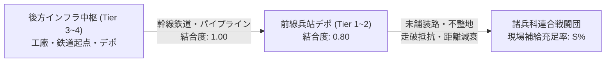
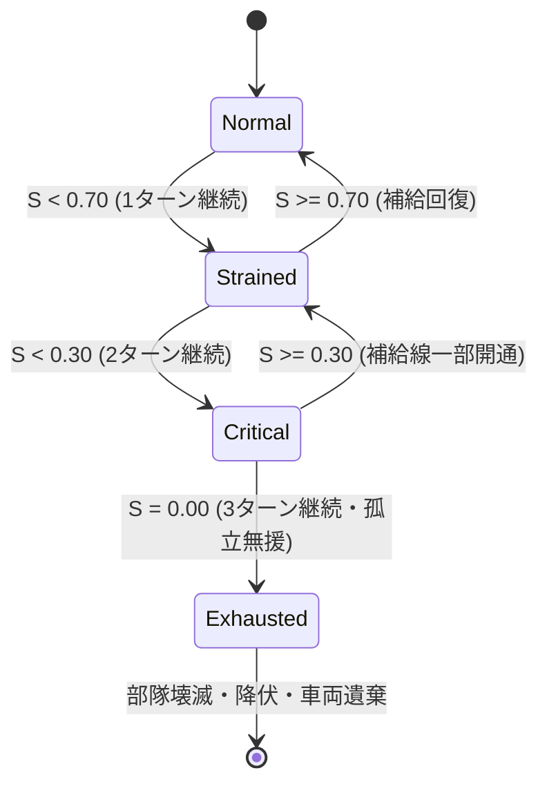
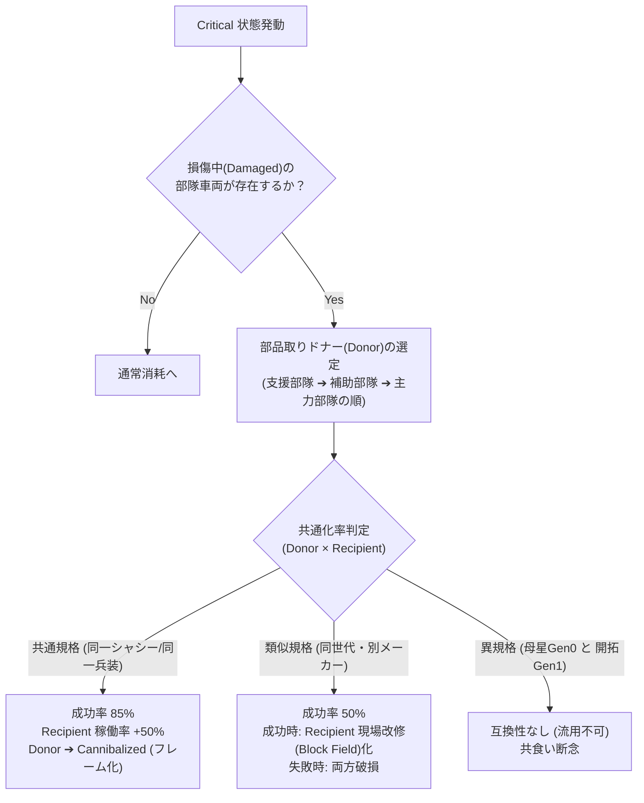
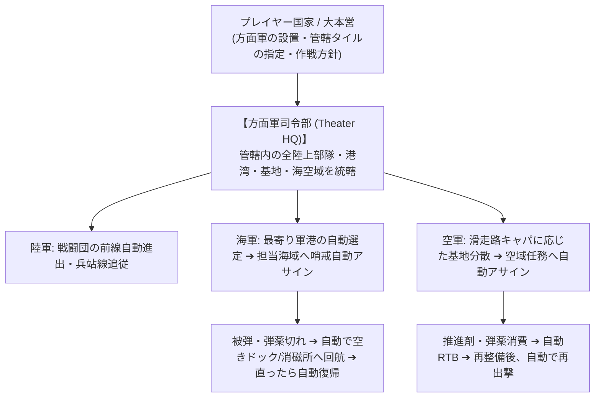

# 3軍統合（陸・海・空）戦闘団（TO&E）× 兵站・装備更新統合データ仕様書 (SEC-01)

(Tri-Service Combined Arms TO&E, Logistics Infrastructure & Cannibalization Specification)

本作（4X大戦略＋諸兵科連合戦闘団制＋脱都市タイル進展）における**「3軍（陸上戦闘団・海洋艦隊・航空団）の内部データ構造、各ドメインに応じた自動補給・洋上補給・空中給油、兵站途絶時の稼働率低下、現場判断による共食い整備（陸軍）およびドック・基地回航（海軍・空軍）のステートマシン」**を定義する統合仕様書である。

---

## 1. 増強師団・諸兵科連合戦闘団（TO&E）データ構造

大戦略マップ上の1コマとして運用される戦闘団は、歩兵・戦車・自走砲・防空・直協航空・工兵・補給が自己完結した**「増強師団／諸兵科連合旅団（約10,000〜15,000名、戦闘・支援車両・航空機 約600〜700両/機規模）」**に相当する。
内部階層は**「4両＝1小隊、4小隊＝1中隊（16両）、4個中隊＝1個大隊（64両）」**という2進数倍々補完（2-2構成）を基底とする。

```text
┌─────────────────────────────────────────────────────────────────────────────┐
│       増強師団・諸兵科連合戦闘団 (Combined Arms Combat Group TO&E) 構造     │
├─────────────────────────────────────────────────────────────────────────────┤
│                                                                             │
│  【師団司令部および直轄付属群 (Division HQ & Specialized Attached)】         │
│    ・師団司令部管理中隊（HHC: 指揮所C4I車・通信中継・警護）                 │
│    ・師団通信大隊（大容量戦術データリンク・抗妨害通信網）                   │
│    ・師団施設戦闘工兵大隊（重架橋車 16両 ＋ 重啓開工作車 16両 ＋ 地雷散布車）│
│    ・師団軍事情報・ISR隊（長距離地上レーダー ＋ 戦術UAV指揮統制）            │
│    ・師団特殊生物化学武器防護隊（対エイリアン除染・環境防護 16両）          │
│    ・師団対舟艇対戦車誘導弾隊（重装甲多目的重ミサイル発射車 16両）          │
│                                                                             │
│  【基幹機甲連隊群 (4個諸兵科連合機甲連隊: 戦車256両 ＋ 重IFV256両 ＋ 重迫128両)】│
│    ・第1機甲連隊（連隊HHC ＋ 工兵・重偵察 ＋ 機甲大隊×2: 戦車64・IFV64・迫32）│
│    ・第2機甲連隊（連隊HHC ＋ 工兵・重偵察 ＋ 機甲大隊×2: 戦車64・IFV64・迫32）│
│    ・第3機甲連隊（連隊HHC ＋ 工兵・重偵察 ＋ 機甲大隊×2: 戦車64・IFV64・迫32）│
│    ・第4機甲連隊（連隊HHC ＋ 工兵・重偵察 ＋ 機甲大隊×2: 戦車64・IFV64・迫32）│
│    ※ 各機甲大隊（計8個）が「戦車32両＋重IFV32両＋自走重迫16両＝80両」で完結│
│                                                                             │
│  【第1装甲化歩兵連隊 (1st Armored Infantry Regiment)】 ◀── [突破後掃討・確保]│
│    ・連隊本部管理中隊（HHC: 指揮所C4I車、装甲救護・重ARV）                 │
│    ・連隊付装甲戦闘工兵中隊（障害啓開・陣地要塞化 16両）                    │
│    ・第1諸兵科連合装甲歩兵大隊（重IFV32両 ＋ 装甲APC32両 ＋ 自走重迫16両＝80両）│
│    ・第2諸兵科連合装甲歩兵大隊（重IFV32両 ＋ 装甲APC32両 ＋ 自走重迫16両＝80両）│
│    ※ 機甲突破の背後で強襲突入（重IFV）と面制圧・要衝要塞化（装甲APC）を自律遂行│
│                                                                             │
│  【左右両翼偵察戦闘連隊 (Wheeled Recon Combat Regiments: 計160両)】         │
│    ・第1偵察戦闘連隊（左翼 80両: 戦闘大隊48両［迫撃16含］ ＋ 偵察大隊32両） │
│    ・第2偵察戦闘連隊（右翼 80両: 戦闘大隊48両［迫撃16含］ ＋ 偵察大隊32両） │
│    ※ 左右両翼を各1個連隊でスクリーン。自前の120C迫撃中隊で遭遇戦・遅滞を自力完結│
│                                                                             │
│  【師団野戦特科連隊 (Field Artillery Regiment)】                            │
│    ・自走野戦特科第1大隊（160C自走榴弾砲 24両）                            │
│    ・自走野戦特科第2大隊（160C自走榴弾砲 24両） ◀── 持続斉射交代         │
│    ・重破砕特科大隊（210C重自走榴弾砲 16両）                                │
│    ・戦術誘導打撃大隊（TELミサイルランチャー 16両） ◀── 長距離精密阻止     │
│                                                                             │
│  【師団高射連隊 (Air Defense Regiment)】                                    │
│    ・近接・低高度防空大隊（35C自走複合機関砲 24両）                         │
│    ・短・中距離地対空誘導弾大隊（装軌式複合SAM 24両） ◀── 師団防空傘    │
│    ・師団電子戦・早期警戒防空大隊（対空レーダー・指向性EW 16両）             │
│                                                                             │
│  【師団直轄 航空連隊・兵站回収群 (Aviation & Logistics)】                    │
│    ・師団直協戦闘航空連隊（計32機: 1飛行隊8機 × 4個飛行隊）                │
│       ├─ 第1・第2戦闘飛行隊（重武装戦闘ヘリ/VTOL 16機: 8機×2）           │
│       └─ 第1・第2輸送飛行隊（強襲戦術輸送ヘリ 16機: 8機×2）             │
│    ・前方回収・野戦整備大隊（装甲回収車ARV 32両 ＋ 移動工作ドック）         │
│    ・師団兵站補給第1連隊（燃料弾薬輸送大型トラック梯団）                   │
│    ・師団兵站補給第2連隊（航空推進剤・重部品輸送梯団）                     │
│                                                                             │
└─────────────────────────────────────────────────────────────────────────────┘
```

### 1.1 部隊単位のデータ構造（Rust / Bevy ECS想定）

```rust
/// 戦闘団を構成する各大隊・中隊エンティティ
#[derive(Debug, Clone, PartialEq)]
pub struct SubUnit {
    pub unit_id: u32,
    pub name: String,
    pub echelon: EchelonLevel,          // Platoon, Company, Battalion
    pub category: UnitCategory,         // Armor, MechInf, Artillery, AirDefense, Aviation, Logistics
    pub chassis_id: String,             // 車台ID (例: "Std-T4", "Std-W6", "Biped-H1")
    pub weapon_module_id: String,       // 兵装ID (例: "WPN-01", "WPN-02")
    pub powerpack_id: String,           // 動力ID (例: "PWR-01", "PWR-02")
    pub armor_module_id: String,        // 装甲ID (例: "ARM-01", "ARM-02")
    pub generation: Generation,         // Gen0(遺産), Gen1(開拓), Gen2(現地重工)...
    pub vehicle_count: u16,             // 配備両数 (小隊=4, 中隊=16, 大隊=48~64)
    pub status: UnitHealthStatus,       // 部隊健全度状態
    pub field_modified: bool,           // 現場現地改修 (Block Field) フラグ
    pub frame_age_years: u16,           // シャシー・フレーム稼働年数 (0〜100年)
    pub structural_integrity: f32,      // 骨格・ハル構造健全度 (0.00..=1.00: 金属疲労・結晶脆化)
}

#[derive(Debug, Clone, Copy, PartialEq, Eq)]
pub enum EchelonLevel {
    Platoon,    // 小隊 (4両)
    Company,    // 中隊 (16両)
    Battalion,  // 大隊 (48〜64両)
}

#[derive(Debug, Clone, Copy, PartialEq, Eq)]
pub enum UnitCategory {
    Armor,              // 機甲（戦車・突撃砲）
    MechanizedInf,      // 機械化歩兵（IFV・APC・工兵）
    Artillery,          // 特科（自走砲・TEL誘導弾）
    AirDefense,         // 高射防空（機関砲・SAM）
    Aviation,           // 直協航空（戦闘ヘリ・VTOL・UAV）
    LogisticsSupport,   // 兵站支援（ARV・補給トラック・ドローン母車）
}

#[derive(Debug, Clone, Copy, PartialEq)]
pub enum UnitHealthStatus {
    Operational { efficiency: f32 },   // 健全〜軽微損傷 (稼働効率 0.70..=1.00)
    Damaged { repair_turns: u8 },      // 要整備・現場修理中 (戦闘力半減)
    Cannibalized,                      // 部品取り済・稼働不能 (フレームのみ残存)
    StructuralExpired,                 // 構造寿命限界（金属疲労・骨格破断限界 / 最大1世紀）
    Destroyed,                         // 完全撃破・全滅
}
```

### 1.2 プラットフォーム基幹構造（フレーム・車体）の寿命限界：最長1世紀

モジュール（武装・電子戦FCS・動力エンジン）が野戦交換部品（FieldSpares）や近代化改修（MLU）で更新され続けるのに対し、**土台となる「車体フレーム／竜骨（キール）／主翼桁」は金属疲労・衝撃荷重・異星大気腐食により不可逆的に劣化**する。

1. **歴史的耐用年数基準の適用（長くて1世紀／約100年）**:
   - 超弩級艦艇（陸上戦艦・水上決戦艦）：最長 **100年（1世紀）**（ドック大改修を前提）
   - 重装軌戦闘車両（戦車・自走重砲）：**60〜80年**（パワーパック・足回り交換の限界）
   - 装輪・軽装甲車両・航空機：**30〜50年**（モノコック疲労、主翼桁クラック限界）
2. **フレーム老朽化のゲーム的影響**:
   - `frame_age_years` が設計寿命（50〜100年）に近づくと、`structural_integrity` が低下。
   - 骨格が劣化した部隊は、野戦整備を行っても最大稼働効率にキャップがかかり、被弾時の「即座の全滅・車体破断率」が上昇する。
   - **最終的な帰結**: 「中身の兵装をいくら最新に換装しても、土台が持たない」ため、プレイヤーは新世代の新造車台（Gen 2/3工廠生産品）への完全リプレイスか、後方警備への払い下げを迫られる。

---

## 2. インフラ結合度による自動プッシュ補給モデル

本作では前線部隊に「燃料切れ」や「弾薬運び」を1手ずつ命じることはせず、親タイルの**「インフラ結合度（Infrastructure Connectivity: 0.00〜1.00）」**と**「補給線距離（Supply Line Distance）」**に基づいて自動算出される。



### 2.1 補給充足率（Supply Satisfaction: $S$）の計算式

戦闘団が所在するタイルにおいて、毎ターン受け取れる補給充足率 $S$（0.00〜1.00）は以下で決定される：

$$S = C_{\text{tile}} \times \left(1.0 - \min(1.0, \frac{D_{\text{depot}}}{R_{\text{supply}}})\right) \times \eta_{\text{doctrine}}$$

- $C_{\text{tile}}$: 戦闘団が所在するタイルのインフラ結合度（0.00〜1.00）。未開拓地は 0.10、野戦前哨は 0.40、舗装動脈上は 0.80〜1.00。
- $D_{\text{depot}}$: 最寄りの補給デポ（Tier 1以上の兵站拠点）からの親タイル距離（ヘックス数）。
- $R_{\text{supply}}$: 補給デポの最大有効兵站半径（基本値: 4〜8タイル）。
- $\eta_{\text{doctrine}}$: 国家兵站ドクトリンによる効率補正（0.85〜1.15）。

---

## 3. 兵站断絶時の状態遷移（State Machine）

毎ターンの補給充足率 $S$ に応じて、戦闘団のステータスは以下の4段階で遷移する。



### 3.1 ステート別挙動詳細

| ステート名    | 判定条件              | 戦術・大戦略ペナルティ                       | 現場整備大隊の自律動作                                                                  |
| :------------ | :-------------------- | :------------------------------------------- | :-------------------------------------------------------------------------------------- |
| **Normal**    | $S \ge 0.70$          | なし（稼働率 100%）。全火器自由射撃。        | 定期点検を実施。軽微損傷車両を毎ターン全快。                                            |
| **Strained**  | $0.30 \le S < 0.70$   | 移動速度 -20%、支援砲撃の弾薬割当量 -30%。   | 消耗部品の延命措置。主打撃大隊へ優先配分。                                              |
| **Critical**  | $S < 0.30$            | 移動速度 -50%、反撃のみ許可（攻勢不可）。    | **共食い整備（Cannibalization）の自律実行**。損傷車両をパーツ取りに回し主力車両を復旧。 |
| **Exhausted** | $S = 0.00$（3ターン） | 移動不能、全武装弾薬枯渇（白兵・自衛のみ）。 | 整備不能。敵性部隊と交戦時、名誉・ドクトリンに応じた投降/遺棄自爆を実行。               |

---

## 4. 共食い整備（Cannibalization）ロジック

`Critical` 状態に陥った戦闘団において、整備部隊は部隊の全滅を防ぐため、**「損傷の激しい車両を犠牲にし、その部品を取り外して別の大隊・中隊の車両を稼働状態に戻す」**自律処理を行う。



### 4.1 非再生産・初期高度装備（Gen 0等）の共食い整備メカニクス

国内に金型や工作機械ラインが存在しない「非再生産装備（初期積載の高度MIL-SPEC品や鹵獲先進兵器など）」の共食い整備は、産業自立度と規格互換性の観点から以下の普遍的メカニクスで処理される。

1. **同型機からの部品取り（同一規格ドナー）**:
   - **元部品（ドナー部位）の残存健全度に応じた復旧率と劣化度**:
     - 一律に劣化するのではなく、**「ドナー機体側のどの部位が無事だったか（元部品の状態）」**によって復旧結果が分岐する。
     - **非被弾・健全部位の流用（クリーンパーツ）**:
       - 例: 砲塔が吹き飛んだ撃破車から無傷のエンジンブロックを回収、または履帯が吹き飛んだ車体からFCS・電子コアを移植。
       - **結果**: 稼働率はほぼ **100%（新品同様）** に回復し、劣化蓄積も極めて軽微（0〜5%程度）。
     - **過酷稼働・疲労部位の流用（摩耗パーツ）**:
       - 例: 長期行軍で熱疲労を起こしたパワーパック、被弾破片が食い込んだ装甲板、衝撃で歪んだサスペンションの移植。
       - **結果**: 応急復旧はするものの、**稼働率上限の低下（100% ➔ 80〜90%）**や「累積整備疲労」が蓄積し、次回の故障率が上昇。
   - **ドナー機の恒久欠損**:
     - 部品を剥ぎ取られたドナー機体は**「恒久欠損（廃車・フレーム化）」**となり、国内に該当金型ラインが新設・リバースエンジニアリングされるまで再生産・補充が効かない。
     - 大戦略ダッシュボードにおいて「非再生産資産の消耗・欠損アラート」が通知される。
   - **ゲーム的力学**:
     - 「砲塔をやられた車両」と「足回りをやられた車両」をニコイチ合体させて1両をほぼ完全復旧させる現場のリアリズムと、ボロボロの残骸から無理やり寄せ集めた車両が次第に劣化・疲弊していくリアリズムが両立する。
2. **現地暫定規格（Gen 1等の低精度部品）の流用・無理な溶接**:
   - 規格不一致のため、流用成功率は基礎値 **25%** に低迷。
   - **成功時**: 車両は「現場改修型（Block Field）」となり、稼働率は復旧するが整備工数係数が増加し、スペック（電子戦・出力）が一定割合低下する。
   - **失敗時**: 駆動部・電子系統のショート等により、移植先車両も致命的損傷を被る。
3. **本メカニクスのゲーム的意義**:
   - これは「母星だから特別扱い」なのではなく、**「国内にサプライチェーンが存在しない高度機材を、無理に前線維持させるか（劣化と共食い死の受容）、後方温存して技術解析・国産化の雛形にするか」という普遍的な資源・装備管理の意思決定**として機能する。

---

## 5. 国家整備ドクトリン（ステアリング介入）

プレイヤーは個々の共食い整備を手動でポチポチ指示することはできないが、**「国家整備ドクトリン（Maintenance Steering）」**をマクロ設定することで、全軍の整備方針を誘導できる。

```text
┌─────────────────────────────────────────────────────────────────────────────┐
│                 国家整備ドクトリン（ステアリング設定値）                    │
├─────────────────────────────────────────────────────────────────────────────┤
│                                                                             │
│  [1. 前線維持最優先 (Survival First)]                                       │
│    ・共食い整備の閾値を緩和（Strained 段階から部品流用を開始）              │
│    ・Gen 0 の共食い解体を許可（主戦力大隊の稼働車両数を死守）               │
│    ・効果: 包囲戦・遠征時の継戦能力 +40%、Gen 0 喪失ペースが加速            │
│                                                                             │
│  [2. プラットフォーム温存 (Platform Preservation - 標準)]                  │
│    ・Critical 状態でのみ同型間共食いを許可                                  │
│    ・Gen 0 の部品取り解体を原則禁止（稼働率低下を受け入れ後方回送）         │
│    ・効果: 兵器耐用年数の最大化、長期的な軍事資産の保全                     │
│                                                                             │
│  [3. 共通化厳格準拠 (Strict Modular Discipline)]                           │
│    ・規格外・類似モジュールの無理な現場溶接（Block Field化）を厳禁          │
│    ・故障車は共食いさせず、正規インフラ（工廠デポ）への牽引搬送を徹底       │
│    ・効果: 部隊共通化率 100% を維持、兵站が繋がっている際の修理速度 +30%     │
│                                                                             │
└─────────────────────────────────────────────────────────────────────────────┘
```

---

## 6. 3軍（陸・海・空）統合兵站モデルの対比と非対称性

本作における兵站・修理システムは、陸軍の「現場共食い整備」のみならず、現代軍事力学および大戦略自動化（HoI式×方面軍統合）に則った海軍・空軍固有の兵站制約をモデル化している。

### 6.1 方面軍（Theater）による基地・海域・空域の自動アサイン

プレイヤーが艦隊や航空団を1つずつ手動で「この基地に配属し、この海域・空域へ任務指定する」といったマイクロマネジメントは行わない。
本作の**「方面軍（Theater Command）システム」**に基づき、高位の作戦領域（Sectors）とドクトリンを指定するだけで、司令部AIが直下の3軍部隊・基地・任務を**自律的に自動アサイン・再配分**する。



1. **海軍の自動アサインと回航サイクル**:
   - 方面軍管轄下の海洋タイルに対し、所属艦隊が「哨戒（Patrol）」「迎撃（Strike）」「通商護衛（Escort）」へ自動配分される。
   - 母港は**「管轄内でドック・消磁能力に空きがある最寄りの軍港／前進泊地」が司令部AIにより自動紐付け**される。
   - 中破・大破・弾薬枯渇時は**自動で回航ステート（InTransit）に切り替わって母港へ後退**し、浮ドック修繕や船体消磁が完了すると、プレイヤーの手を煩わせることなく**自動で元の任務海域へ再進出**する。
2. **空軍の基地分散と自動ソアティ生成**:
   - 方面軍内の空軍基地（正規基地・道路滑走路）の「滑走路キャパシティ」および「燃料パイプライン接続状況」を参照し、戦闘機隊・爆撃機隊が自動で最適基地へ分散駐留（過密ペナルティの自動回避）。
   - 管轄空域での航空優勢（CAP）や近接航空支援（CAS）任務へ自動出撃し、燃料・残弾消費後は自動でRTB（基地帰投）。整備完了次第、自動で次期ソアティが生成される。

---

### 6.2 3軍兵站特性マトリクス

| 項目 | 陸軍（地上増強師団） | 海軍（艦隊） | 空軍（航空団） |
| :--- | :--- | :--- | :--- |
| **主戦力単位** | 常設増強師団 / 軍団 | 通常艦隊 / 航空艦隊 / 戦艦艦隊 | 戦闘航空団 / 迎撃航空団 / 輸送航空団 |
| **補給の基盤（起点）** | 前線兵站デポ / 補給工廠 | 軍港 / 臨海工廠 / MOB（洋上基地） | 正規空軍基地 / 前線飛行場 / 空母 |
| **現場での受給手段** | 道路・鉄道・パイプライン網の自動プッシュ | 随伴補給艦による洋上補給（UNREP） | 空中給油機（Tanker: 燃料のみ） |
| **現場での修理可否** | **現場で可能**（ARV・移動工作車、共食い整備） | **現場不可**（ダメコンによる沈没防止・機関バイパスのみ） | **現場不可**（緊急着陸かベイルアウト） |
| **被弾・損傷時の対応** | 前線で耐えて自力修理・居座り | **母港・浮ドック・仮設泊地への「回航」** | **母基地・滑走路への「帰投（RTB）」** |
| **ニコイチ（共食い）修復** | **前線・野戦で即時実行**（ARV） | **工廠・浮ドック等の整備拠点で実行**（艦首/機関/VLS移植） | **空軍基地・デポで実行**（主翼/エンジン/FCS移植） |
| **前進設営アセット** | 野戦補給デポ、工兵架橋 | **浮ドック ＋ 起重機船**（仮設泊地開設） | **道路滑走路、移動式整備トラック** |
| **兵站途絶時の末路** | 停止 ➔ 共食い ➔ 白兵・投降・自爆 | 弾薬・燃料枯渇 ➔ 母港強制後退 | **地上待機（Grounded: 飛べない鉄屑化）** |

---

### 6.2 海軍の補給・損傷修繕仕様（回航と前進泊地アセット）

現代艦艇は複合素材・電子戦アレイ・精密機関の塊であり、洋上での本格修理（工作艦による旋盤作業など）は不可能である。

1. **洋上補給（UNREP: Underway Replenishment）の厳格な範囲限定**:
   - 艦隊に随伴する補給艦モジュール（または民間コンテナ船団）から補給可能なのは、**「艦艇燃料（重油・核推進剤）」「ミサイル・弾薬」「真水・食料・交換用簡易アセンブリ」**のみに限定される。
   - 浸水、主装甲貫通、主機（タービン）損傷、フェーズドアレイ破損などの「構造修理」は洋上補給艦では一切行えない。
2. **回航ステート（Transit / Limp Home）**:
   - 艦艇が「中破・大破」または「弾薬完全枯渇」となった場合、現場での居座りは行えず、**最寄りの修繕可能拠点へ「回航（自動後退）」**ステートに移行する。
   - 回航中は最大速力が半減し、護衛部隊による対潜・防空アンブレラがなければ敵哨戒潜水艦・航空攻撃に対して極めて脆弱となる。
3. **前進泊地アセット（浮ドック・起重機船）**:
   - 本土の本格海軍工廠（固定乾ドック）は建造・全快修理が可能だが、戦線から遠い。
   - プレイヤーは工廠から**「浮ドック（Floating Drydock）」および「起重機船（Crane Vessel）」**を任意の島嶼部・沿岸タイル、または洋上浮体基地（MOB）へ曳航・展開することで、**「仮設前進修繕泊地」**を開設できる。
   - これにより、大破艦艇を遠方の本土まで戻さずに中破〜大破修理・VLS再装填を行わせ、前線復帰時間を劇的に短縮可能となる。
4. **整備拠点（工廠・浮ドック）におけるニコイチ修復（Depot Cannibalization）**:
   - 洋上現場では不可能なニコイチ修復も、**「母港工廠や浮ドック・起重機船のある整備拠点」に回航収容された後であれば実行可能**となる。
   - 例: 艦首を吹き飛ばされた艦艇と、艦尾・機関室を大破した同型艦をドック内で切断・接合（英海軍駆逐艦ズビアン［Zulu＋Nubian］や、米原潜サンフランシスコ［ホノルルの艦首ブロックを移植］等の実例）。
   - ただし、大掛かりな切断・ブロック移植や原子炉・機関系のオーバーホールを伴う修復は、前進泊地の浮ドックでは対応しきれず、本土の大規模海軍工廠（大型乾ドック）への長期間入渠が必要となる。
   - 新品艦の建造待ち（多数ターン）をスキップし、大破艦2隻から稼働艦1隻を再生させる緊急工廠処理として機能する（残された1隻はフレーム化／廃艦解体資材へ）。
5. **船体消磁（Hull Degaussing / Deperming）および異星磁気環境への適応**:
   - 鋼製水上艦や潜水艦は航行に伴い船体に地磁気（または異星固有の強磁場）を帯磁し、**磁気機雷・磁気探知（MAD: Magnetic Anomaly Detector）や生体磁気感知エイリアンに対する被探知・被雷リスク**が徐々に上昇する。
   - **船体消磁所（Degaussing Range / Facility）**: 本土主要軍港または特定の前進整備デポに配備。入渠・回航時に定期的に船体消磁処理を行うことで、ステルス性・対機雷生残性をリセット・維持する。
   - 船体消磁インフラを欠いた前進泊地で長期間運用し続けると、「磁気シグネチャ肥大化」ペナルティが蓄積する。

---

### 6.3 空軍の補給・ソアティ生成仕様（基地依存とターンアラウンド）

空軍戦力は空中に居座り続けることはできず、**「基地出撃 ➔ 空域作戦 ➔ 基地帰投（RTB） ➔ 再整備（ターンアラウンド）」**のループによって管理される。

1. **空中補給の限界**:
   - 空中給油機によって作戦半径の延伸や滞空時間の延長は可能だが、空中での兵装再装填や修理は不可能。弾薬を使い果たした機体は即座に母基地へRTBする。
2. **ソアティ生成率（Sortie Generation Rate）と地上待機（Grounded）**:
   - 航空団の戦力発揮は、母基地への「高純度航空推進剤」および「精密誘導弾」のインフラ結合度に直結する。
   - 基地への兵站パイプラインや輸送路が破壊された場合、機体自体が無傷であっても**「燃料・弾薬欠品による地上待機（Grounded）」**となり、出撃可能率がゼロ（制空権の即時喪失）となる。
3. **基地インフラ等級と前線展開**:
   - **正規空軍基地（大型舗装滑走路＋防護シェルター）**: 大型爆撃機・大型輸送機・ステルス機の運用・重整備が可能。
   - **道路滑走路（Highway Strip）/ 前線簡易飛行場**: 軽迎撃機・SVTOL機のみが運用可能。移動式整備トラックにより燃料・弾薬の急速補給（ホットピット給油）を行うが、重整備は不可。
   - **損傷機の後方回送**: 被弾・不時着した機体は前線では修理できず、大型輸送機（C-17級）や地上重トレーラーによって本土の航空工廠へ回送（Transit）される。
4. **航空基地・デポにおけるニコイチ修復（Hangar Cannibalization）**:
   - 上空や前線簡易滑走路では行えないが、**「母基地格納庫や後方航空デポ」**において、被弾損傷機や部品欠損機同士のパーツ取り（エンジン・レーダー・主翼の移植）が日常的に行われる。
   - 補給線が細く新品部品が届かない遠隔基地でも、損傷した2〜3機から1機の完全稼働機を仕立て上げ、即応迎撃体制（ソアティ数）を死守する現場判断として再現される。

---

## 7. 実装用コンポーネント・システム対応（Bevy ECS）

```rust
use bevy::prelude::*;

/// 3軍共通：軍種ドメイン
#[derive(Debug, Clone, Copy, PartialEq, Eq)]
pub enum MilitaryDomain {
    Ground, // 陸上（戦闘団）
    Naval,  // 海洋（艦隊）
    Air,    // 航空（航空団）
}

/// 戦闘団・艦隊・航空団の兵站ステータスコンポーネント
#[derive(Component, Debug)]
pub struct ForceLogistics {
    pub domain: MilitaryDomain,
    pub supply_satisfaction: f32,      // 0.00..=1.00 (補給充足率 / 基地充足率)
    pub strained_turns: u8,            // 連続兵站圧迫ターン数
    pub state: LogisticsState,         // Normal, Strained, Critical, Exhausted, InTransit
    pub doctrine: MaintenanceDoctrine, // SurvivalFirst, PlatformPreservation, StrictModular
    pub base_entity: Option<Entity>,   // 母港 / 母基地 / 補給デポ
}

#[derive(Debug, Clone, Copy, PartialEq, Eq)]
pub enum LogisticsState {
    Normal,
    Strained,
    Critical,
    Exhausted,
    InTransit { destination: Entity }, // 海軍の母港回航、空軍のRTB・後方回送
}

#[derive(Debug, Clone, Copy, PartialEq, Eq)]
pub enum MaintenanceDoctrine {
    SurvivalFirst,
    PlatformPreservation,
    StrictModularDiscipline,
}

/// 海軍前進泊地アセットコンポーネント
#[derive(Component, Debug)]
pub struct ForwardNavalAnchorage {
    pub has_floating_drydock: bool,  // 浮ドック（中破・大破ドック修理可能）
    pub has_crane_vessel: bool,      // 起重機船（大型モジュール換装・VLS再装填可能）
    pub has_degaussing_range: bool,  // 船体消磁所（磁気シグネチャ・磁気機雷リスクの除去）
    pub repair_speed_mult: f32,      // 本土工廠比 (例: 0.60〜0.80)
}

/// 空軍基地インフラコンポーネント
#[derive(Component, Debug)]
pub struct AirbaseInfrastructure {
    pub runway_tier: RunwayTier,     // HighwayStrip, StandardRunway, StrategicHardened
    pub fuel_pipeline_connected: bool, // 航空推進剤パイプライン接続
    pub sortie_generation_rate: f32, // ターンあたり出撃可能率 (0.00..=1.00)
}

#[derive(Debug, Clone, Copy, PartialEq, Eq)]
pub enum RunwayTier {
    HighwayStrip,       // 道路滑走路（軽迎撃機・SVTOL・即席給油のみ）
    StandardRunway,     // 通常舗装滑走路（戦闘機・中型輸送機）
    StrategicHardened,  // 戦略地下シェルター付き滑走路（重爆撃機・大型輸送機・全快ドック）
}

/// 毎ターンの兵站評価および3軍自律システム
pub fn evaluate_force_logistics_system(
    mut logistics_query: Query<(&mut ForceLogistics, &mut Vec<SubUnit>)>,
    anchorage_query: Query<&ForwardNavalAnchorage>,
    airbase_query: Query<&AirbaseInfrastructure>,
    tile_infra_query: Query<&TileInfrastructureGrid>,
) {
    // 1. ドメイン（陸・海・空）に応じた補給充足率・出撃可能率の算出
    // 2. 状態遷移:
    //    - 陸軍: 補給断絶 ➔ Critical時に自律共食い整備 (Cannibalization)
    //    - 海軍: 中破/弾薬枯渇 ➔ 最寄りの工廠または浮ドック泊地への回航 (InTransit)
    //    - 空軍: 作戦終了 ➔ 母基地RTB、推進剤不足時の地上待機 (Grounded)
}
```
